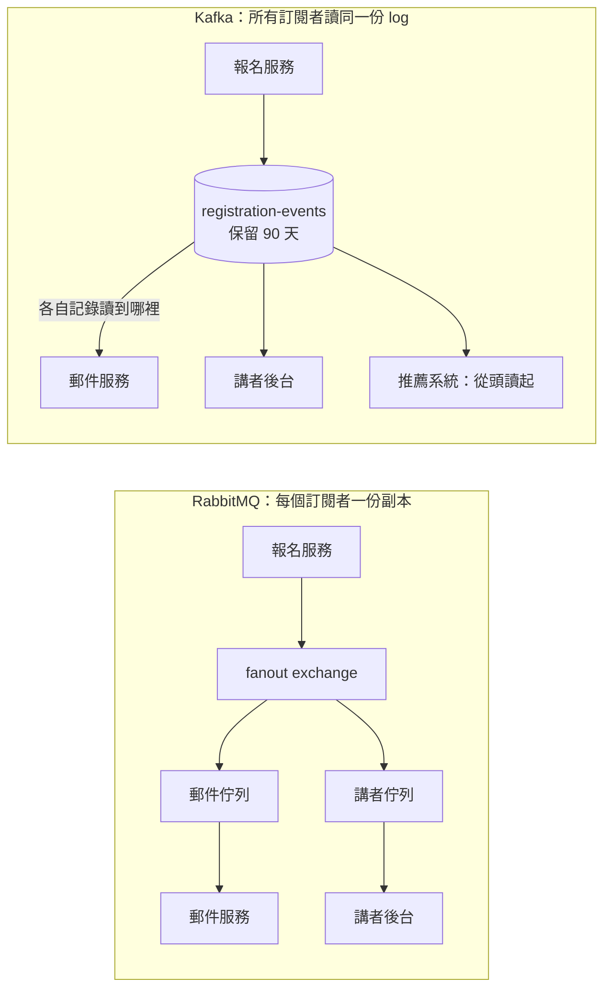

> **System Design 系列** Part 5-3｜上一篇：[Message Queue](/post/systemdesign/message-queue/)｜下一篇：[冪等性與 Idempotency Key](/post/systemdesign/idempotency-key/)｜[系列地圖](/post/systemdesign/system-design-thinking/#系列地圖)

## 情境與問題

[上一篇](/post/systemdesign/message-queue/)的佇列只有一種消費者：寄確認信。但「有人報名了」這件事，關心的服務越來越多：

- 郵件服務寄確認信
- 講者後台更新報名人數
- 推薦系統記錄使用者的興趣
- 資料倉儲做每日報表
- 稽核系統保存所有報名異動

而且新的需求不斷出現：推薦團隊上線新的模型，希望**拿過去三個月的報名紀錄重新訓練**。

報名服務不該知道有哪些消費者，也不該為每個新消費者改程式。它只要宣告「發生了這件事」，誰有興趣誰就訂閱。這就是 publish/subscribe。

## 最簡單的做法與它的極限

- **報名服務逐一呼叫每個服務**：每多一個消費者就要改報名服務；任何一個消費者故障都會影響報名
- **為每個消費者各送一則訊息到各自的佇列**：報名服務仍然要知道有哪些消費者
- **RabbitMQ 的 fanout exchange**：報名服務只送到一個 exchange，每個消費者綁定自己的佇列，broker 負責複製。這解決了解耦，但訊息被消費之後就刪除了，**新的消費者看不到過去的訊息**，推薦團隊想要的三個月歷史無從取得

## 核心機制

### 兩種 Pub/Sub 模型



| | RabbitMQ exchange | Kafka topic |
|---|---|---|
| 訊息的生命 | 每個佇列各一份，消費確認後刪除 | 一份 log，依保留期限或大小刪除，和有沒有人讀無關 |
| 讀取位置 | Broker 追蹤每則訊息的狀態 | 消費者自己記錄讀到哪個 offset |
| 新的訂閱者 | 只看得到之後的訊息 | 可以從保留期限內的任何位置開始讀 |
| 重播 | 不行 | 把 offset 移回去就能重新處理 |
| 單則訊息的處理 | 個別確認、個別重送 | 消費群組依 offset 順序前進，一則卡住會擋住後面的（share group 例外，見下文） |
| 路由 | exchange 與 routing key，很彈性 | 依 topic 與分區，較單純 |

Kafka 把訊息當成**事件的歷史紀錄**，而不是待辦工作。這讓它適合多個訂閱者、需要重播的場景，代價是失去了彈性路由，傳統的消費群組也沒有逐則確認。

### 分區與順序

一個 topic 分成多個**分區**（partition）。每個分區是一段只能附加的 log，分區內有嚴格的順序，**不同分區之間沒有順序**。

生產者送出訊息時可以指定 key，相同的 key 經過雜湊後永遠進同一個分區。所以：

- **需要順序的事件用同一個 key**：同一筆報名的「報名 → 付款 → 取消」用報名 ID 當 key，保證依序處理
- **key 的選擇決定負載分布**：用講座 ID 當 key，熱門講座的所有事件都擠在同一個分區，那個分區的消費者忙不過來，其他分區卻很閒（和 [Sharding 篇](/post/systemdesign/sharding/)的熱點問題相同）
- **增加分區會改變 key 對應的分區**：雜湊結果對分區數取餘數，分區從 12 個變成 16 個，大部分 key 都換了分區（[Consistent Hashing 篇](/post/systemdesign/consistent-hashing/)的取模問題）。過渡期間，同一個 key 的新舊事件分散在兩個分區，順序就不保證了。分區數一開始就要預留空間

### 消費群組

同一個**消費群組**（consumer group）裡的消費者分工處理一個 topic：每個分區同一時間只分配給群組裡的一個消費者。不同的群組各自獨立，各自記錄自己的 offset。

- 郵件服務、講者後台、推薦系統是三個不同的群組，每個群組都會收到所有事件
- 郵件服務開 4 個實例，就是同一個群組裡的 4 個消費者，分攤 12 個分區
- **平行度的上限是分區數**：12 個分區最多只有 12 個消費者有工作做，第 13 個會閒著

Kafka 4.2 起，**share group**（KIP-932）可以用在正式環境：同一個分區可以由多個消費者共同處理，每則訊息個別確認，並計算投遞次數，用法接近上一篇的工作佇列。代價是不保證順序，適合一則一則獨立處理的工作，而不是需要依序處理的事件流。

消費者加入、離開、當機時，群組會**重新分配分區**（rebalance）。消費者處理太久沒有再呼叫 poll，超過 `max.poll.interval.ms`，也會被認定為失效而觸發重新分配。被收回的分區交給別的消費者，從最後一次提交的 offset 繼續，中間已處理但還沒提交的訊息會再處理一次。

### 投遞語意由 offset 的提交時機決定

消費者處理訊息和提交 offset 是兩個步驟，順序決定了當機時的後果：

| 順序 | 當機時 | 語意 |
|---|---|---|
| 先提交 offset，再處理 | 這則訊息被跳過 | at-most-once |
| 先處理，再提交 offset | 這則訊息再處理一次 | at-least-once |

Kafka 客戶端預設會定期自動提交 offset，提交的時機和處理完成與否無關，可能提交了還沒處理完的訊息。Spring for Apache Kafka 從 2.3 起預設關閉自動提交，改由 listener container 在處理完一批訊息後才提交（`AckMode.BATCH`），也就是 at-least-once。

### Exactly-once 到底保證了什麼

「exactly-once」常被誤解成「每則訊息只會被處理一次」。實際上要分開看：

- **生產者不重複寫入**：生產者沒收到確認就重送，可能在 log 裡寫入兩筆。冪等生產者由 broker 給每個生產者一個 ID，並用序號去除重複的寫入
- **Kafka 內部的「讀取 → 處理 → 寫回」**：交易可以把「寫入輸出的 topic」和「提交輸入的 offset」綁在一起，要嘛全部成功，要嘛全部不算。下游消費者設定 `isolation.level=read_committed`，就只會看到已提交的交易
- **對外的副作用不在保證範圍內**：寄信、呼叫 HTTP API、寫入另一個資料庫，Kafka 的交易管不到。處理完寄出了信、提交 offset 之前當機，信還是會再寄一次

所以實務上的「exactly-once」是：**at-least-once 投遞 + 冪等的處理**。API 的重試也是同一個道理，[下一篇](/post/systemdesign/idempotency-key/)詳談。訊息可能被處理兩次，但第二次不會產生額外的效果。做法有兩種：

- **去重表**：在同一個資料庫交易裡，記錄「這個消費者已處理過這個事件 ID」並執行業務邏輯。事件 ID 已存在就跳過
- **把 offset 和結果存在一起**：消費者把處理結果和 offset 寫進同一個資料庫交易，重啟時從資料庫讀取 offset，而不是從 Kafka

### 耐久性

| 設定 | 層級 | 作用 |
|---|---|---|
| `replication.factor=3` | topic | 每個分區有 3 份副本 |
| `min.insync.replicas=2` | topic 或 broker | 至少 2 份同步副本存在時才接受 `acks=all` 的寫入 |
| `acks=all` | 生產者 | 等所有同步副本都寫入才回覆成功 |
| `unclean.leader.election.enable=false` | topic 或 broker | 不讓落後的副本成為 leader，寧可暫停也不遺失資料 |

`min.insync.replicas` 的預設值是 1。只設定 `acks=all` 而沒有調高它，同步副本縮減到只剩 leader 時，「所有同步副本」就只有 leader 一個，寫入仍然成功，leader 一壞資料就遺失了。這又是 [CAP](/post/systemdesign/cap-pacelc/) 的取捨：`min.insync.replicas=2` 在副本不足時拒絕寫入，選擇一致而放棄可用。

### 重試：阻塞與非阻塞

Kafka 的消費者依 offset 前進，一則訊息處理失敗時：

- **阻塞重試**：在原地重試幾次，期間這個分區後面的訊息都在等。保留順序，但一則壞訊息會讓整個分區停擺
- **非阻塞重試**：把失敗的訊息送到重試 topic，原分區繼續前進，重試 topic 的消費者稍後再處理。分區不會卡住，但**同一個 key 的訊息順序就被打亂了**
- **最終失敗**：送到 dead letter topic（DLT），等人處理

需要順序的事件（同一筆報名的狀態變化）用阻塞重試，並限制次數；順序不重要的事件（寫入資料倉儲）可以用非阻塞重試。

## 方案比較

| 方案 | 模型 | 重播 | 適合 |
|---|---|---|---|
| RabbitMQ fanout / topic exchange | 每個訂閱者一個佇列 | 否 | 訂閱者固定、需要逐則重試與彈性路由 |
| Kafka | 保留的分區 log，消費群組各自讀取 | 是 | 事件串流、訂閱者多、需要重播、高吞吐量 |
| 雲端的 Pub/Sub 服務（例如 SNS 搭配 SQS） | 主題扇出到各訂閱者的佇列 | 依服務而定 | 不想維運 broker |
| Redis Pub/Sub | 即時廣播，不保存 | 否；訂閱者離線就漏掉 | 可以遺失的即時通知 |

講座平台的選擇：「報名事件」有多個訂閱者、推薦系統需要重播，用 Kafka；寄確認信這類工作型的任務，用上一篇的工作佇列，或由郵件服務訂閱 Kafka 事件後放進自己的工作佇列。

## Java 落地

### 1. 生產者：明確設定耐久性，以報名 ID 為 key

```yaml
spring:
  kafka:
    producer:
      properties:
        "[acks]": "all"
        "[enable.idempotence]": "true"
```

不同版本的 Kafka 客戶端預設值不同，耐久性相關的設定明確寫出來，不依賴預設值。topic 本身用 `replication.factor=3`、`min.insync.replicas=2` 建立。

```java
@Component
public class RegistrationEventPublisher {

    private static final String TOPIC = "registration-events";

    private final KafkaTemplate<String, RegistrationEvent> kafkaTemplate;

    public RegistrationEventPublisher(KafkaTemplate<String, RegistrationEvent> kafkaTemplate) {
        this.kafkaTemplate = kafkaTemplate;
    }

    public CompletableFuture<SendResult<String, RegistrationEvent>> publish(RegistrationEvent event) {
        // 同一筆報名的事件進同一個分區，依序處理
        return kafkaTemplate.send(TOPIC, String.valueOf(event.registrationId()), event);
    }
}
```

`send` 是非同步的，要檢查回傳的 future 是否失敗。和上一篇一樣，「資料庫提交」與「送出事件」之間的雙寫問題要用 outbox 解決（Part 7）。

### 2. 錯誤處理：有限的阻塞重試，失敗送 DLT

```java
@Configuration
public class KafkaErrorHandlingConfig {

    @Bean
    public DefaultErrorHandler kafkaErrorHandler(KafkaTemplate<Object, Object> template) {
        // 預設送到 <原 topic>-dlt 的同一個分區，所以 DLT 的分區數不能少於原 topic
        DeadLetterPublishingRecoverer recoverer = new DeadLetterPublishingRecoverer(template);
        DefaultErrorHandler handler = new DefaultErrorHandler(recoverer, new FixedBackOff(1_000L, 3L));
        handler.addNotRetryableExceptions(InvalidEventException.class);    // 格式錯誤的事件不重試
        return handler;
    }
}
```

- Spring Boot 會把 `CommonErrorHandler` bean 自動套用到預設的 listener container factory
- `FixedBackOff(1_000L, 3L)`：間隔 1 秒、重試 3 次，共執行 4 次，之後送到 DLT 並提交 offset，分區繼續前進
- 反序列化失敗、型別轉換失敗這類例外，`DefaultErrorHandler` 預設就不重試。要讓反序列化失敗的訊息走到 error handler，消費者要設定 `ErrorHandlingDeserializer`，否則消費者會在同一個 offset 上不停失敗

### 3. 冪等的消費者

講者後台的群組維護每位講者的報名人數。事件可能重複送達，用去重表確保每個事件只計算一次：

```sql
CREATE TABLE processed_event (
    consumer VARCHAR(64) NOT NULL,
    event_id CHAR(36)    NOT NULL,
    PRIMARY KEY (consumer, event_id)
);
```

```java
@Component
public class SpeakerStatsListener {

    private static final String CONSUMER = "speaker-stats";

    private final JdbcClient jdbc;
    private final TransactionTemplate transactions;

    public SpeakerStatsListener(JdbcClient jdbc, TransactionTemplate transactions) {
        this.jdbc = jdbc;
        this.transactions = transactions;
    }

    @KafkaListener(topics = "registration-events", groupId = CONSUMER)
    public void onEvent(RegistrationEvent event) {
        transactions.executeWithoutResult(status -> {
            try {
                jdbc.sql("INSERT INTO processed_event (consumer, event_id) VALUES (:consumer, :eventId)")
                        .param("consumer", CONSUMER)
                        .param("eventId", event.eventId())
                        .update();
            } catch (DuplicateKeyException alreadyProcessed) {
                return;                                     // 重複的事件：之前已經計算過
            }
            jdbc.sql("UPDATE speaker_stats SET registrations = registrations + :delta WHERE speaker_id = :speakerId")
                    .param("delta", event.type() == RegistrationEvent.Type.CANCELLED ? -1 : 1)
                    .param("speakerId", event.speakerId())
                    .update();
        });
    }
}
```

- 去重紀錄和業務更新在同一個交易裡：更新失敗時兩者一起回滾，事件重送時會重新處理；成功時兩者一起提交，之後的重複事件被主鍵擋下
- 事件 ID 由生產者在事件發生時產生（例如 UUID），而不是 Kafka 的 offset。同一個事件被生產者重送兩次時，offset 不同，事件 ID 相同
- 去重表會一直成長，依事件的最長重送期間定期清理

> 以上程式碼依 Spring for Apache Kafka 4.1、Spring Boot 4.1 與 Apache Kafka 4.3 官方文件撰寫，沒有實際編譯與執行。

## 踩坑與 Gotchas

- **以為 exactly-once 涵蓋所有副作用**：Kafka 的交易只涵蓋 Kafka 內部。寄信、呼叫 API、寫入其他資料庫都要自己做到冪等
- **處理太久觸發重新分配**：單次 poll 拿到的訊息處理時間超過 `max.poll.interval.ms`，消費者被踢出群組，分區交給別人，同一批訊息被處理兩次，而且可能不斷循環。減少每次 poll 的筆數，或把慢的工作交給別的執行緒池並控制進度
- **增加分區打亂順序**：同一個 key 換了分區。需要順序的 topic 一開始就預留足夠的分區
- **熱點分區**：key 的分布不均，一個分區的延遲拖累整體。觀察每個分區的 lag，而不是只看總量
- **非阻塞重試破壞順序**：同一筆報名的「取消」可能比「報名」先處理完。需要順序的事件不要用重試 topic
- **`min.insync.replicas` 維持預設的 1**：`acks=all` 的保證在副本縮減時悄悄變弱
- **DLT 的分區數少於原 topic**：預設的 recoverer 送到相同編號的分區，分區不存在時送不出去
- **新的消費群組從哪裡開始讀**：由 `auto.offset.reset` 決定。新群組要從頭處理歷史，或只處理之後的事件，要明確設定
- **事件格式的演進**：Kafka 的事件會被保留、被重播，消費者可能讀到好幾個月前的舊格式。只能做相容的變更（新增選填欄位），用 schema registry 或明確的版本欄位管理

### 資安相關

- **Topic 與消費群組的 ACL**：只有報名服務能寫入 `registration-events`。其他服務若能寫入，就能偽造報名事件，讓講者後台、推薦系統、稽核系統全部收到假資料。消費者讀取需要 topic 與 group 兩種權限，也要限制，否則別的服務可以用同一個 group ID 加入群組，分走原本屬於郵件服務的分區
- **關閉自動建立 topic**：broker 允許自動建立 topic 時，任何有權限的用戶端打錯字或惡意送到新的 topic 名稱，都會建立新的 topic。正式環境關閉，topic 一律由管理流程建立
- **個人資料與保留期限**：事件保留 90 天、可以重播，代表 email、姓名也保留 90 天，而且無法單筆刪除。使用者要求刪除個人資料時，可以讓事件只帶 ID，個資留在可以刪除的資料庫；或者把個資欄位用每位使用者各自的金鑰加密，刪除金鑰就讓那些欄位再也無法解密
- **重播也是攻擊面**：能重設消費群組 offset 的人，可以讓系統把過去的事件再處理一次，例如再次發送退款通知。重設 offset 的權限要控管，消費者本身也要冪等
- **連線加密與身分驗證**：用戶端與 broker、broker 之間都使用 TLS，並用 SASL 或 mTLS 驗證身分，ACL 才有意義
- **DLT 裡的資料**：DLT 存放的是處理失敗的原始事件，可能包含格式異常的惡意內容與個資。檢視與重送 DLT 的工具要有權限控管，不要直接把內容顯示在沒有跳脫處理的網頁上

## 何時用／何時別用

- **用 Kafka 這類 log 型 Pub/Sub**：多個訂閱者、需要重播或回溯、事件量大、需要依 key 的順序
- **用 RabbitMQ 這類 broker**：工作型的任務、需要逐則確認與重試、需要彈性路由、訂閱者固定
- **別用**：只有一個消費者的簡單背景工作（上一篇的工作佇列或資料庫佇列就夠了）、需要同步回應的請求、團隊還無法維運 Kafka 叢集時（考慮雲端的代管服務）

## 參考資料

- Apache Kafka Documentation — Design（Message Delivery Semantics、Replication）：<https://kafka.apache.org/documentation/#design>
- Apache Kafka Documentation — Security（Authorization and ACLs）：<https://kafka.apache.org/documentation/#security_authz>
- Spring for Apache Kafka Reference — Committing Offsets：<https://docs.spring.io/spring-kafka/reference/kafka/receiving-messages/message-listener-container.html>
- Spring for Apache Kafka Reference — Handling Exceptions（DefaultErrorHandler、Dead-Letter Publishing Recoverer）：<https://docs.spring.io/spring-kafka/reference/kafka/annotation-error-handling.html>
- Spring for Apache Kafka Reference — Non-Blocking Retries：<https://docs.spring.io/spring-kafka/reference/retrytopic.html>
- Spring Boot Reference — Apache Kafka Support：<https://docs.spring.io/spring-boot/reference/messaging/kafka.html>
- Jay Kreps, "The Log: What every software engineer should know about real-time data's unifying abstraction", 2013：<https://engineering.linkedin.com/distributed-systems/log-what-every-software-engineer-should-know-about-real-time-datas-unifying>
- Martin Kleppmann, *Designing Data-Intensive Applications*, O'Reilly, 2017, Chapter 11
- 互動圖解延伸：Dilum Sanjaya，System Design — an interactive course：<https://designed-to-scale.vercel.app/>
