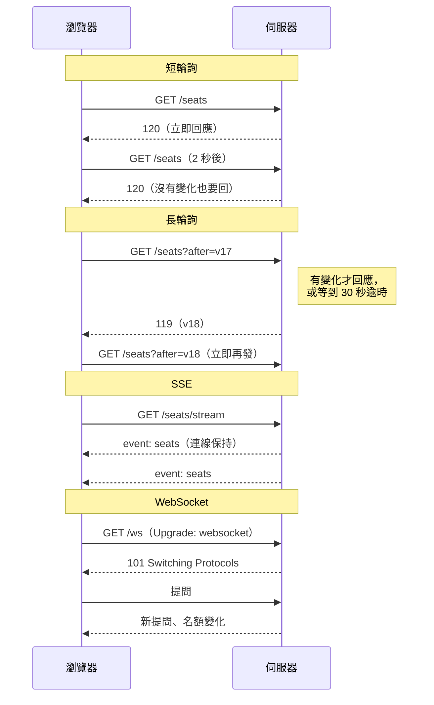
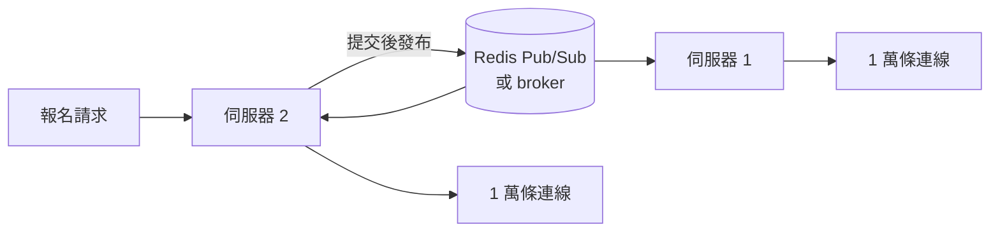

> **System Design 系列** Part 5-5｜上一篇：[冪等性與 Idempotency Key](/post/systemdesign/idempotency-key/)｜下一篇：[備援、故障轉移與災難復原](/post/systemdesign/redundancy-failover-dr/)｜[系列地圖](/post/systemdesign/system-design-thinking/#系列地圖)

## 情境與問題

熱門講座開放報名的那一刻，兩萬人盯著講座頁面上的「剩餘名額」。名額每秒都在變，使用者希望看到的是即時的數字，而不是按下報名後才發現早就額滿了。

講座開始後還有第二個需求：線上直播時的即時提問。聽眾送出問題，講者和其他聽眾馬上看到，講者也能把問題標記為「已回答」。

這兩個需求不太一樣：

| | 剩餘名額 | 即時提問 |
|---|---|---|
| 方向 | 只有伺服器推給瀏覽器 | 雙向 |
| 資料性質 | 狀態：只需要最新的值 | 事件：每一則都要收到 |
| 漏掉一次更新 | 下一次更新會蓋過去 | 少了一則提問 |
| 訂閱者 | 任何人，不需要登入 | 只有報名的聽眾 |

HTTP 原本是「用戶端問、伺服器答」，伺服器沒辦法主動說話。這篇比較讓伺服器「推」資料的幾種做法，以及推播在多台伺服器上會遇到的問題。

## 最簡單的做法與它的極限

**短輪詢**（polling）：瀏覽器每 2 秒呼叫一次 `GET /v1/lectures/42/seats`。

- 實作最簡單，負載平衡、快取、監控都沿用既有的 HTTP 基礎設施
- 兩萬人每 2 秒一次，是每秒 10,000 個請求，而大部分的回應和上一次一樣。用 ETag 回 304 可以省下頻寬，但請求數不會變少
- 更新的延遲最差是一個輪詢間隔。間隔縮短，請求數就等比例增加

對於幾十個使用者的後台、更新頻率以分鐘計的頁面，短輪詢完全夠用。問題出在使用者多、又要求即時的時候。

## 核心機制

### 四種做法



**長輪詢**（long polling）：伺服器收到請求後不立即回應，等到有新資料或逾時才回。用戶端收到回應後立即再發下一個請求。延遲接近即時，而且仍然是一般的 HTTP 請求。但每則訊息都要重建一次請求；兩次請求之間發生的變化，要靠 `after=v18` 這類游標補回來，否則就漏掉了。

**Server-Sent Events**（SSE）：瀏覽器用 `EventSource` 發出一個 GET，伺服器回應 `Content-Type: text/event-stream` 之後不結束回應，持續寫入事件：

```text
id: 18
event: seats
data: {"lectureId":42,"remaining":119,"version":18}

: 這是一行註解，可以當作心跳
```

SSE 的規格（WHATWG HTML Living Standard）內建了幾個重要的行為：

- **自動重連**：連線中斷後，瀏覽器會自動重新連線。伺服器可以用 `retry:` 欄位調整重連的間隔
- **斷點續傳**：重連時，瀏覽器在 `Last-Event-ID` header 帶上最後收到的事件 `id`，伺服器可以從那之後補送
- **停止重連**：伺服器回傳非 200 的狀態（例如 204），瀏覽器就不再重連
- **單向、純文字**：只能由伺服器傳給瀏覽器，內容是 UTF-8 文字。用戶端要送資料，另外發一般的 HTTP 請求

**WebSocket**（RFC 6455）：用一個 HTTP 請求協商升級，伺服器回 `101 Switching Protocols` 之後，這條 TCP 連線就不再是 HTTP，而是雙向的訊息通道。延遲最低、雙向，但連線建立之後的一切都要自己處理：

- 沒有內建的重連，沒有斷點續傳
- 沒有訊息的「種類」或「目的地」，要自己定義格式，或使用 STOMP 這類子協定
- 協定有 ping/pong 控制訊框，但瀏覽器的 JavaScript API 無法主動送出 ping，應用層通常還要自己做心跳

### 方向決定大部分的選擇

剩餘名額只需要伺服器推給瀏覽器，SSE 就夠了，而且自動重連與斷點續傳是免費的。即時提問是雙向的互動，用 WebSocket 比較自然。不過「雙向」也可以拆成「SSE 收訊息 + 一般的 POST 送訊息」，對於送出頻率不高的操作（一個人幾分鐘才提問一次），這樣做通常更簡單，還能沿用既有的 API 驗證、速率限制與冪等設計（[冪等性篇](/post/systemdesign/idempotency-key/)）。WebSocket 真正的優勢在雙方都頻繁傳送的場景，例如協作編輯、多人遊戲。

### 長連線改變了伺服器的形狀

短輪詢的請求幾毫秒就結束；SSE 與 WebSocket 的連線會保持幾十分鐘。這帶來幾個在一般 API 上不明顯的問題：

- **連線數成為容量的上限**：兩萬人在線就是兩萬條同時存在的連線。Servlet 的非同步處理（`SseEmitter`）或 WebFlux 不會為每條連線佔用一個執行緒，但每條連線仍有記憶體、檔案描述符與負載平衡器的成本
- **中間設備的閒置逾時**：負載平衡器與反向代理會切斷一段時間沒有資料的連線（AWS ALB 預設 60 秒，nginx 的 `proxy_read_timeout` 預設也是 60 秒）。伺服器要定期送出心跳，間隔比最短的閒置逾時更短
- **代理的緩衝**：反向代理可能把回應緩衝起來，累積到一定大小才轉送，SSE 事件就延遲送達。nginx 可以用回應 header `X-Accel-Buffering: no` 關閉單一回應的緩衝
- **瀏覽器的連線上限**：在 HTTP/1.1 下，瀏覽器對同一個網域的同時連線數很少（常見是 6 條），而且是所有分頁共用。使用者開了 6 個講座分頁，第 7 個就連不上。HTTP/2 的多工可以解決這個問題
- **部署就是大規模斷線**：滾動更新時，被關閉的那台伺服器上的所有連線同時斷開，同時重連。重連要加上隨機的延遲（jitter，[Part 6 詳談](/post/systemdesign/timeout-retry-backoff/)），伺服器關閉前也應該先停止接受新連線、再分批關閉既有連線

### 多台伺服器的扇出

使用者 A 的 SSE 連線在伺服器 1，使用者 B 的報名請求打到伺服器 2。伺服器 2 扣了名額，但它手上沒有 A 的連線。**每一台伺服器都需要知道每一個變化**，再推給自己手上的連線：



| 扇出方式 | 特性 |
|---|---|
| Redis Pub/Sub | 簡單、延遲低；at-most-once，訂閱端斷線期間的訊息就漏掉了 |
| Message broker（例如 RabbitMQ 搭配 STOMP plugin，讓 Spring 的 broker relay 轉送） | 由 broker 管理訂閱，應用伺服器只轉送；多一個要維運的元件 |
| Kafka | 可以重播；每台伺服器都要收到全部的事件，所以每台要用自己的消費群組，而不是共用一個（[Pub/Sub 篇](/post/systemdesign/pubsub-delivery-semantics/)） |

因為扇出通道可能漏掉訊息，即時推播應該被當成**提示**，而不是事實的來源。資料庫才是事實：

- **狀態型的資料**（剩餘名額）：每次連線或重連時，先送一份目前的完整狀態，之後再推送變化。漏掉一次變化，下一次就蓋過去了
- **事件型的資料**（提問）：每個事件有遞增的 ID。重連時用 `Last-Event-ID` 或 `after=` 游標，從資料庫補回漏掉的事件

### 合併更新

開放報名的第一秒有 500 筆報名，每筆都讓名額變化一次。如果每次變化都推給兩萬條連線，就是每秒 500 × 20,000 = 1,000 萬則訊息，而瀏覽器在一秒內收到 500 個數字，只會顯示最後一個。

狀態型的資料可以**合併**（conflation）：每場講座只記住最新的值，每秒推送一次。推送量降到每秒 20,000 則，使用者看到的延遲最多多一秒。事件型的資料不能合併，但可以批次傳送：把一秒內的多則提問放進同一則訊息。

### 慢的用戶端

推播的速度由伺服器決定，接收的速度由用戶端的網路決定。捷運上的手機收不完，伺服器就要把訊息暫存在那條連線的緩衝區。如果不設上限，少數慢的用戶端就會吃光伺服器的記憶體。所以每條連線都要有緩衝上限與送出逾時，超過就斷開那條連線，讓用戶端重連後重新取得完整狀態。

## 方案比較

| 方案 | 方向 | 重連與續傳 | 基礎設施 | 適合 |
|---|---|---|---|---|
| 短輪詢 | 用戶端拉取 | 不需要 | 一般 HTTP，可以快取 | 使用者少、延遲要求低 |
| 長輪詢 | 近似推播 | 自己用游標處理 | 一般 HTTP，但請求會掛很久 | 無法使用 SSE 或 WebSocket 的環境 |
| SSE | 伺服器 → 瀏覽器 | 瀏覽器內建自動重連與 `Last-Event-ID` | 一般 HTTP，注意代理的緩衝與 HTTP/1.1 連線數 | 通知、儀表板、即時數字、進度 |
| WebSocket | 雙向 | 全部自己處理 | 協定升級，負載平衡器與代理要支援 | 協作編輯、聊天、遊戲 |

講座平台的選擇：剩餘名額用 SSE；即時提問用 WebSocket 加上 STOMP，因為講者與聽眾都會頻繁互動（提問、按讚、標記已回答）。

## Java 落地

### 1. 剩餘名額：SSE 加上合併推送

```java
public record SeatChanged(long lectureId, int remaining, long version) {
}

@Component
public class SeatStreamHub {

    private final Map<Long, Set<SseEmitter>> subscribers = new ConcurrentHashMap<>();
    private final Map<Long, SeatChanged> pending = new ConcurrentHashMap<>();

    /** 連線或重連時呼叫：先送出目前的完整狀態，之後再推送變化。 */
    public SseEmitter subscribe(SeatChanged snapshot) {
        long lectureId = snapshot.lectureId();
        SseEmitter emitter = new SseEmitter(Duration.ofMinutes(30).toMillis());
        subscribers.compute(lectureId, (id, set) -> {
            Set<SseEmitter> emitters = set != null ? set : ConcurrentHashMap.newKeySet();
            emitters.add(emitter);
            return emitters;
        });
        emitter.onTimeout(emitter::complete);                    // 逾時就正常結束，瀏覽器會自動重連
        emitter.onCompletion(() -> unsubscribe(lectureId, emitter));
        send(lectureId, emitter, event(snapshot));
        return emitter;
    }

    /** 由 Redis 的訊息觸發：只記下每場講座最新的狀態，不立即推送。 */
    public void offer(SeatChanged change) {
        pending.merge(change.lectureId(), change,
                (current, incoming) -> incoming.version() > current.version() ? incoming : current);
    }

    @Scheduled(fixedRate = 1_000)
    public void flush() {
        for (Long lectureId : pending.keySet()) {
            SeatChanged latest = pending.remove(lectureId);
            Set<SseEmitter> emitters = subscribers.get(lectureId);
            if (latest != null && emitters != null) {
                emitters.forEach(emitter -> send(lectureId, emitter, event(latest)));
            }
        }
    }

    @Scheduled(fixedRate = 15_000)
    public void heartbeat() {                                    // 比負載平衡器的閒置逾時更短
        subscribers.forEach((lectureId, emitters) ->
                emitters.forEach(emitter -> send(lectureId, emitter, SseEmitter.event().comment("ping"))));
    }

    private static SseEmitter.SseEventBuilder event(SeatChanged change) {
        return SseEmitter.event()
                .id(String.valueOf(change.version()))
                .name("seats")
                .data(change);
    }

    private void send(long lectureId, SseEmitter emitter, SseEmitter.SseEventBuilder event) {
        try {
            emitter.send(event);
        } catch (IOException | IllegalStateException disconnected) {
            unsubscribe(lectureId, emitter);                     // 用戶端已斷線，容器會負責結束這個請求
        }
    }

    private void unsubscribe(long lectureId, SseEmitter emitter) {
        subscribers.computeIfPresent(lectureId, (id, set) -> {
            set.remove(emitter);
            return set.isEmpty() ? null : set;
        });
    }
}
```

```java
@RestController
public class SeatStreamController {

    private final SeatStreamHub hub;
    private final LectureQueryService lectures;

    public SeatStreamController(SeatStreamHub hub, LectureQueryService lectures) {
        this.hub = hub;
        this.lectures = lectures;
    }

    @GetMapping(path = "/v1/lectures/{lectureId}/seats/stream", produces = MediaType.TEXT_EVENT_STREAM_VALUE)
    public SseEmitter stream(@PathVariable long lectureId) {
        // 名額是狀態型的資料：重連時直接送最新的完整狀態，不需要依 Last-Event-ID 補送
        return hub.subscribe(lectures.currentSeats(lectureId));
    }
}
```

- 新增與移除都在 `ConcurrentHashMap` 的 `compute` 系列方法裡進行，同一個 key 的操作是原子的，不會發生「剛把空集合移除，另一個執行緒又往舊集合加入連線」的情況
- `send` 拋出 `IOException` 代表用戶端已經斷線。這時只要移除，不要呼叫 `completeWithError`，Spring MVC 會透過容器的錯誤通知結束這個請求
- 不同秒的合併結果可能因為訊息延遲而亂序，瀏覽器端要忽略 `version` 比目前小的事件

### 2. 跨伺服器扇出：Redis Pub/Sub

```java
@Configuration
public class RealtimeRelayConfig {

    static final String SEAT_CHANNEL = "realtime:lecture-seats";
    static final String QUESTION_CHANNEL = "realtime:lecture-questions";

    @Bean
    RedisMessageListenerContainer realtimeListener(RedisConnectionFactory connectionFactory, JsonMapper jsonMapper,
                                                   SeatStreamHub seats, SimpMessagingTemplate stomp) {
        RedisMessageListenerContainer container = new RedisMessageListenerContainer();
        container.setConnectionFactory(connectionFactory);
        container.addMessageListener(
                (message, pattern) -> seats.offer(jsonMapper.readValue(message.getBody(), SeatChanged.class)),
                new ChannelTopic(SEAT_CHANNEL));
        container.addMessageListener((message, pattern) -> {
            QuestionView question = jsonMapper.readValue(message.getBody(), QuestionView.class);
            stomp.convertAndSend("/topic/lectures/" + question.lectureId() + "/questions", question);
        }, new ChannelTopic(QUESTION_CHANNEL));
        return container;
    }
}

@Component
public class RealtimePublisher {

    private final StringRedisTemplate redis;
    private final JsonMapper jsonMapper;

    public RealtimePublisher(StringRedisTemplate redis, JsonMapper jsonMapper) {
        this.redis = redis;
        this.jsonMapper = jsonMapper;
    }

    @TransactionalEventListener(phase = TransactionPhase.AFTER_COMMIT)
    public void on(SeatChanged change) {
        redis.convertAndSend(RealtimeRelayConfig.SEAT_CHANNEL, jsonMapper.writeValueAsString(change));
    }

    @TransactionalEventListener(phase = TransactionPhase.AFTER_COMMIT)
    public void on(QuestionView question) {
        redis.convertAndSend(RealtimeRelayConfig.QUESTION_CHANNEL, jsonMapper.writeValueAsString(question));
    }
}
```

- 每台伺服器都訂閱同一個 channel，所以每台都收到每個變化，再推給自己手上的連線
- 交易提交之後才發布（和 [Message Queue 篇](/post/systemdesign/message-queue/)的做法相同），避免推出一個最後被回滾的名額
- Redis Pub/Sub 是 at-most-once。某台伺服器和 Redis 短暫斷線時，它手上的連線會漏掉幾次更新；名額會被下一次變化蓋過，提問則由瀏覽器重連時依游標補回

### 3. 即時提問：STOMP over WebSocket

```java
@Configuration
@EnableWebSocketMessageBroker
public class QnaWebSocketConfig implements WebSocketMessageBrokerConfigurer {

    @Override
    public void registerStompEndpoints(StompEndpointRegistry registry) {
        registry.addEndpoint("/ws").setAllowedOrigins("https://lectures.example.com");
    }

    @Override
    public void configureMessageBroker(MessageBrokerRegistry registry) {
        registry.setApplicationDestinationPrefixes("/app");     // 用戶端送到 /app/** 的訊息交給 @MessageMapping
        registry.enableSimpleBroker("/topic");                   // 每台伺服器各自的訂閱表，跨伺服器靠 Redis 扇出
    }

    @Override
    public void configureWebSocketTransport(WebSocketTransportRegistration registration) {
        registration.setMessageSizeLimit(16 * 1024)             // 一則提問用不到更大的訊息
                .setSendTimeLimit(10_000)
                .setSendBufferSizeLimit(256 * 1024);             // 慢的用戶端超過上限就斷線
    }
}
```

```java
@Controller
public class QnaController {

    private final QuestionService questions;

    public QnaController(QuestionService questions) {
        this.questions = questions;
    }

    @MessageMapping("/lectures/{lectureId}/questions")
    public void ask(@DestinationVariable long lectureId, @Payload AskQuestion request, Principal principal) {
        // 驗證長度、速率限制、寫入資料庫；提交後由 RealtimePublisher 發布到 Redis，再由每台伺服器廣播
        questions.ask(lectureId, principal.getName(), request.text());
    }
}
```

控制器不直接廣播，而是寫入資料庫、提交後才經由 Redis 扇出。這樣每一則推播出去的提問都已經存在資料庫裡，瀏覽器重連時可以呼叫 `GET /v1/lectures/42/questions?after={最後的提問 ID}` 補回漏掉的部分。

### 4. 逐則訊息的授權

```java
@Configuration
@EnableWebSocketSecurity
public class QnaWebSocketSecurityConfig {

    @Bean
    AuthorizationManager<Message<?>> messageAuthorizationManager(
            MessageMatcherDelegatingAuthorizationManager.Builder messages, AttendanceService attendance) {
        AuthorizationManager<MessageAuthorizationContext<?>> attendeeOnly = (authentication, context) -> {
            Authentication auth = authentication.get();
            OptionalLong lectureId = parseId(context.getVariables().get("lectureId"));
            boolean allowed = auth != null && auth.isAuthenticated() && lectureId.isPresent()
                    && attendance.isAttendee(lectureId.getAsLong(), auth.getName());
            return new AuthorizationDecision(allowed);
        };
        messages
                .nullDestMatcher().authenticated()                              // CONNECT、DISCONNECT 等
                .simpDestMatchers("/app/lectures/{lectureId}/questions").access(attendeeOnly)
                .simpSubscribeDestMatchers("/topic/lectures/{lectureId}/questions").access(attendeeOnly)
                .anyMessage().denyAll();                                        // 其他一律拒絕
        return messages.build();
    }

    private static OptionalLong parseId(String value) {
        try {
            return value == null ? OptionalLong.empty() : OptionalLong.of(Long.parseLong(value));
        } catch (NumberFormatException e) {
            return OptionalLong.empty();
        }
    }
}
```

- 訂閱與送出都要檢查「這個人是不是這場講座的聽眾」，而不是只檢查「有沒有登入」
- 最後的 `anyMessage().denyAll()` 很重要：沒有它，用戶端可以直接 SEND 到 `/topic/lectures/42/questions`。以 `/topic` 開頭的訊息會直接交給 broker 廣播，完全繞過 `QnaController` 的驗證、速率限制與資料庫
- `@EnableWebSocketSecurity` 預設要求 STOMP 的 CONNECT 訊框帶上 CSRF token，確保只有同源的頁面能建立連線

> 以上程式碼依 Spring Framework 7、Spring Security 7.1、Spring Boot 4.1（Jackson 3）與 Spring Data Redis 官方文件撰寫，沒有實際編譯與執行。

## 踩坑與 Gotchas

- **沒有心跳**：連線在負載平衡器上閒置 60 秒被切斷，用戶端看起來「每分鐘斷線一次」。伺服器也無法得知用戶端已經離開，因為 Servlet API 沒有用戶端斷線的通知，只有在寫入失敗時才會發現
- **代理把 SSE 緩衝起來**：本機測試正常，上線後事件一批一批到達。檢查每一層代理的緩衝設定
- **把推播當成事實**：用戶端只靠推播更新畫面，漏掉一則就永遠錯了。連線與重連時都要從資料庫取得完整狀態或補回事件
- **沒有合併**：熱門講座的每一次變化都推給所有人，推播量是變化次數乘以連線數
- **部署造成重連風暴**：所有連線在同一秒重連，同時查詢完整狀態，資料庫被打爆。重連加上隨機延遲，完整狀態加上快取
- **共用消費群組做扇出**：用 Kafka 扇出時，多台伺服器共用一個消費群組，每個事件只會被其中一台收到，其他伺服器上的使用者就看不到
- **Redis Cluster 的 Pub/Sub**：一般的 `PUBLISH` 會把訊息送到叢集的每一個節點，訊息量大時成為瓶頸。Redis 7 起有 sharded Pub/Sub（`SPUBLISH`），訊息只在 channel 所屬的分片傳遞
- **連線數的監控**：一般 API 看 QPS，長連線要看同時連線數、每台的連線分布與每秒新建的連線數。負載平衡器用 round robin 分配新連線，舊的連線不會重新分配，新加入的伺服器可能長時間沒有連線

### 資安相關

- **Cross-Site WebSocket Hijacking**：瀏覽器建立 WebSocket 時會自動帶上 cookie，而且不受 CORS 的預檢保護。惡意網站可以用使用者的登入身分連上你的 WebSocket，讀取即時提問、以使用者的名義送出訊息。伺服器必須檢查 `Origin`：Spring 預設只接受同源的請求，`setAllowedOrigins` 只列出自己的網域，不要用 `*`；再加上 Spring Security 對 CONNECT 的 CSRF 檢查
- **Token 放在 URL 裡**：瀏覽器的 WebSocket 與 `EventSource` API 都無法設定自訂的 header，所以常見的做法是把 token 放在查詢字串。但 URL 會被寫進存取紀錄、代理的 log 與瀏覽器歷史紀錄。優先使用 cookie 加上來源檢查；必須用 token 時，可以在 STOMP 的 CONNECT 訊框帶上，或用一次性、幾十秒內有效的短效 token 換取連線
- **只在連線時檢查一次權限**：長連線可能維持數小時。使用者登出、被移出講座、token 過期之後，已經訂閱的連線仍然持續收到訊息。權限被撤銷時要主動中斷相關的連線，或者定期重新驗證
- **逐則訊息的授權**：每個 SUBSCRIBE 都要檢查訂閱者能不能看這個目的地，例如講者後台的 `/topic/speakers/7/registrations` 只有講者 7 能訂閱（和 REST API 的物件層級授權是同一個問題，[Part 8](/post/systemdesign/authorization-owasp-api-top10/) 詳談）。最後用 `denyAll` 收尾，避免遺漏
- **儲存型 XSS 的放大**：一則惡意的提問會即時推送到兩萬個瀏覽器。前端顯示提問時一律當成純文字（`textContent`，而不是 `innerHTML`），伺服器端也要限制長度與內容
- **連線耗盡攻擊**：攻擊者開大量連線但不讀取資料，佔住伺服器的連線與緩衝區。限制每個使用者與每個 IP 的連線數、訊息大小與送出頻率，並設定送出逾時與緩衝上限
- **公開與私有的資料分開**：剩餘名額是公開資訊，可以不需要登入；講者的報名名單是個資，不要和公開的串流共用同一個端點或同一個 topic 命名空間

## 何時用／何時別用

- **用 SSE**：伺服器單向推送的通知、即時數字、任務進度、儀表板，以及 LLM 這類逐字輸出的回應
- **用 WebSocket**：雙方都頻繁傳送訊息的互動，例如聊天、協作編輯、多人遊戲
- **用短輪詢**：使用者少、更新慢、或基礎設施不支援長連線時，它仍然是最容易維運的選擇
- **別用以上任何一種**：使用者不在線時的通知。關掉頁面的使用者收不到 SSE 或 WebSocket，要用 email 或行動裝置的推播服務

## 參考資料

- WHATWG HTML Living Standard — Server-sent events：<https://html.spec.whatwg.org/multipage/server-sent-events.html>
- RFC 6455, "The WebSocket Protocol"：<https://www.rfc-editor.org/rfc/rfc6455>
- MDN Web Docs — Using server-sent events：<https://developer.mozilla.org/en-US/docs/Web/API/Server-sent_events/Using_server-sent_events>
- Spring Framework Reference — Asynchronous Requests（SSE、Disconnects）：<https://docs.spring.io/spring-framework/reference/web/webmvc/mvc-ann-async.html>
- Spring Framework Reference — WebSockets（Allowed Origins、STOMP、Performance）：<https://docs.spring.io/spring-framework/reference/web/websocket.html>
- Spring Security Reference — WebSocket Security：<https://docs.spring.io/spring-security/reference/servlet/integrations/websocket.html>
- Spring Data Redis Reference — Redis Messaging (Pub/Sub)：<https://docs.spring.io/spring-data/redis/reference/redis/pubsub.html>
- OWASP — WebSocket Security Cheat Sheet：<https://cheatsheetseries.owasp.org/cheatsheets/WebSocket_Security_Cheat_Sheet.html>
- 互動圖解延伸：Dilum Sanjaya，System Design — an interactive course：<https://designed-to-scale.vercel.app/>
