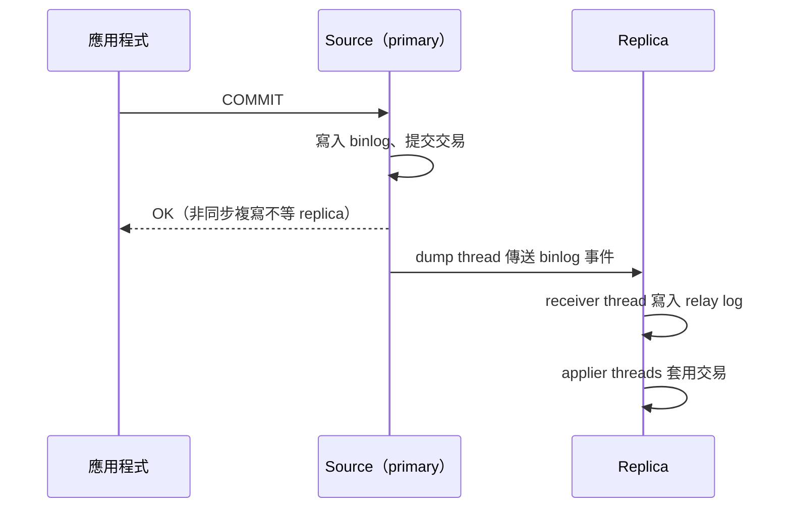

> **System Design 系列** Part 4-1｜上一篇：[Geohash 與地理索引](/post/systemdesign/geohash/)｜下一篇：[Sharding](/post/systemdesign/sharding/)｜[系列地圖](/post/systemdesign/system-design-thinking/#系列地圖)

## 情境與問題

講座平台的讀寫比約 50 : 1，尖峰每秒 1 萬次讀取、200 次寫入，primary 的 CPU 長期在 80% 以上。團隊加了兩台 read replica，把查詢導過去，primary 的負載立刻降下來。但上線一週後，客服收到三種抱怨：

1. 「我改了個人簡介，重新整理後還是舊的。」
2. 「報名成功後，『我的報名』清單裡有這場；再整理一次就不見了，再整理又出現。」
3. primary 當機、切換到 replica 之後，最後幾秒的報名紀錄不見了。

這三個問題都來自同一件事：**replica 的資料比 primary 晚**。

## 最簡單的做法與它的極限

最簡單的做法是全部讀 primary，完全沒有延遲問題，但讀取量會被單台主機的上限卡住。加 replica 可以水平擴展讀取，代價是要回答：**哪些讀取可以接受舊資料、能接受多舊**。

延遲通常只有幾十毫秒，所以測試環境很難重現。但它有長尾：replica 在套用一個大交易時（例如每月結算一次更新 300 萬列），後面的交易常常要排在它後面，延遲會一路累積到好幾秒。用非同步複寫時，primary 在延遲 200 毫秒的瞬間當機，以每秒 200 次寫入計算，大約有 40 筆已經回覆使用者成功的交易還沒送到 replica；延遲尖峰 8 秒時就是 1,600 筆。

## 核心機制

### 複寫在複製什麼

- **Statement-based**：複製 SQL 敘述本身。資料量小，但 `NOW()`、`UUID()`、沒有 `ORDER BY` 的 `LIMIT` 在 replica 上重新執行，結果可能不同
- **Row-based**：複製每一列實際的變更。結果一定相同，但一個更新 300 萬列的 `UPDATE` 會變成 300 萬筆列事件。MySQL 預設使用 row-based，而且切換格式這件事從 8.0 起已被標為 deprecated，未來會只剩 row-based
- **實體複寫**：PostgreSQL 的 streaming replication 直接傳送 WAL，也就是資料頁層級的變更，replica 是 primary 逐位元組的副本，主要版本必須相同

### MySQL 的複寫流程



延遲可能卡在任何一段：網路、relay log 的寫入、applier 的套用速度。MySQL 8.4 的 replica 預設有 4 個 applier thread 平行套用，但大交易、DDL、replica 的硬體比 primary 差、replica 上有吃資源的報表查詢，都會讓 applier 跟不上。

### 同步、非同步、半同步

| 模式 | 提交時等什麼 | primary 當機會不會掉資料 | 寫入延遲 |
|---|---|---|---|
| 非同步（MySQL 預設） | 不等 replica | 會，掉 replica 還沒收到的部分 | 最低 |
| 半同步，`AFTER_SYNC` | 至少一台 replica 收到並寫入 relay log | 不會（降級成非同步期間除外） | 多一次網路往返 |
| Group Replication | 多數節點對交易順序達成共識 | 不會 | 較高 |

半同步要等的是 replica「收到」，不是「套用」，所以它解決的是 failover 時掉資料的問題，**沒有解決**讀不到剛寫的資料的問題。

PostgreSQL 用 `synchronous_commit` 決定提交時要等到哪一步：

| `synchronous_commit` | 等待 | replica 上查得到 |
|---|---|---|
| `off` | 不等本機 WAL 寫入磁碟 | 否 |
| `local` | 本機 WAL 寫入磁碟 | 否 |
| `remote_write` | 同步 standby 收到並寫入作業系統 | 否 |
| `on` | 同步 standby 寫入磁碟 | 否 |
| `remote_apply` | 同步 standby 套用完成 | 是 |

只有 `remote_apply` 能保證提交後在同步 standby 上查得到，代價是每次提交都要等 standby 套用完成。

### 延遲造成的異常

- **Read-your-writes**：自己剛寫的資料讀不到，對應抱怨 1
- **Monotonic reads**：先讀到新資料，下一次卻讀到舊的，資料像是倒退了。兩次讀取落在延遲不同的兩台 replica 上就會發生，對應抱怨 2
- **Consistent prefix**：看到結果卻沒看到原因，例如講座問答區裡，講者的回覆比學員的提問先出現。資料分散到多個分片之後（見 [Sharding 篇](/post/systemdesign/sharding/)）更容易發生

### 實測：四種讀取路由

模擬一台 primary、兩台非同步 replica，時間長度一小時。replica 平常延遲 5 到 80 毫秒，平均每 2 分鐘遇到一次需要 2 到 8 秒套用的大交易。20 萬名使用者各寫入一次，寫完後 30 到 150 毫秒被導回頁面讀取一次，第 2 秒、第 5 秒各重新整理一次：

<details>
<summary>模擬程式（<code>java ReplicationLagSimulation.java</code>）</summary>

```java
import java.util.Random;

/** 一台 primary、兩台非同步 replica，模擬一小時。比較四種讀取路由下，使用者會不會讀不到自己剛寫的資料，或看到資料「倒退」。 */
public class ReplicationLagSimulation {

    static final int SECONDS = 3600;
    static final int STEP_MS = 10;
    static final int STEPS = SECONDS * 1000 / STEP_MS;
    static final long[][] applied = new long[2][STEPS];             // replica 在每個時間點已套用到 primary 的哪個時間點

    enum Routing { RANDOM_REPLICA, STICKY_REPLICA, PRIMARY_FOR_1S, POSITION_TOKEN }

    public static void main(String[] args) {
        Random random = new Random(42);
        for (int r = 0; r < 2; r++) {
            simulateReplica(r, random);
        }

        int users = 200_000;
        long[] writeAt = new long[users];
        long[][] readAt = new long[users][3];
        for (int u = 0; u < users; u++) {
            writeAt[u] = 10_000 + (long) (random.nextDouble() * (SECONDS - 20) * 1000);
            readAt[u][0] = writeAt[u] + 30 + random.nextInt(120);  // 寫完被導回頁面
            readAt[u][1] = writeAt[u] + 2_000;                      // 重新整理
            readAt[u][2] = writeAt[u] + 5_000;                      // 再重新整理
        }

        System.out.println("路由方式          第1次讀不到  之後讀不到  資料倒退 讀 primary");
        for (Routing routing : Routing.values()) {
            run(routing, users, writeAt, readAt, new Random(7));
        }
    }

    /** 平常延遲 5 到 80 ms；平均每 2 分鐘遇到一次 2 到 8 秒的大交易，套用期間延遲持續累積，結束後以 3 倍速度追上。 */
    static void simulateReplica(int r, Random random) {
        long backlog = 0;
        long busyUntil = -1;
        long over1s = 0;
        long max = 0;
        for (int i = 0; i < STEPS; i++) {
            long t = (long) i * STEP_MS;
            if (t >= busyUntil && random.nextDouble() < STEP_MS / 120_000.0) {
                busyUntil = t + 2_000 + random.nextInt(6_000);
            }
            backlog = t < busyUntil ? backlog + STEP_MS : Math.max(0, backlog - 3 * STEP_MS);
            long lag = 5 + random.nextInt(76) + backlog;
            applied[r][i] = Math.max(i == 0 ? 0 : applied[r][i - 1], t - lag);  // replica 不會「取消套用」
            long actual = t - applied[r][i];
            max = Math.max(max, actual);
            over1s += actual > 1_000 ? 1 : 0;
        }
        System.out.printf("replica %d：最大延遲 %.1f 秒，延遲超過 1 秒的時間占 %.1f%%%n",
                r + 1, max / 1000.0, 100.0 * over1s / STEPS);
    }

    static long appliedAt(int replica, long t) {
        return applied[replica][(int) (t / STEP_MS)];
    }

    static void run(Routing routing, int users, long[] writeAt, long[][] readAt, Random random) {
        long firstStale = 0;
        long laterStale = 0;
        long wentBack = 0;
        long primaryReads = 0;
        for (int u = 0; u < users; u++) {
            long token = writeAt[u];                                // 這個使用者至少要看到的位置
            long lastSeen = -1;
            for (int k = 0; k < 3; k++) {
                long t = readAt[u][k];
                int replica = switch (routing) {
                    case STICKY_REPLICA -> u % 2;
                    default -> random.nextInt(2);
                };
                boolean primary = switch (routing) {
                    case PRIMARY_FOR_1S -> t - writeAt[u] < 1_000;
                    case POSITION_TOKEN -> appliedAt(replica, t) < token;
                    default -> false;
                };
                long seen = primary ? t : appliedAt(replica, t);
                primaryReads += primary ? 1 : 0;
                if (seen < writeAt[u]) {
                    if (k == 0) {
                        firstStale++;
                    } else {
                        laterStale++;
                    }
                }
                if (seen < lastSeen) {
                    wentBack++;
                }
                lastSeen = Math.max(lastSeen, seen);
                token = Math.max(token, seen);                      // token 也記住看過的最新位置
            }
        }
        System.out.printf("%-16s %11.2f%% %10.2f%% %8.2f%% %9.1f%%%n", routing,
                100.0 * firstStale / users, 100.0 * laterStale / (2L * users),
                100.0 * wentBack / (2L * users), 100.0 * primaryReads / (3L * users));
    }
}
```

</details>

```text
replica 1：最大延遲 7.9 秒，延遲超過 1 秒的時間占 5.1%
replica 2：最大延遲 7.6 秒，延遲超過 1 秒的時間占 3.3%
路由方式          第1次讀不到  之後讀不到  資料倒退 讀 primary
RANDOM_REPLICA         11.97%       2.04%     1.44%       0.0%
STICKY_REPLICA         11.95%       2.02%     0.00%       0.0%
PRIMARY_FOR_1S          0.00%       2.04%     2.44%      33.3%
POSITION_TOKEN          0.00%       0.00%     0.00%       5.7%
```

- **隨機選 replica**：寫完後第一次讀取有 12% 讀不到自己的資料；之後的重新整理仍有 2% 讀不到，那是遇到延遲尖峰；1.4% 的讀取看到資料倒退
- **固定 replica**（依使用者分配）：同一個人永遠讀同一台，資料不會倒退，但讀不到自己資料的比例完全沒有改善
- **寫入後 1 秒內讀 primary**：第一次讀取沒問題了，但 2 秒、5 秒後的讀取一樣會碰到延遲尖峰，而且**資料倒退反而增加**：第一次從 primary 讀到最新的資料，之後回到落後的 replica，看起來就像資料消失了。用時間猜延遲，猜錯的時候正好是延遲最大的時候
- **位置 token**：記住「這個使用者至少要看到 primary 的哪個位置」，replica 還沒套用到這個位置就改讀 primary，讀完後再把看過的最新位置記回 token。三種異常都是 0，這些剛寫完的使用者的讀取只有 5.7% 落到 primary

模擬裡的「位置」，在 MySQL 是 GTID 集合，在 PostgreSQL 是 WAL 的 LSN。

### 量測延遲

MySQL 的 `SHOW REPLICA STATUS` 有 `Seconds_Behind_Source`，但它算的是 applier 和 receiver 之間的差距：網路慢、receiver 自己就落後時，它常常顯示 0。網路斷線但 receiver 還沒發現時也可能是 0；applier 停止時則是 `NULL`。

更可靠的做法是 **heartbeat 表**：primary 每秒寫入一次目前時間，在 replica 上讀出這個時間和現在相減，就是端到端的延遲，連網路與 receiver 的落後都算進去了。

## 方案比較

| 讀取策略 | 保證 | 成本 |
|---|---|---|
| 全部讀 primary | 最強 | 讀取量被單台主機限制 |
| 隨機 replica | 無 | 最省，三種異常都會發生 |
| 固定 replica | Monotonic reads | replica 故障或擴充時，使用者會換到別台 |
| 寫入後 N 秒讀 primary | 只在延遲小於 N 時成立 | 簡單，但延遲尖峰時失效 |
| 位置 token | Read-your-writes 與 monotonic reads | 每次讀取多一次位置檢查；token 要跟著使用者走 |
| 同步複寫（`remote_apply`） | 寫入後所有同步 standby 都查得到 | 每次寫入都要等 standby 套用 |

實務上常用的組合是：大部分讀取走 replica，**剛寫過資料的使用者**用位置 token，**金額、名額、權限**這類讀取一律走 primary。

## Java 落地

### 1. 讀寫分離：`LazyConnectionDataSourceProxy`

Spring Framework 6.1.2 起，`LazyConnectionDataSourceProxy` 可以設定一個 read-only 的 `DataSource`：標記為 `readOnly` 的交易，第一次執行 SQL 時才向 replica 取得連線，其餘的走 primary。自己定義 `DataSource` bean 之後，Spring Boot 就不會再自動建立：

```java
package replication;

import com.zaxxer.hikari.HikariDataSource;
import javax.sql.DataSource;
import org.springframework.context.annotation.Bean;
import org.springframework.context.annotation.Configuration;
import org.springframework.context.annotation.Primary;
import org.springframework.core.env.Environment;
import org.springframework.jdbc.core.simple.JdbcClient;
import org.springframework.jdbc.datasource.DataSourceTransactionManager;
import org.springframework.jdbc.datasource.LazyConnectionDataSourceProxy;
import org.springframework.transaction.PlatformTransactionManager;

@Configuration
public class DataSourceConfig {

    private final Environment env;

    public DataSourceConfig(Environment env) {
        this.env = env;
    }

    @Bean(destroyMethod = "close")
    public HikariDataSource primaryPool() {
        return pool("primary");
    }

    @Bean(destroyMethod = "close")
    public HikariDataSource replicaPool() {
        HikariDataSource pool = pool("replica");
        pool.setReadOnly(true);             // proxy 不會替每個交易切換 read-only 旗標，由連線池預先設定
        return pool;
    }

    /** 一般交易用 primary；標記為 readOnly 的交易，在第一個 SQL 執行時才向 replica 取得連線。 */
    @Bean
    @Primary
    public DataSource dataSource() {
        LazyConnectionDataSourceProxy proxy = new LazyConnectionDataSourceProxy(primaryPool());
        proxy.setReadOnlyDataSource(replicaPool());
        return proxy;
    }

    @Bean
    public PlatformTransactionManager transactionManager() {
        return new DataSourceTransactionManager(dataSource());
    }

    @Bean
    public JdbcClient jdbcClient() {
        return JdbcClient.create(dataSource());
    }

    private HikariDataSource pool(String name) {
        HikariDataSource pool = new HikariDataSource();
        pool.setPoolName(name);
        pool.setJdbcUrl(env.getRequiredProperty("app.datasource." + name + ".url"));
        pool.setUsername(env.getRequiredProperty("app.datasource." + name + ".username"));
        pool.setPassword(env.getRequiredProperty("app.datasource." + name + ".password"));
        return pool;
    }
}
```

這個設定的實際行為，用兩個 H2 資料庫分別扮演 primary 與 replica 來確認（replica 不會自動同步，最後一步手動補上）：

<details>
<summary>驗證程式（<code>RoutingDemo.java</code>）</summary>

```java
package replication;

import org.springframework.context.annotation.AnnotationConfigApplicationContext;
import org.springframework.jdbc.core.simple.JdbcClient;
import org.springframework.jdbc.datasource.DriverManagerDataSource;
import org.springframework.transaction.PlatformTransactionManager;
import org.springframework.transaction.support.TransactionTemplate;

/** 兩個 H2 記憶體資料庫分別扮演 primary 與 replica，replica 不會自動同步，用來確認每個讀寫實際落在哪一台。 */
public class RoutingDemo {

    public static void main(String[] args) {
        for (String node : new String[] {"primary", "replica"}) {
            String url = "jdbc:h2:mem:" + node + ";DB_CLOSE_DELAY=-1";
            System.setProperty("app.datasource." + node + ".url", url);
            System.setProperty("app.datasource." + node + ".username", "sa");
            System.setProperty("app.datasource." + node + ".password", "");
            JdbcClient direct = JdbcClient.create(new DriverManagerDataSource(url, "sa", ""));
            direct.sql("CREATE TABLE node (name VARCHAR(20))").update();
            direct.sql("INSERT INTO node VALUES ('" + node + "')").update();
            direct.sql("CREATE TABLE member_profile (member_id BIGINT PRIMARY KEY, bio VARCHAR(100))").update();
            direct.sql("INSERT INTO member_profile VALUES (1, '舊的簡介')").update();
        }

        try (var context = new AnnotationConfigApplicationContext(DataSourceConfig.class)) {
            JdbcClient jdbc = context.getBean(JdbcClient.class);
            PlatformTransactionManager transactionManager = context.getBean(PlatformTransactionManager.class);
            TransactionTemplate writeTx = new TransactionTemplate(transactionManager);
            TransactionTemplate readTx = new TransactionTemplate(transactionManager);
            readTx.setReadOnly(true);
            String sql = "SELECT n.name || '，簡介：' || p.bio FROM node n, member_profile p WHERE p.member_id = 1";

            show("一般交易，寫入後讀取", writeTx.execute(status -> {
                jdbc.sql("UPDATE member_profile SET bio = '新的簡介' WHERE member_id = 1").update();
                return jdbc.sql(sql).query(String.class).single();
            }));
            show("readOnly 交易", readTx.execute(status -> jdbc.sql(sql).query(String.class).single()));
            show("沒有交易", jdbc.sql(sql).query(String.class).single());
            show("readOnly 交易，但在一般交易裡面", writeTx.execute(outer ->
                    readTx.execute(inner -> jdbc.sql(sql).query(String.class).single())));

            JdbcClient.create(new DriverManagerDataSource("jdbc:h2:mem:replica", "sa", ""))
                    .sql("UPDATE member_profile SET bio = '新的簡介' WHERE member_id = 1").update();
            show("replica 追上之後的 readOnly 交易", readTx.execute(status -> jdbc.sql(sql).query(String.class).single()));
        }
    }

    static void show(String label, String result) {
        System.out.println(result + "｜" + label);
    }
}
```

</details>

```text
primary，簡介：新的簡介｜一般交易，寫入後讀取
replica，簡介：舊的簡介｜readOnly 交易
primary，簡介：新的簡介｜沒有交易
primary，簡介：新的簡介｜readOnly 交易，但在一般交易裡面
replica，簡介：新的簡介｜replica 追上之後的 readOnly 交易
```

- `readOnly` 交易確實讀 replica，也就讀到了舊的簡介
- **沒有交易的查詢走 primary**：只有「標記為 readOnly 的交易」才會改走 replica，沒加 `@Transactional(readOnly = true)` 的查詢，負載全都還在 primary 上
- **readOnly 交易包在一般交易裡面時走 primary**：預設的傳播行為是加入外層交易，連線早就在 primary 上了

### 2. Read-your-writes：GTID token

寫入後查詢 primary 已執行的 GTID 集合當作 token；之後讀取時，先在 replica 上用 `GTID_SUBSET` 確認這些交易都已經套用：

```java
package replication;

import java.util.Optional;
import java.util.function.Supplier;
import java.util.regex.Pattern;
import org.springframework.jdbc.core.simple.JdbcClient;
import org.springframework.transaction.PlatformTransactionManager;
import org.springframework.transaction.support.TransactionTemplate;

/** Read-your-writes：寫入後記下 primary 的 GTID 集合，之後的讀取先確認 replica 已經套用，否則改讀 primary。 */
public class ConsistentReads {

    private static final Pattern GTID_SET = Pattern.compile("[0-9a-fA-F:,\\-\\s]{1,2000}");

    private final JdbcClient jdbc;
    private final TransactionTemplate primaryTx;
    private final TransactionTemplate replicaTx;

    public ConsistentReads(JdbcClient jdbc, PlatformTransactionManager transactionManager) {
        this.jdbc = jdbc;
        this.primaryTx = new TransactionTemplate(transactionManager);
        this.replicaTx = new TransactionTemplate(transactionManager);
        this.replicaTx.setReadOnly(true);
    }

    /** 回傳的 token 包含寫入後 primary 已執行的所有交易，由呼叫端存在 session，之後讀取時帶回來。 */
    public String write(Runnable command) {
        primaryTx.executeWithoutResult(status -> command.run());
        return jdbc.sql("SELECT @@GLOBAL.gtid_executed").query(String.class).single();
    }

    /** query 不可回傳 null。token 為 null 代表這個使用者最近沒有寫入。 */
    public <T> T read(String token, Supplier<T> query) {
        if (token != null && !GTID_SET.matcher(token).matches()) {
            throw new IllegalArgumentException("invalid consistency token");
        }
        Optional<T> fromReplica = replicaTx.execute(status ->
                token == null || caughtUp(token) ? Optional.of(query.get()) : Optional.empty());
        return fromReplica.orElseGet(() -> primaryTx.execute(status -> query.get()));
    }

    /** 和 query 在同一個交易、同一條 replica 連線上執行，確認的就是實際回答查詢的那台 replica。 */
    private boolean caughtUp(String token) {
        return jdbc.sql("SELECT GTID_SUBSET(:token, @@GLOBAL.gtid_executed)")
                .param("token", token)
                .query(Integer.class)
                .single() == 1;
    }
}
```

> 這段程式碼已對 Spring 7.0.10 編譯，但沒有對 MySQL 實際執行；`GTID_SUBSET` 與 `@@GLOBAL.gtid_executed` 的語意依 MySQL 8.4 文件。

- **檢查和查詢要在同一條連線上**：replica 的連線池背後常常是多台 replica 的負載平衡位址，分成兩個交易，檢查的和回答的可能不是同一台
- **token 存在伺服器端 session**：GTID 集合裡有伺服器的 UUID 與交易流水號，流水號的成長速度等於公開了平台的寫入量
- **token 要有效期限**：非同步複寫的 failover 遺失了某些交易時，這些 GTID 永遠不會出現在任何 replica 上，帶著舊 token 的使用者會一直被導到 primary。幾分鐘後就該丟掉
- `@@GLOBAL.gtid_executed` 包含所有已執行的交易，比「這個使用者的交易」更嚴格，但仍然正確。MySQL 也能用 `session_track_gtids` 把這筆交易的 GTID 隨回應帶回，省下一次查詢，前提是 driver 支援
- PostgreSQL 的做法相同：寫入後在 primary 取得 `pg_current_wal_lsn()`，讀取前確認 replica 的 `pg_last_wal_replay_lsn()` 已經超過它

### 3. 延遲過大時把 replica 移出

位置 token 只保護剛寫過資料的使用者。其他人的讀取延遲多大可以接受，要依 heartbeat 量到的延遲決定：超過門檻（例如 5 秒）就暫時不把讀取導到這台 replica。注意所有 replica 同時落後時，讀取全部回到 primary，primary 要有承受得住的容量，或者寧可回傳舊資料、在畫面上註明更新時間。

## 踩坑與 Gotchas

- **以為所有查詢都會走 replica**：只有 `readOnly` 交易才會。實測中沒有交易的查詢走 primary
- **class 上標了 `readOnly`，裡面卻有寫入方法**：寫入會被送到 replica。replica 一定要開啟 `super_read_only`，讓這種錯誤直接失敗，而不是悄悄寫進 replica，讓 replica 和 primary 的資料分歧
- **`Seconds_Behind_Source` 等於 0 不代表沒有延遲**：用 heartbeat 量端到端的延遲
- **大交易造成延遲尖峰**：大量 `UPDATE`、`DELETE` 要分批，每批幾千列
- **半同步會悄悄降級**：replica 在 `rpl_semi_sync_source_timeout`（預設 10 秒）內沒有回應，primary 會改成非同步繼續提交，而 `rpl_semi_sync_source_enabled` 仍然是 1。要監控 `Rpl_semi_sync_source_status`
- **非同步複寫的 failover 會掉資料**：切換後，舊 primary 上沒送出去的交易就不見了。舊 primary 回來時不能直接當成 replica 接回去，它的 binlog 裡可能有新 primary 沒有的交易，要先比對、處理後再重建
- **讀 replica 判斷、寫 primary 執行**：在 replica 上讀到「還有名額」就去扣名額，是 [交易篇](/post/systemdesign/transaction-isolation/)的 lost update 再加上延遲。判斷與扣減要在 primary 的同一個條件式 `UPDATE` 裡完成
- **在 replica 上跑長時間的報表**：會和複寫搶資源，讓延遲變大。PostgreSQL 的 standby 上，長查詢還可能和 WAL 的套用衝突而被取消。報表最好用獨立的 replica

### 資安相關

- **權限與撤銷的檢查要讀 primary**：管理員停用帳號、撤銷講者權限、使用者改密碼後登出所有裝置，這些變更在 replica 上可能晚好幾秒才出現。權限檢查讀 replica，被撤銷的人在延遲期間仍然能通過檢查，這正是 Part 8 BOLA 篇要處理的授權問題。授權相關的讀取一律走 primary，或者要求 replica 已套用撤銷那筆交易
- **延遲會放大競態攻擊**：優惠券「是否已使用」從 replica 讀，攻擊者在延遲尖峰時連續送出兌換請求，每個請求都看到「未使用」。守住寫入的檢查必須在 primary 的寫入交易裡，用條件式 `UPDATE` 或唯一約束完成
- **複寫通道也是資料外洩的路徑**：binlog 包含每一列的變更，個資也在裡面。複寫帳號只給 `REPLICATION SLAVE` 權限、複寫連線開啟 TLS、binlog 檔案加密並設定保存期限。給分析用的 replica 等於一份完整的正式資料，帳號與遮罩要另外管理
- **用戶端帶來的 token 要驗證**：`ConsistentReads` 會檢查 token 的格式與長度，因為它會被放進 SQL 參數，交給 `GTID_SUBSET` 解析。存在伺服器端 session 更好，還能避免使用者偽造 token，讓所有讀取都打到 primary

## 何時用／何時別用

- **用 read replica**：讀多寫少，而且大部分讀取可以接受短暫的延遲
- **別期待 replica 解決寫入瓶頸**：每台 replica 都要套用所有寫入，寫入量太大要靠[分片](/post/systemdesign/sharding/)
- **一律讀 primary**：金額、庫存與名額、權限與帳號狀態
- **跨地區的 replica**：可以讓遠端使用者讀得更快，但延遲以百毫秒計，read-your-writes 更需要處理

## 參考資料

- Douglas B. Terry et al., "Session Guarantees for Weakly Consistent Replicated Data", *PDIS*, 1994
- Martin Kleppmann, *Designing Data-Intensive Applications*, O'Reilly, 2017，第 5 章 Replication
- MySQL 8.4 Reference Manual — Replication Formats：<https://dev.mysql.com/doc/refman/8.4/en/replication-formats.html>
- MySQL 8.4 Reference Manual — Semisynchronous Replication：<https://dev.mysql.com/doc/refman/8.4/en/replication-semisync-interface.html>
- MySQL 8.4 Reference Manual — SHOW REPLICA STATUS：<https://dev.mysql.com/doc/refman/8.4/en/show-replica-status.html>
- MySQL 8.4 Reference Manual — Functions Used with GTIDs：<https://dev.mysql.com/doc/refman/8.4/en/gtid-functions.html>
- PostgreSQL Documentation — Write Ahead Log（`synchronous_commit`）：<https://www.postgresql.org/docs/current/runtime-config-wal.html>
- Spring Framework Javadoc — LazyConnectionDataSourceProxy：<https://docs.spring.io/spring-framework/docs/current/javadoc-api/org/springframework/jdbc/datasource/LazyConnectionDataSourceProxy.html>
- 互動圖解延伸：Dilum Sanjaya，System Design — an interactive course：<https://designed-to-scale.vercel.app/>
