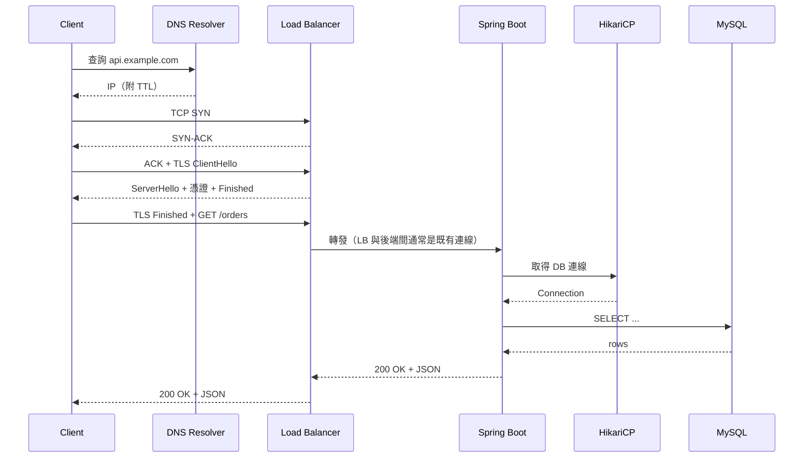

> **System Design 系列** Part 1-1｜上一篇：[系統設計怎麼想](/post/systemdesign/system-design-thinking/)｜下一篇：[Latency、Throughput 與 p99](/post/systemdesign/latency-throughput/)｜[系列地圖](/post/systemdesign/system-design-thinking/#系列地圖)

## 情境與問題

美國的客戶回報：「訂單頁打開要一秒多。」你打開 APM，`GET /orders` 的伺服器處理時間只有 150 ms，資料庫查詢 5 ms。差的那一秒去哪了？

答案是：伺服器處理時間只是整趟旅程的其中一段。在優化任何一行程式碼之前，要先知道時間花在哪一站。

## 最簡單的模型與它的盲點

最直覺的模型是「Client → Server → DB」三站。這個模型漏掉了很多會花時間的地方：

- **找到伺服器**：網域名稱要先透過 DNS 換成 IP
- **建立連線**：TCP 三次握手、TLS 交換金鑰與驗證憑證
- **排隊**：Load Balancer、Tomcat 的 thread pool、HikariCP 的連線池，滿了都要等
- **傳輸**：response 很大時，受頻寬與 TCP 擁塞控制影響

更麻煩的是，伺服器端的 metric 是從「Tomcat 開始處理請求」算到「寫完 response」，**連線建立和網路傳輸的時間完全不在裡面**。所以伺服器看起來很快，使用者卻覺得很慢。

## 核心機制：一個請求經過的每一站



把每一站的成本列出來（RTT 指封包一來一回的時間）：

| 階段 | 第一次請求 | 重用既有連線時 | 說明 |
|---|---|---|---|
| DNS 查詢 | 0（快取命中）～數十 ms 以上 | 0 | 取決於 resolver 位置與 TTL |
| TCP 握手 | 1 RTT | 0 | SYN → SYN-ACK → ACK |
| TLS 握手 | TLS 1.3 為 1 RTT，TLS 1.2 為 2 RTT | 0 | 還有憑證驗證的 CPU 成本 |
| 送出請求到收到第一個 byte | 1 RTT + 伺服器處理時間 | 同左 | 即 TTFB（Time To First Byte） |
| 下載 response body | 取決於大小與頻寬 | 較快 | 新連線受 TCP slow start 影響，傳輸速度要逐步爬升 |
| Tomcat 排隊 | 0 ～不定 | 同左 | thread 全忙時請求在 accept queue 等待 |
| 取得 DB 連線 | 0 ～ `connection-timeout` | 同左 | 連線池用盡時等待 |
| SQL 執行 | 主鍵查詢約 1 ms | 同左 | 慢查詢另論 |

RTT 的量級（實際值依線路與電信商而異）：同機房 1 ms 以內；台北到東京約 30–40 ms；台北到美西約 130–160 ms。

用這張表算一次開頭的情境。美西使用者連台灣機房，RTT 150 ms，第一次請求：

```text
DNS 50 + TCP 150 + TLS 150 + 請求來回 150 + 伺服器 150 = 650 ms 才收到第一個 byte
```

伺服器只占 23%。如果前端接著還要依序呼叫兩支「要等上一支結果」的 API（連線已建立，每支 = 1 RTT + 伺服器 150 ms）：

```text
650 + 2 × (150 + 150) = 1,250 ms
```

這就是那一秒多的來源。把伺服器從 150 ms 優化到 50 ms，總時間也只會降到 950 ms。**跨區延遲受光速限制，最佳化程式碼救不回來**，能做的只有兩件事：減少往返次數，或是把終點搬近一點。

## 方案比較：減少往返的手段

| 手段 | 省下什麼 | 代價／前提 |
|---|---|---|
| 連線重用（keep-alive、連線池） | 每次請求省下 TCP + TLS 握手 | 要處理閒置連線被對方關閉的情況 |
| HTTP/2 多工 | 一條連線同時跑多個請求，不必多開連線 | 底層仍是單一 TCP 連線，掉一個封包會卡住所有 stream（TCP 層的 head-of-line blocking） |
| HTTP/3（QUIC） | 傳輸與加密握手合併；掉封包只影響單一 stream；支援 0-RTT 恢復連線 | 走 UDP，可能被企業防火牆擋；0-RTT 資料可能被重放，只能用在冪等請求 |
| TLS session resumption | TLS 1.2 從 2 RTT 降為 1 RTT；TLS 1.3 省的是憑證傳輸與驗證的成本 | TLS 1.3 除非用 0-RTT，否則仍要 1 RTT |
| 在邊緣終止 TLS（CDN、就近的 LB） | 握手在離使用者近的節點完成，RTT 變短 | 邊緣到源站的連線要維持並重用，否則只是把延遲搬位置 |
| 合併或平行化 API 呼叫 | 減少依序等待的往返次數 | API 設計變複雜（BFF、批次 API、GraphQL） |
| 拉長 DNS TTL | 少查 DNS | 故障切換時，舊 IP 會被快取更久 |

## Java 落地

### 1. 用 curl 把時間拆開

```bash
curl -o /dev/null -s \
  -w 'dns=%{time_namelookup} tcp=%{time_connect} tls=%{time_appconnect} ttfb=%{time_starttransfer} total=%{time_total}\n' \
  https://api.example.com/orders
```

示意輸出（為了說明而假設的數字，不是實測）：

```text
dns=0.048 tcp=0.198 tls=0.349 ttfb=0.652 total=0.655
```

這些數字都是**從開始到該階段結束的累計秒數**，要相減才是各段耗時：

| 階段 | 計算 | 耗時 |
|---|---|---|
| DNS | `time_namelookup` | 48 ms |
| TCP 握手 | `time_connect - time_namelookup` | 150 ms |
| TLS 握手 | `time_appconnect - time_connect` | 151 ms |
| 等待回應 | `time_starttransfer - time_appconnect` | 303 ms（1 RTT + 伺服器處理） |
| 下載 body | `time_total - time_starttransfer` | 3 ms |

### 2. Java HttpClient：整個應用程式共用一個 client

```java
public final class OrderApiClient {

    // HttpClient 內部有連線池，共用同一個 instance，TCP 與 TLS 連線才會被重用
    private static final HttpClient CLIENT = HttpClient.newBuilder()
            .version(HttpClient.Version.HTTP_2)
            .connectTimeout(Duration.ofSeconds(2))
            .build();

    public String fetchOrders(URI uri) throws IOException, InterruptedException {
        HttpRequest request = HttpRequest.newBuilder(uri)
                .timeout(Duration.ofSeconds(3))   // 等待回應的上限，逾時拋出 HttpTimeoutException
                .GET()
                .build();
        return CLIENT.send(request, HttpResponse.BodyHandlers.ofString()).body();
    }
}
```

想親眼看到連線重用的差異，可以跑這支程式（JDK 11 以上，`java ConnectionReuseDemo.java` 即可直接執行）：

```java
import java.net.URI;
import java.net.http.HttpClient;
import java.net.http.HttpRequest;
import java.net.http.HttpResponse;

public class ConnectionReuseDemo {

    public static void main(String[] args) throws Exception {
        URI uri = URI.create(args.length > 0 ? args[0] : "https://example.com/");
        HttpClient client = HttpClient.newHttpClient(); // 同一個 client 連發三次

        for (int i = 1; i <= 3; i++) {
            long start = System.nanoTime();
            HttpResponse<Void> res = client.send(
                    HttpRequest.newBuilder(uri).build(),
                    HttpResponse.BodyHandlers.discarding());
            long ms = (System.nanoTime() - start) / 1_000_000;
            System.out.printf("第 %d 次：HTTP %d，%d ms%n", i, res.statusCode(), ms);
        }
    }
}
```

第 1 次會明顯比第 2、3 次慢：裡面包含 DNS、TCP、TLS 握手，還有 JVM 第一次載入 TLS 相關類別的成本。第 2 次之後只剩請求的往返和伺服器處理時間。

### 3. 伺服器端：記錄每個請求的處理時間

```yaml
server:
  tomcat:
    basedir: /var/app/tomcat
    accesslog:
      enabled: true
      pattern: '%t %a "%r" %s %b %D'
```

`%D` 是 Tomcat 處理這個請求的時間（Tomcat 10 起單位是 microseconds）。它不包含 DNS、握手和網路傳輸，所以拿 client 端量到的總時間減掉它，就知道時間花在網路還是伺服器。

伺服器內部的排隊也要看：HikariCP 透過 Micrometer 輸出 `hikaricp.connections.acquire`（等待取得連線的時間）和 `hikaricp.connections.pending`（正在等待的 thread 數）。連線池的大小怎麼設，見 [HikariCP 調校](/post/database/hikaricp-tuning/)。

### 4. JVM 的 DNS 快取

JVM 會快取 DNS 結果，由 security property `networkaddress.cache.ttl` 控制。沒有安裝 SecurityManager 時，規格只說快取時間由實作決定，OpenJDK 的實作是 30 秒；查詢失敗的結果由 `networkaddress.cache.negative.ttl` 控制，預設 10 秒。

```java
// 要在第一次 DNS 查詢之前設定；也可以改 $JAVA_HOME/conf/security/java.security
java.security.Security.setProperty("networkaddress.cache.ttl", "30");
```

注意它是 **security property，不是 system property**，寫成 `-Dnetworkaddress.cache.ttl=30` 不會生效。

## 踩坑與 Gotchas

- **每次呼叫都 new 一個 client**：每個請求都重做 TCP + TLS 握手，大量建立連線還會留下一堆 `TIME_WAIT`。`HttpClient`、`RestClient` 底層的連線工廠都應該共用
- **Keep-alive 閒置時間比 LB 長**：client 以為連線還能用，LB 早就關掉了，送出請求時就收到 `Connection reset`。原則是 **client 的閒置逾時要比 server 和 LB 短**（例如 AWS ALB 預設閒置逾時 60 秒，client 端就設 30–50 秒）
- **只看伺服器端的 latency**：伺服器的 metric 看不到握手、排隊在 accept queue 的時間和網路傳輸。使用者感受要從 client 端量（Real User Monitoring 或合成監測）
- **以為 DNS TTL 設短就能快速切換**：中間的 resolver、作業系統、JVM 都有自己的快取，不一定遵守你的 TTL。切換流量最好靠 LB，不要只靠 DNS
- **大 response 沒壓縮**：幾百 KB 的 JSON 在跨區連線上要多花好幾個 RTT。Spring Boot 可以用 `server.compression.enabled=true` 開啟 gzip
- **Tomcat thread 滿了才發現**：請求在 accept queue 排隊的時間不會算進應用程式的 latency metric，要另外監控 `tomcat.threads.busy` 這類指標（Spring Boot 要設 `server.tomcat.mbeanregistry.enabled=true` 才會輸出）

## 何時需要拆到這麼細

- **需要**：使用者和伺服器跨區、行動網路使用者多、client 端量到的 p99 和伺服器端對不起來、評估要不要上 CDN 或多區部署
- **不太需要**：同機房的微服務互相呼叫，RTT 不到 1 ms，連線也已經重用。這種情況的瓶頸幾乎都在伺服器內部：排隊、連線池、慢查詢，下一篇會談
- **重新評估的時機**：新增海外市場、前端架構改變（例如從伺服器端渲染改成 SPA，API 呼叫次數變多）

## 參考資料

- Ilya Grigorik，《High Performance Browser Networking》，O'Reilly：<https://hpbn.co/>
- RFC 8446 — The Transport Layer Security (TLS) Protocol Version 1.3：<https://www.rfc-editor.org/rfc/rfc8446>
- RFC 9000 — QUIC: A UDP-Based Multiplexed and Secure Transport：<https://www.rfc-editor.org/rfc/rfc9000>
- curl `--write-out` 說明：<https://curl.se/docs/manpage.html>
- Java SE 21 API — `HttpClient`、`InetAddress`（InetAddress Caching 章節）：<https://docs.oracle.com/en/java/javase/21/docs/api/>
- Spring Boot How-to — Embedded Web Servers（Access Logging）：<https://docs.spring.io/spring-boot/how-to/webserver.html>
- 互動圖解延伸：Dilum Sanjaya，System Design — an interactive course：<https://designed-to-scale.vercel.app/>
