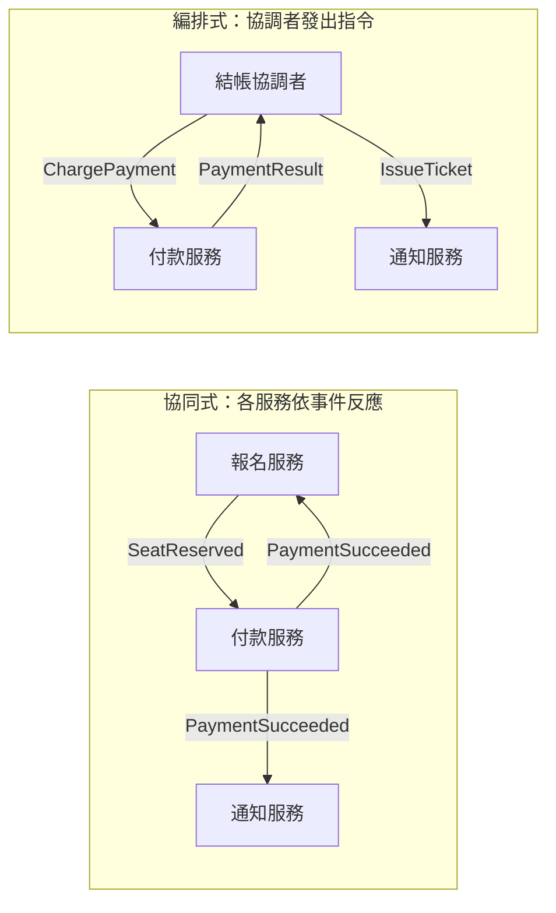

> **System Design 系列** Part 7-3｜上一篇：[Service Discovery](/post/systemdesign/service-discovery/)｜下一篇：[Batch 與 Stream](/post/systemdesign/batch-vs-stream/)｜[系列地圖](/post/systemdesign/system-design-thinking/#系列地圖)

## 情境與問題

付款拆成獨立的服務之後，「報名並付款」這件事跨越了三個服務、三個資料庫：

1. 報名服務：預留一個名額，建立「待付款」的報名
2. 付款服務：向金流扣款
3. 報名服務：把報名改成「已確認」，通知服務寄出電子票券

在單體裡，前兩步可以放在同一個資料庫交易：扣款失敗，名額的預留一起回滾。現在它們在不同的資料庫裡，本地交易管不到別人的資料庫。

- 名額預留了，扣款失敗：名額要還回去，否則講座會顯示額滿，實際上卻有空位
- 扣款成功了，報名服務在更新狀態前當機：使用者付了錢，卻沒有報名紀錄
- 扣款的請求逾時：不知道錢到底扣了沒有

```diagram
title: 報名並付款，跨三個服務
row: R 報名服務 | P 付款服務 | GW 金流
row: RDB 報名資料庫 | PDB 付款資料庫 | .
step: 預留名額
  報名服務預留一個名額，建立一筆「待付款」的報名，寫在報名服務自己的資料庫。
R -> RDB: 預留名額、待付款
step: 扣款
  付款服務向金流扣款，紀錄寫在付款服務自己的資料庫。在單體裡，這兩步可以放在同一個交易；現在它們在不同的資料庫，本地交易管不到別人的資料庫。
R -> P: 扣款
P -> GW: 扣款
P -> PDB: 付款紀錄
step: 確認並寄出票券
  扣款成功後，報名服務把報名改成「已確認」，通知服務寄出電子票券。這是一切順利的情況。
R -> RDB: 改成已確認 [ok]
step: 扣款失敗
  名額預留了，扣款卻失敗。名額要還回去，否則講座顯示額滿，實際上卻有空位。
P -> GW: 扣款失敗 [danger]
note RDB: 名額還被佔著 [danger]
step: 更新前當機
  扣款成功了，報名服務卻在更新狀態前當機。使用者付了錢，卻沒有確認的報名紀錄。
note R: 更新前當機 [danger]
note PDB: 已經扣款
note RDB: 仍是待付款 [danger]
step: 扣款逾時
  扣款的請求逾時了，不知道錢到底扣了沒有。重試可能扣兩次，不重試可能漏掉一筆。
R -> P: 扣款逾時 [danger]
note R: 錢到底扣了沒？ [danger]
```

## 最簡單的做法與它的極限

**分散式交易（兩階段提交，2PC）**：由協調者先詢問所有參與者「能不能提交」，全部同意才通知提交。

- 所有參與者在兩個階段之間都要**鎖住資料**，等待協調者的決定。協調者在這時當機，參與者只能一直等
- 參與者必須支援 XA 這類協定。HTTP API、外部的金流服務、大部分的 message broker 都不支援
- 所有參與者都正常才能提交，整體的可用性是每個參與者可用性的乘積

**在程式裡依序呼叫，失敗時 `catch` 再補救**：

```java
reserveSeat();
try {
    paymentClient.charge(...);
} catch (Exception e) {
    releaseSeat();          // 如果程序剛好在這之前當機呢？
    throw e;
}
confirmRegistration();      // 如果這一步失敗，錢已經扣了
```

這段程式的狀態只存在記憶體裡。程序在任何兩行之間當機、重新部署，補救就不會發生；而扣款逾時進入 `catch`，也可能其實已經扣款成功了。

## 核心機制

### Saga：一串本地交易，每一步都有補償

Saga 由 Hector Garcia-Molina 與 Kenneth Salem 在 1987 年提出：把一個長流程拆成一連串的**本地交易** T1、T2、…、Tn，每一步各自提交。如果第 k 步失敗，就依相反的順序執行前面每一步的**補償交易** Ck-1、…、C1。

補償是**語意上的撤銷**，不是資料庫的回滾：

| 步驟 | 補償 |
|---|---|
| 預留名額 | 釋放名額 |
| 扣款 | 退款（而不是刪除扣款紀錄：扣款已經發生過，帳上要有紀錄） |
| 寄出確認信 | 無法收回，只能寄一封更正通知 |

### 樞紐交易：不能回頭的那一步

不是每一步都能補償。寄出的信收不回來，已經交給外部的金流，也不一定能取消。Saga 的步驟可以分成三類：

- **可補償的步驟**：失敗時可以撤銷，例如預留名額
- **樞紐交易**（pivot transaction）：成功之後就不再回頭，整個 Saga 一定要往前完成，例如扣款成功
- **可重試的步驟**：樞紐之後的步驟，必須保證**最終一定會成功**，只能重試，不能失敗，例如確認報名、寄出票券

所以步驟的順序很重要：**可補償的放前面，難以補償的放後面，不可撤銷的放在樞紐之後**。先預留名額（可以釋放）、再扣款（樞紐）、最後寄出票券（只要重試到成功）。如果反過來先寄票券再扣款，扣款失敗時就要寄「你的票券作廢了」。

### 協同式與編排式



| | 協同式（choreography） | 編排式（orchestration） |
|---|---|---|
| 做法 | 每個服務聽別人的事件，做完自己的事再發出事件 | 一個協調者保存流程的狀態，依序發出指令並處理回覆 |
| 優點 | 沒有中心，步驟少時很簡單 | 流程寫在同一個地方，看得懂、測得到、容易加上逾時 |
| 缺點 | 流程分散在各服務裡，沒有人看得到全貌；步驟多了容易出現循環依賴 | 協調者可能越長越大，把各服務的業務邏輯都吸進去 |
| 適合 | 兩三個步驟、各服務的反應彼此獨立 | 步驟多、有分支、有逾時與補償的流程 |

協調者應該只負責「流程」：下一步要做什麼、失敗時補償什麼。扣款怎麼做、名額怎麼算，仍然是各服務自己的事。

### 每一步都要可靠地送出

Saga 的每一步是「更新自己的資料庫」加上「通知下一步」。這兩件事如果分開做，就回到 [Message Queue 篇](/post/systemdesign/message-queue/)的雙寫問題：資料庫提交了，訊息沒送出去，Saga 就卡在半路。

解法是 **transactional outbox**：把要送出的訊息寫進同一個資料庫的 `outbox` 表，和業務資料在**同一個本地交易**裡提交；另一個程序再把 outbox 的內容送到 broker。輪詢與 CDC 兩種送出方式的細節，在 [Outbox Pattern](/post/architecture/outbox-pattern/) 一文有完整的說明。

Outbox 保證的是 at-least-once，所以**每個接收端都要冪等**（[冪等性篇](/post/systemdesign/idempotency-key/)）：付款服務用 Saga 的 ID 當 Idempotency Key，同一個扣款指令收到兩次也只扣一次。

### Saga 沒有隔離性

本地交易有 ACID；Saga 只有 ACD，**沒有 I**。每一步提交之後，中間狀態對其他人就是可見的：

- 名額已預留、還沒付款時，其他人看到的剩餘名額已經少了一個。如果最後付款失敗，這段時間有人因為「額滿」而離開
- 兩個 Saga 同時處理同一筆資料，可能互相覆蓋

Chris Richardson 整理了幾種對策，最常用的是：

- **語意鎖**（semantic lock）：用狀態欄位標示「處理中」，例如報名的 `PENDING_PAYMENT`。其他操作看到這個狀態，就知道它還沒定案，可以拒絕、等待，或照業務規則處理
- **可交換的更新**：`remaining = remaining - 1` 與 `remaining = remaining + 1` 不論順序，結果都一樣，補償可以安全地和其他更新交錯
- **重新讀取**：補償或下一步執行前，重新讀取資料並檢查它沒有被改過（[交易與隔離等級篇](/post/systemdesign/transaction-isolation/)的樂觀鎖）

### 逾時與遲到的回覆

Saga 的某一步可能永遠等不到回覆：付款服務收到指令後當機、訊息卡在 DLQ、金流沒有回呼。所以每個等待中的狀態都要有**期限**：

- 15 分鐘內沒有付款結果，就取消報名、釋放名額
- 但付款的結果可能在取消之後才到達：錢其實扣成功了。這時不能直接忽略，要觸發**補償**：退款

逾時處理與遲到的回覆可能同時發生。兩者都必須透過**條件式的狀態轉換**（「只有在狀態仍是待付款時，才改成已取消」）決定誰贏，輸的一方依最新狀態處理。

## 方案比較

| 方案 | 一致性 | 適合 | 代價 |
|---|---|---|---|
| 單一資料庫的本地交易 | 強一致 | 資料在同一個服務、同一個資料庫 | 需要把相關的資料放在一起 |
| 2PC / XA | 強一致 | 同一個機房內、都支援 XA 的資料庫 | 阻塞、鎖定時間長、可用性相乘，跨 HTTP 服務無法使用 |
| 協同式 Saga | 最終一致 | 步驟少、各自獨立的反應 | 流程不可見，難以處理逾時 |
| 編排式 Saga | 最終一致 | 步驟多、有分支與補償 | 要設計狀態機、補償與逾時 |
| 持久化執行引擎（例如 Temporal、Camunda） | 最終一致 | 長時間、步驟非常多的流程 | 多一個要維運的平台，流程程式要遵守引擎的限制 |

[Sharding 篇](/post/systemdesign/sharding/)提過，最好的分散式交易是不需要分散式交易：如果兩份資料總是要一起修改，先考慮它們是不是應該在同一個服務、同一個資料庫裡。

## Java 落地

這裡用編排式 Saga：結帳協調者放在報名服務裡，因為名額與報名都屬於它。

### 1. 資料表

```sql
CREATE TABLE checkout_saga (
    saga_id         CHAR(36)     PRIMARY KEY,
    registration_id BIGINT       NOT NULL UNIQUE,
    lecture_id      BIGINT       NOT NULL,
    state           VARCHAR(20)  NOT NULL,          -- PAYMENT_PENDING、CONFIRMED、CANCELLED
    deadline        TIMESTAMP(3) NOT NULL,
    updated_at      TIMESTAMP(3) NOT NULL DEFAULT CURRENT_TIMESTAMP(3) ON UPDATE CURRENT_TIMESTAMP(3),
    KEY idx_state_deadline (state, deadline)
);

CREATE TABLE outbox (
    id          BIGINT       AUTO_INCREMENT PRIMARY KEY,
    topic       VARCHAR(100) NOT NULL,
    message_key VARCHAR(100) NOT NULL,
    payload     JSON         NOT NULL,
    created_at  TIMESTAMP(3) NOT NULL DEFAULT CURRENT_TIMESTAMP(3)
);
```

### 2. Outbox：只能在交易裡寫入

```java
@Component
public class Outbox {

    private final JdbcClient jdbc;
    private final JsonMapper jsonMapper;

    public Outbox(JdbcClient jdbc, JsonMapper jsonMapper) {
        this.jdbc = jdbc;
        this.jsonMapper = jsonMapper;
    }

    /** MANDATORY：呼叫端沒有交易時直接拋出例外，而不是自己開一個交易悄悄提交。 */
    @Transactional(propagation = Propagation.MANDATORY)
    public void append(String topic, String key, Object message) {
        jdbc.sql("INSERT INTO outbox (topic, message_key, payload) VALUES (:topic, :key, :payload)")
                .param("topic", topic)
                .param("key", key)
                .param("payload", jsonMapper.writeValueAsString(message))
                .update();
    }
}
```

把 outbox 的內容送到 Kafka 的 relay（輪詢或 Debezium），見 [Outbox Pattern](/post/architecture/outbox-pattern/)。訊息的 key 用 Saga 的 ID，同一個 Saga 的訊息會進同一個分區、依序處理（[Pub/Sub 篇](/post/systemdesign/pubsub-delivery-semantics/)）。

### 3. 結帳協調者

```java
@Service
public class CheckoutSaga {

    private static final Duration PAYMENT_DEADLINE = Duration.ofMinutes(15);

    private final JdbcClient jdbc;
    private final Outbox outbox;
    private final LectureCatalog catalog;

    public CheckoutSaga(JdbcClient jdbc, Outbox outbox, LectureCatalog catalog) {
        this.jdbc = jdbc;
        this.outbox = outbox;
        this.catalog = catalog;
    }

    /** 可補償的步驟：預留名額、建立待付款的報名、送出扣款指令，全部在同一個本地交易。 */
    @Transactional
    public UUID start(long lectureId, long memberId) {
        int reserved = jdbc.sql("UPDATE lecture SET remaining = remaining - 1 WHERE id = :id AND remaining > 0")
                .param("id", lectureId)
                .update();
        if (reserved == 0) {
            throw new SoldOutException(lectureId);
        }
        KeyHolder keys = new GeneratedKeyHolder();
        jdbc.sql("""
                        INSERT INTO registration (lecture_id, member_id, status)
                        VALUES (:lectureId, :memberId, 'PENDING_PAYMENT')
                        """)
                .param("lectureId", lectureId)
                .param("memberId", memberId)
                .update(keys, "id");
        long registrationId = keys.getKey().longValue();

        UUID sagaId = UUID.randomUUID();
        jdbc.sql("""
                        INSERT INTO checkout_saga (saga_id, registration_id, lecture_id, state, deadline)
                        VALUES (:sagaId, :registrationId, :lectureId, 'PAYMENT_PENDING', :deadline)
                        """)
                .param("sagaId", sagaId.toString())
                .param("registrationId", registrationId)
                .param("lectureId", lectureId)
                .param("deadline", Timestamp.from(Instant.now().plus(PAYMENT_DEADLINE)))
                .update();

        // 金額由伺服器依講座決定，不採用用戶端傳來的數字
        long amount = catalog.priceOf(lectureId);
        outbox.append("payment-commands", sagaId.toString(), new ChargePayment(sagaId, memberId, amount));
        return sagaId;
    }

    /** 付款服務透過它自己的 outbox 回覆結果。 */
    @KafkaListener(topics = "payment-results", groupId = "checkout-saga")
    @Transactional
    public void onPaymentResult(PaymentResult result) {
        SagaRow saga = find(result.sagaId());
        String target = result.succeeded() ? "CONFIRMED" : "CANCELLED";
        if (!transition(result.sagaId(), "PAYMENT_PENDING", target)) {
            handleLateOrDuplicate(saga, result);
            return;
        }
        if (result.succeeded()) {
            // 樞紐之後：以下只能重試到成功，不能失敗
            updateRegistration(saga.registrationId(), "CONFIRMED");
            outbox.append("registration-events", result.sagaId().toString(),
                    new RegistrationConfirmed(saga.registrationId(), saga.lectureId()));
        } else {
            compensateSeat(saga);
        }
    }

    /** 逾時：期限內沒有付款結果，就取消並釋放名額，同時要求付款服務作廢這筆扣款。 */
    @Scheduled(fixedDelay = 60_000)
    @Transactional
    public void expireOverdue() {
        List<SagaRow> overdue = jdbc.sql("""
                        SELECT saga_id AS sagaId, registration_id AS registrationId, lecture_id AS lectureId
                          FROM checkout_saga
                         WHERE state = 'PAYMENT_PENDING' AND deadline < NOW(3)
                         LIMIT 100
                        """)
                .query(SagaRow.class)
                .list();
        for (SagaRow saga : overdue) {
            if (transition(saga.sagaId(), "PAYMENT_PENDING", "CANCELLED")) {
                compensateSeat(saga);
                outbox.append("payment-commands", saga.sagaId().toString(), new VoidPayment(saga.sagaId()));
            }
        }
    }

    /** 重複的回覆直接忽略；逾時取消之後才到的「扣款成功」要退款。 */
    private void handleLateOrDuplicate(SagaRow saga, PaymentResult result) {
        if (result.succeeded() && "CANCELLED".equals(currentState(saga.sagaId()))) {
            outbox.append("payment-commands", saga.sagaId().toString(),
                    new RefundPayment(saga.sagaId(), result.paymentId()));
        }
    }

    /** 條件式轉換：逾時處理與付款回覆同時到達時，只有一方會成功。 */
    private boolean transition(UUID sagaId, String from, String to) {
        return jdbc.sql("UPDATE checkout_saga SET state = :to WHERE saga_id = :id AND state = :from")
                .param("to", to)
                .param("id", sagaId.toString())
                .param("from", from)
                .update() == 1;
    }

    private void compensateSeat(SagaRow saga) {
        jdbc.sql("UPDATE lecture SET remaining = remaining + 1 WHERE id = :id")
                .param("id", saga.lectureId())
                .update();
        updateRegistration(saga.registrationId(), "CANCELLED");
    }

    // find、currentState、updateRegistration 是一般的查詢與更新，省略
}
```

- **每一個狀態轉換都是一個本地交易**，同時寫入業務資料與 outbox。程序在任何時刻當機，資料庫裡的狀態都是一致的，outbox 裡的訊息也不會遺失
- **條件式的 `UPDATE ... WHERE state = :from`** 是整個協調者的並行控制：同一個付款結果被投遞兩次、逾時處理和遲到的回覆同時發生，只有第一個轉換會成功
- `VoidPayment` 與 `RefundPayment` 都要在付款服務那一端冪等，並以 Saga 的 ID 識別。作廢一筆根本沒有收到的扣款指令，應該是一個安全的空操作
- 協調者的狀態保存在資料庫，不在記憶體。部署、當機、擴充到多台，Saga 都能繼續
- `@KafkaListener` 與 `@Transactional` 同時使用時，資料庫交易提交之後才提交 offset；交易回滾，訊息會被重新投遞，由條件式的轉換處理重複

> 以上程式碼依 Spring Framework 7 與 Spring for Apache Kafka 官方文件撰寫，沒有實際編譯與執行。SQL 以 MySQL 為例。

## 踩坑與 Gotchas

- **把補償當成回滾**：補償是新的業務操作，會留下紀錄，也可能失敗。補償也要冪等、可重試，真的一直失敗時要能交給人工處理
- **步驟順序錯誤**：不可撤銷的動作放在可能失敗的步驟之前
- **沒有逾時**：Saga 永遠停在「待付款」，名額永遠被佔住
- **忽略遲到的回覆**：逾時取消之後收到扣款成功，沒有退款，使用者付了錢卻沒有報名
- **協調者的狀態放在記憶體**：重新部署時，所有進行中的 Saga 都消失了
- **補償和原本的操作亂序**：「取消預留」比「預留」先到達。接收端要能處理：記錄「這個預留已經被取消」，之後收到預留時直接拒絕
- **忽略缺少隔離的影響**：報表、搜尋讀到了待付款的報名，把它當成已確認
- **協同式的流程沒有人看得懂**：五個服務互相聽對方的事件，出問題時沒有人知道流程卡在哪裡。至少要能用 trace ID 串起整個流程（[Observability 篇](/post/systemdesign/observability/)）
- **把業務邏輯放進協調者**：協調者開始計算折扣、判斷會員等級，變成新的單體

### 資安相關

- **偽造的回覆訊息**：如果任何服務都能寫入 `payment-results`，攻擊者只要送出一則 `PaymentSucceeded`，就能免費確認報名。這類 topic 要用 ACL 限定只有付款服務能寫入（[Pub/Sub 篇](/post/systemdesign/pubsub-delivery-semantics/)），協調者也要核對回覆的金額、會員與 Saga 是否相符
- **金額由伺服器決定**：扣款指令裡的金額來自講座的定價，而不是用戶端送來的請求。否則攻擊者可以把 2,000 元的講座改成 1 元
- **名額囤積**：預留名額不需要付款，攻擊者可以用大量帳號預留所有名額但不付款，讓真正的使用者無法報名，15 分鐘後再重來一次。限制每個帳號同時預留的數量、縮短期限，並搭配限流與人機驗證（[Rate Limiting 篇](/post/systemdesign/rate-limiting/)）
- **退款是高價值的操作**：觸發退款的指令要有嚴格的來源限制與冪等保護。重放同一則 `RefundPayment` 不能退兩次款，而付款服務要確認退款金額不超過原本的扣款
- **狀態轉換的稽核紀錄**：使用者爭議「我付了錢卻沒有報名」時，要能回答每一步在什麼時間、因為哪一則訊息而發生。Saga 的每一次轉換都寫入稽核紀錄（[Observability 篇](/post/systemdesign/observability/)）
- **Outbox 也是資料**：outbox 表與 broker 上的訊息可能包含個資與金額，要和業務資料一樣加密、限制存取，送出後依保存期限清理

## 何時用／何時別用

- **用 Saga**：流程跨越多個服務或外部系統，無法放進一個本地交易，而且業務能接受短暫的中間狀態
- **用編排式**：步驟多、有逾時與補償、需要看得到整個流程的狀態
- **用協同式**：兩三個彼此獨立的反應，例如報名確認之後，通知、結算、推薦各自處理
- **別用**：資料其實可以放在同一個資料庫時，先考慮調整服務邊界；業務要求嚴格的即時一致，連短暫的中間狀態都不能接受時，Saga 不是答案，要重新思考資料的歸屬

## 參考資料

- Hector Garcia-Molina, Kenneth Salem, "Sagas", *Proceedings of ACM SIGMOD*, 1987
- Chris Richardson, *Microservices Patterns*, Manning, 2018, Chapter 4 "Managing transactions with sagas"
- Chris Richardson, "Pattern: Saga" 與 "Pattern: Transactional outbox"：<https://microservices.io/patterns/data/saga.html>
- Pat Helland, "Life beyond Distributed Transactions: an Apostate's Opinion", *CIDR*, 2007
- Martin Kleppmann, *Designing Data-Intensive Applications*, O'Reilly, 2017, Chapter 9 與 Chapter 12
- Spring Framework Reference — Transaction Propagation：<https://docs.spring.io/spring-framework/reference/data-access/transaction/declarative/tx-propagation.html>
- 互動圖解延伸：Dilum Sanjaya，System Design — an interactive course：<https://designed-to-scale.vercel.app/>
