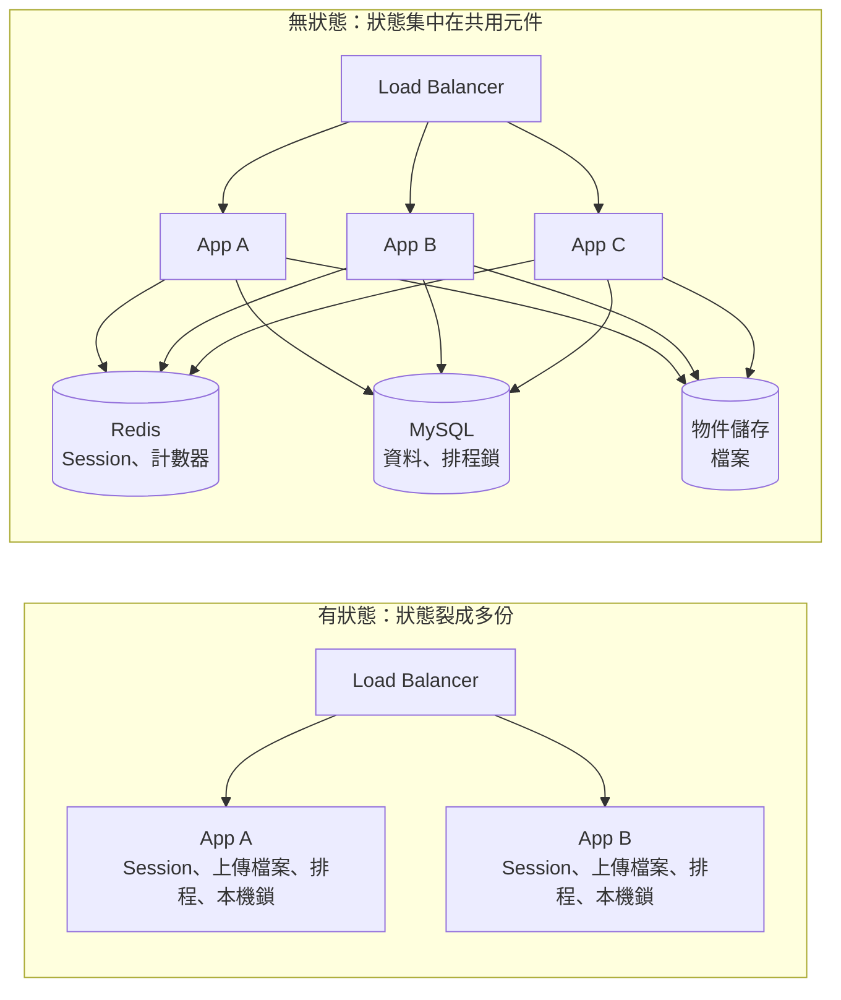
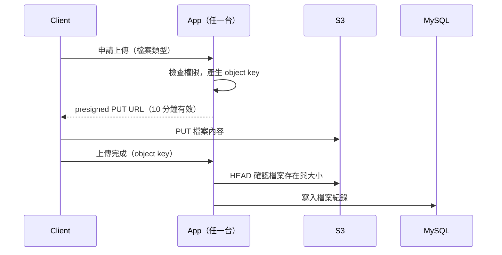
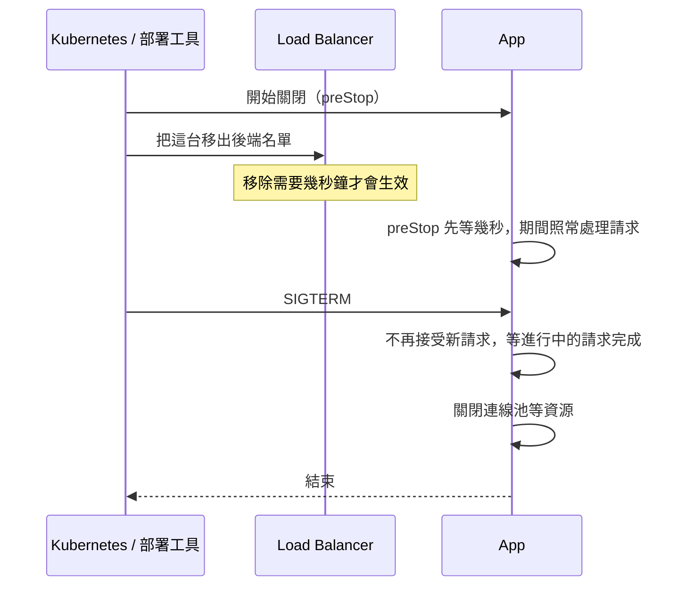

> **System Design 系列** Part 2-1｜上一篇：[Napkin Math 容量估算](/post/systemdesign/napkin-math/)｜下一篇：[Load Balancing 深入](/post/systemdesign/load-balancing/)｜[系列地圖](/post/systemdesign/system-design-thinking/#系列地圖)

## 情境與問題

雙 11 前壓測，一台 8 核的 Spring Boot 在尖峰時 CPU 已經 85%。你加了第二台，前面放一個 Load Balancer，心想這樣容量就翻倍了。上線當晚陸續出現：

1. 使用者登入後重新整理，有時就被登出
2. 剛上傳的商品圖片，有時看得到、有時 404
3. 每天凌晨的對帳排程跑了兩次，客戶收到兩封通知信
4. 「每人限搶一次」用 `synchronized` 做的檢查失效，有人搶到兩次
5. 同一個商品，兩台機器顯示的價格不一樣

五個問題的根因都一樣：**應用程式把狀態存在自己身上**。只有一台機器時，這些狀態剛好都在同一個地方，所以沒事；加了第二台，狀態就裂成兩份。

## 最簡單的做法與它的極限：垂直擴展

在加機器之前，先想想能不能**換一台更大的機器**。垂直擴展（scale up）的好處常被低估：

- 程式完全不用改，沒有任何分散式問題
- 所有資料都在同一個記憶體空間，延遲最低
- 維運最簡單：一台機器、一份 log、一個要監控的對象

它的極限有三個：

1. **有天花板**：雲端規格選到最大就沒有下一步，而且升級規格通常要重啟
2. **單點故障**：再大的機器壞了就是全部停擺。就算一台撐得住流量，為了可用性也至少要兩台
3. **程式本身不一定吃得到更多核心**：Amdahl 定律告訴我們，程式中無法平行化的部分決定了加速的上限

Amdahl 定律：加速倍數 = 1 ÷（序列部分比例 +（可平行比例 ÷ 核心數））。假設程式有 95% 可以平行化，5% 必須序列執行（例如搶同一把鎖、寫同一個檔案）：

| 核心數 | 理論加速 |
|---|---|
| 8 | 5.9 倍 |
| 16 | 9.1 倍 |
| 64 | 15.4 倍 |
| 無限多 | 20 倍 |

核心從 16 加到 64 是 4 倍成本，換來的加速卻不到 2 倍。到這個時候，與其繼續買更大的機器，不如把工作拆到多台機器上，也就是**水平擴展（scale out）**。但水平擴展的前提，是應用程式必須是**無狀態**的。

## 核心機制：狀態藏在哪裡、該搬去哪裡

「無狀態」不是指系統沒有狀態，而是指**狀態不跟著 instance 走**：任何一台都可以隨時被關掉、替換或複製，請求送到哪一台，結果都一樣。狀態要往下推到所有 instance 共用的地方。



把藏在應用程式裡的狀態全部列出來：

| 狀態 | 單機時放在哪 | 變成多台之後的問題 | 該搬去哪裡 |
|---|---|---|---|
| `HttpSession` | Tomcat 記憶體 | 請求換一台就像沒登入 | Redis（Spring Session）或 token（JWT） |
| 上傳檔案 | 本機硬碟 | 其他台讀不到；instance 重建後檔案消失 | 物件儲存（S3 等） |
| `@Scheduled` 排程 | 每台各自觸發 | 同一個工作被執行 N 次 | 排程鎖（ShedLock）、獨立 worker、外部排程器 |
| `synchronized`、`ReentrantLock` | JVM 內 | 只鎖得住自己那一台 | 資料庫條件式更新、唯一鍵、[分散式鎖](/post/systemdesign/distributed-lock/) |
| 本機快取（`HashMap`、Caffeine） | JVM 記憶體 | 各台資料不一致 | 接受短暫不一致加 TTL，或集中快取加失效通知（[Cache 篇](/post/systemdesign/caching/)） |
| 記憶體計數器（限流、統計） | JVM 記憶體 | 總限額變成 N 倍 | Redis 原子計數（Part 6 Rate Limiting） |
| WebSocket 連線 | 綁在某一台 | 推播時要找到連線所在的那台 | 用 pub/sub 廣播給所有 instance（Part 5） |
| 本機 log 檔 | 本機硬碟 | 查一個請求要登入每一台 | 集中收集（Part 6 Observability） |

這裡有一個很容易忽略的後果：**狀態往下推，瓶頸也跟著往下推**。應用伺服器可以無限加，但它們全部共用同一個 Redis、同一個 MySQL。所以水平擴展的下一步，必然是處理共用儲存層的擴展，也就是 Part 3、Part 4 的主題。

### 檔案：用 presigned URL 讓檔案不經過應用伺服器

檔案搬到物件儲存之後，還可以更進一步：讓 client 直接上傳到物件儲存，應用伺服器只負責「發許可」。



應用伺服器不必承擔檔案的頻寬和記憶體，任何一台都能發出 URL，完全不需要知道檔案最後放在哪。

### 優雅關機：讓 instance 可以隨時被替換

無狀態的另一半是**可拋棄性**：instance 要能快速啟動，也要能安全關閉。關機時如果直接切斷，正在處理的請求會失敗，滾動部署期間就會出現一批 502。正確的關機順序：



關鍵在第三步：從「通知 LB 移除」到「LB 真的不再送請求」之間有時間差。如果 instance 一收到通知就關閉，這段時間內進來的請求就會失敗，所以要先等一下。

## 方案比較

### 垂直擴展 vs 水平擴展

| | 垂直擴展 | 水平擴展 |
|---|---|---|
| 程式要改嗎 | 不用 | 要先做到無狀態 |
| 容量上限 | 受單機最大規格限制 | 理論上無上限，瓶頸會移到共用儲存 |
| 可用性 | 單點故障 | 壞一台還有其他台 |
| 成本曲線 | 越大越不划算（吃不到更多核心） | 大致線性，但多了 LB 與共用元件 |
| 部署 | 升級通常要停機 | 可以滾動部署、零停機 |
| 適合 | 資料庫主庫、早期產品、難以拆分的有狀態服務 | 無狀態的應用層、需要彈性擴縮的服務 |

### Session 的三種做法

| | Sticky Session | 集中式 Session（Redis） | Token（JWT） |
|---|---|---|---|
| 做法 | LB 依 cookie 把同一使用者固定送到同一台 | Session 存 Redis，每台都讀得到 | 狀態簽章後交給 client，伺服器只驗證 |
| 某台掛掉 | 那台的使用者全部被登出 | 不受影響 | 不受影響 |
| 滾動部署 | 每部署一台就踢掉一批人 | 不受影響 | 不受影響 |
| 負載分佈 | 可能不均（重度使用者黏在同一台） | 均勻 | 均勻 |
| 強制登出 | 刪 session | 刪 Redis key，立即生效 | 困難，要靠黑名單或縮短效期（見 [JWT 篇](/post/security/jwt-spring-security/)） |
| 額外依賴 | 無 | Redis，而且必須高可用 | 金鑰管理與輪替 |
| 每個請求的成本 | 無 | 一次 Redis 讀取（約 0.5 ms） | 一次驗簽（CPU） |

一般的 Web 應用建議用**集中式 Session**：撤銷簡單、行為和單機時一樣。跨網域、行動 App、服務對服務呼叫才用 token。Sticky session 只適合當作過渡方案，因為它把「應用程式有狀態」這件事藏起來，直到某台機器掛掉才爆發。

### 排程的做法

| 做法 | 原理 | 優點 | 缺點 |
|---|---|---|---|
| ShedLock | 執行前先在資料庫搶一筆鎖 | 改動最小，加一個註解 | 鎖逾時後可能重複執行，工作本身仍要冪等 |
| 獨立 worker | 只有一台啟用排程（例如用 profile 控制） | 簡單 | 那台就是單點故障 |
| 外部排程器 | Kubernetes CronJob、Quartz 叢集模式 | 有重試、歷史紀錄、監控 | 多一套元件要維運 |
| 交給 MQ | 排程只負責丟訊息，由 consumer 處理 | 工作可以分散到多台平行處理 | 架構最複雜 |

不管用哪一種，**排程工作都要設計成冪等的**。分散式環境下「保證只執行一次」很難做到，比較實際的目標是「可能執行多次，但結果和執行一次一樣」。

## Java 落地

以 Spring Boot 3.x 為例。

### 1. Spring Session + Redis

```groovy
implementation 'org.springframework.boot:spring-boot-starter-data-redis'
implementation 'org.springframework.session:spring-session-data-redis'
```

```properties
spring.data.redis.host=redis.internal
spring.session.timeout=30m
```

classpath 上有 Spring Session 的 Redis 模組，Spring Boot 就會自動把 `HttpSession` 存到 Redis，程式碼裡的 `session.getAttribute()` 完全不用改。

預設的序列化方式是 Java Serialization，這會埋下一個部署地雷：只要放進 session 的類別改了欄位，新版程式讀到舊 session 就會反序列化失敗，**所有已登入的使用者一起被登出**。建議改成 JSON：

```java
@Configuration
public class SessionConfig {

    // bean 名稱必須是 springSessionDefaultRedisSerializer，Spring Session 才會採用
    @Bean
    public RedisSerializer<Object> springSessionDefaultRedisSerializer(ObjectMapper objectMapper) {
        return new GenericJackson2JsonRedisSerializer(objectMapper);
    }
}
```

改成 JSON 之後有一個陷阱：session attribute 的型別是 `Object`，JSON 本身沒有記錄原本的 Java 型別，還原時 Jackson 只能用猜的。用 Jackson 2.15 把三種值寫出去再讀回來：

```text
Long       -> Integer
String     -> String
Cart       -> LinkedHashMap
```

寫進去的是 `Long`，讀回來變成 `Integer`，`(Long) session.getAttribute("userId")` 直接丟 `ClassCastException`。即使照 Spring Session 文件的註解啟用 `DefaultTyping.NON_FINAL`，`Long` 是 final 類別，一樣不會帶型別資訊。所以：

- **session 只放少量、型別單純的資料**：userId 用 `String` 存，或讀取時一律用 `((Number) value).longValue()` 轉型。購物車這類會長大的資料，放資料庫或另外用 userId 當 key 存，每次請求從 Redis 讀取的資料量也比較小
- **有用 Spring Security 時**：`SecurityContext` 也存在 session 裡，`ObjectMapper` 要註冊 `SecurityJackson2Modules.getModules(classLoader)`。它會啟用有白名單限制的型別資訊，Security 的物件才還原得回來，Spring Session 文件有完整範例

Spring Boot 4 改用 Jackson 3，對應的序列化類別是 `JacksonJsonRedisSerializer`。

### 2. 排程：ShedLock

```java
@Configuration
@EnableScheduling
@EnableSchedulerLock(defaultLockAtMostFor = "10m")
public class SchedulingConfig {

    @Bean
    public LockProvider lockProvider(DataSource dataSource) {
        return new JdbcTemplateLockProvider(
                JdbcTemplateLockProvider.Configuration.builder()
                        .withJdbcTemplate(new JdbcTemplate(dataSource))
                        .usingDbTime()   // 用資料庫的時間判斷鎖是否過期，避免各台時鐘不同步
                        .build());
    }
}
```

```java
@Component
public class ReconciliationJob {

    @Scheduled(cron = "0 0 3 * * *", zone = "Asia/Taipei")
    @SchedulerLock(name = "daily-reconciliation", lockAtMostFor = "30m", lockAtLeastFor = "1m")
    public void reconcile() {
        // 每天凌晨 3 點，整個叢集只有搶到鎖的那一台會執行
    }
}
```

```sql
CREATE TABLE shedlock (
    name       VARCHAR(64)  NOT NULL PRIMARY KEY,
    lock_until TIMESTAMP    NOT NULL,
    locked_at  TIMESTAMP    NOT NULL,
    locked_by  VARCHAR(255) NOT NULL
);
```

兩個參數決定了它的安全性：

- **`lockAtMostFor`**：持有鎖的那台如果中途當機，鎖最多被佔住多久。**一定要比工作最長的執行時間還長**，否則工作還沒跑完，鎖就過期了，另一台會再跑一次
- **`lockAtLeastFor`**：就算工作很快跑完，鎖也至少保留這麼久。避免時鐘稍有差異的另一台在工作結束後馬上又觸發一次

### 3. 檔案：S3 presigned URL

```java
@Service
public class UploadService {

    private final S3Presigner presigner;

    public UploadService(S3Presigner presigner) {
        this.presigner = presigner;
    }

    public UploadTicket issueUploadUrl(long memberId, String contentType) {
        String key = "uploads/%d/%s".formatted(memberId, UUID.randomUUID());

        PutObjectRequest objectRequest = PutObjectRequest.builder()
                .bucket("shop-product-images")
                .key(key)
                .contentType(contentType)
                .build();

        PutObjectPresignRequest presignRequest = PutObjectPresignRequest.builder()
                .signatureDuration(Duration.ofMinutes(10))   // URL 10 分鐘後失效
                .putObjectRequest(objectRequest)
                .build();

        PresignedPutObjectRequest presigned = presigner.presignPutObject(presignRequest);
        return new UploadTicket(key, presigned.url().toString());
    }

    public record UploadTicket(String objectKey, String uploadUrl) {}
}
```

注意 `contentType` 會變成簽章的一部分：client 上傳時必須帶一模一樣的 `Content-Type` header，否則 S3 會回 `SignatureDoesNotMatch`。這其實是好事，可以防止使用者把申請成圖片的 URL 拿去上傳其他類型的檔案。`S3Presigner` 持有 HTTP 與憑證相關的資源，用完要 `close()`。宣告成 Spring 的 singleton bean 共用即可，Spring 關閉時會自動呼叫它的 `close()`。

### 4. 優雅關機與 Kubernetes

```yaml
server:
  shutdown: graceful                    # Spring Boot 3.4 起已是預設值
spring:
  lifecycle:
    timeout-per-shutdown-phase: 30s     # 最多等進行中的請求 30 秒
management:
  endpoint:
    health:
      probes:
        enabled: true                   # 提供 /actuator/health/readiness 與 liveness
```

```yaml
spec:
  terminationGracePeriodSeconds: 45
  containers:
    - name: app
      lifecycle:
        preStop:
          exec:
            command: ["sh", "-c", "sleep 10"]   # 等 LB 把這台移出名單
      readinessProbe:
        httpGet:
          path: /actuator/health/readiness
          port: 8080
```

時間要算得起來：`terminationGracePeriodSeconds` 是從開始關閉就起算的總時限，`preStop` 的 10 秒和 Spring 的 30 秒都包含在內，所以要設成大於 10 + 30。時間到了還沒結束，Kubernetes 會直接 `SIGKILL`。

### 5. 擴容前先算連線總數

水平擴展時最常被忘記的是**連線數的乘法**：

```text
資料庫連線總數 = instance 數 × 每台連線池大小
```

MySQL 的 `max_connections` 預設是 151。HikariCP 每台預設 10 條連線，而且啟動時就會全部建好：15 台剛好 150 條，自動擴容到第 16 台，新機器一啟動就收到 `Too many connections`。解法是依 [Little's Law](/post/systemdesign/latency-throughput/) 把每台的連線池縮到真正需要的大小，或在中間加一層連線代理（例如 ProxySQL、RDS Proxy）。

## 踩坑與 Gotchas

- **用 sticky session 掩蓋有狀態的問題**：平常看起來一切正常，直到某台機器掛掉或滾動部署，那台的使用者全部被登出
- **Session 用 Java Serialization**：類別欄位一改，部署後所有使用者被登出
- **Session 改用 JSON 後直接強制轉型**：`Long` 讀回來是 `Integer`，自訂物件讀回來是 `LinkedHashMap`
- **Session 塞大物件**：每個請求都要從 Redis 讀寫一次，物件越大，延遲和網路流量越高
- **以為 `synchronized` 能防重複**：它只鎖得住同一個 JVM。跨機器的互斥要交給資料庫條件式更新、唯一鍵或分散式鎖
- **ShedLock 的 `lockAtMostFor` 設太短**：工作還沒跑完鎖就過期，另一台會再跑一次
- **把產生的報表存在本機再讓使用者下載**：下載請求被 LB 送到另一台，檔案就不見了
- **擴容時沒算資料庫連線總數**：應用層擴容反而把資料庫打掛
- **依 CPU 自動擴容，但瓶頸在資料庫**：CPU 高是因為在等資料庫、重試、排隊。這時加機器只會增加資料庫的併發壓力，讓情況更糟。擴容條件要搭配下游的健康狀況一起看
- **關機沒有排空**：滾動部署期間固定出現一批 502

### 資安相關

- **Session cookie 少了 `Secure`**：Spring Session 預設依 `request.isSecure()` 決定 cookie 要不要加 `Secure`。TLS 在 LB 就終止了，應用程式收到的是 HTTP，cookie 因此不帶 `Secure`，瀏覽器在任何 HTTP 連線上都會送出它。設定 `server.forward-headers-strategy`（見 [Load Balancing 篇](/post/systemdesign/load-balancing/)），讓應用程式知道原始請求是 HTTPS；或宣告自己的 `DefaultCookieSerializer`，呼叫 `setUseSecureCookie(true)`
- **自己寫登入沒有換 session ID**：攻擊者先取得一個 session ID，設法讓受害者帶著它登入，登入後這個 ID 就成了已登入狀態（session fixation）。Spring Security 預設在登入成功時呼叫 `changeSessionId()` 換掉 ID；繞過 Spring Security、自己 `session.setAttribute("userId", ...)` 的登入流程就沒有這層保護
- **Presigned URL 的權限邊界**：URL 在有效期內可以重複使用，拿到它的人都能上傳，而且 presigned PUT 沒有「大小上限」的條件可設。object key 由伺服器產生並綁定使用者，不讓 client 指定路徑；效期盡量短；上傳完成後用 `HEAD` 檢查大小與類型，不符就刪除。需要在上傳當下就限制大小時，改用支援 `content-length-range` 條件的 presigned POST
- **Session 放在 Redis，Redis 就成了登入憑證庫**：能讀 Redis 的人就能拿到所有有效的 session。Redis 要放在內網、開 ACL 與 TLS，用和資料庫同等級的標準保護

## 何時用／何時別用

- **先垂直擴展**：資料庫主庫、早期產品、單機規格還有餘裕、或者需要馬上止血的時候。一台大機器加一台備援，往往比十台小機器簡單得多
- **改成水平擴展**：需要高可用（至少兩台）、流量有明顯波峰需要彈性擴縮、單機已經接近最大規格、需要零停機部署
- **重新評估的時機**：最大規格的單機在尖峰時使用率超過 60%；部署造成的停機已經無法接受；共用的 Redis 或 MySQL 開始成為瓶頸，這時就要進入 Part 3、Part 4 的資料層擴展

## 參考資料

- The Twelve-Factor App — VI. Processes：<https://12factor.net/processes>、IX. Disposability：<https://12factor.net/disposability>
- Gene Amdahl, "Validity of the single processor approach to achieving large scale computing capabilities", AFIPS, 1967
- Spring Boot Reference — Spring Session：<https://docs.spring.io/spring-boot/reference/web/spring-session.html>
- Spring Boot Reference — Graceful Shutdown：<https://docs.spring.io/spring-boot/reference/web/graceful-shutdown.html>
- Spring Session Reference — Redis（JSON 序列化）：<https://docs.spring.io/spring-session/reference/configuration/redis.html>
- ShedLock：<https://github.com/lukas-krecan/ShedLock>
- AWS SDK for Java 2.x Developer Guide — Presigned URLs：<https://docs.aws.amazon.com/sdk-for-java/latest/developer-guide/examples-s3-presign.html>
- Kubernetes — Pod Lifecycle（Termination of Pods）：<https://kubernetes.io/docs/concepts/workloads/pods/pod-lifecycle/>
- 互動圖解延伸：Dilum Sanjaya，System Design — an interactive course：<https://designed-to-scale.vercel.app/>
