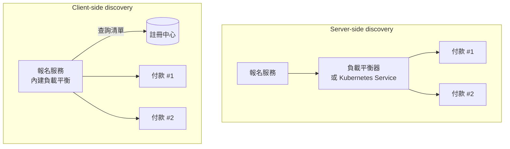
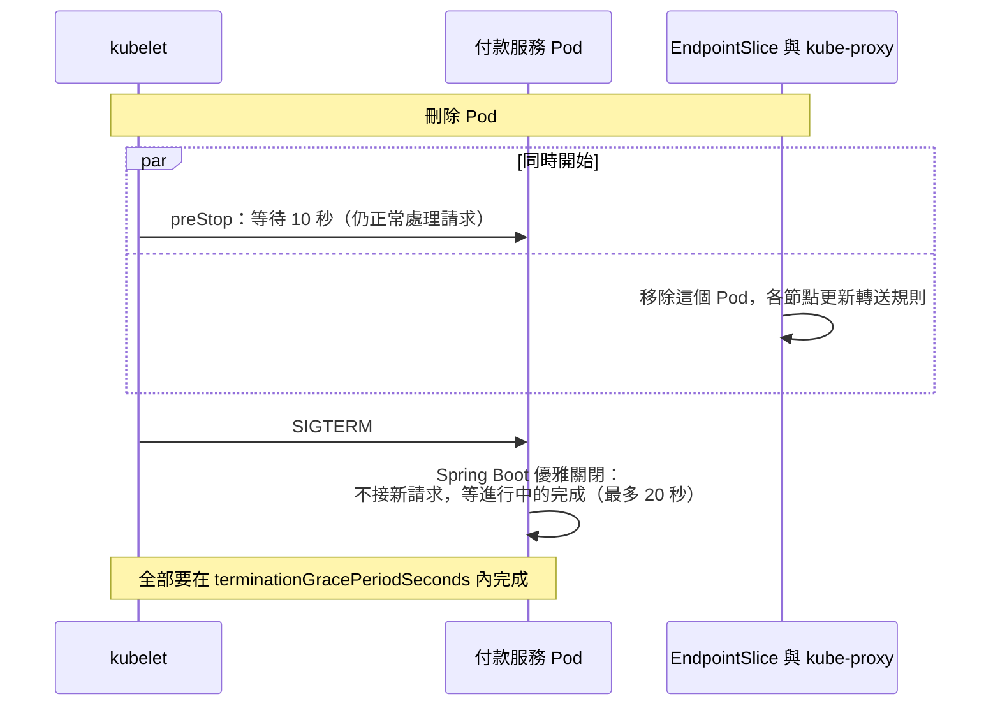

> **System Design 系列** Part 7-2｜上一篇：[單體 vs 微服務](/post/systemdesign/monolith-vs-microservices/)｜下一篇：[Saga 與 Outbox](/post/systemdesign/saga-outbox/)｜[系列地圖](/post/systemdesign/system-design-thinking/#系列地圖)

## 情境與問題

[上一篇](/post/systemdesign/monolith-vs-microservices/)把付款拆成獨立的服務。報名服務要呼叫付款服務，第一個問題是：**付款服務在哪裡？**

付款服務有 3 到 12 個實例，依流量自動擴充與縮減；每次部署，所有實例都會被替換成新的，IP 位址也跟著換；某個實例當機了，要盡快停止把請求送給它。寫死 IP 位址的設定檔，在第一次部署之後就失效了。

服務發現要回答兩件事：

- **目前有哪些實例可以接受請求**（註冊與健康狀態）
- **呼叫端怎麼拿到這份清單，並選出一個實例**（查詢與負載平衡）

而且這份清單永遠是**有延遲的**：實例當機的那一刻，到所有呼叫端都知道，中間一定有一段時間差。服務發現的設計，大部分是在處理這段時間差。

## 最簡單的做法與它的極限

- **設定檔寫死實例的位址**：每次擴充、縮減、部署都要改設定並重新啟動呼叫端
- **前面放一台固定位址的負載平衡器**：呼叫端只需要知道負載平衡器的位址，這其實就是 server-side discovery 的最簡單形式。但負載平衡器本身要知道後端有哪些實例，問題只是被移到了負載平衡器上；而且每個請求多經過一跳

## 核心機制

### 註冊：誰把實例加進清單

| 方式 | 做法 | 例子 |
|---|---|---|
| 自行註冊 | 實例啟動時自己向註冊中心登記，定期送心跳，關閉時自己登出 | Eureka、Consul 的用戶端程式庫 |
| 平台註冊 | 由部署平台負責：實例啟動並通過健康檢查後，平台把它加入清單 | Kubernetes 依 readiness probe 更新 EndpointSlice；雲端的負載平衡器目標群組 |

自行註冊需要每一個服務都整合註冊中心的用戶端程式庫，而且當機的實例無法替自己登出，只能等心跳逾時。平台註冊讓應用程式不需要知道註冊中心的存在，是目前比較常見的做法。

### 健康：清單上的實例真的能用嗎

註冊中心用**租約**判斷實例是否還活著（和 [Raft 篇](/post/systemdesign/consensus-raft/)的 etcd lease 是同一個概念）：實例定期續約，超過期限沒有續約就被移除。

以 Eureka 的預設值為例：實例每 30 秒送一次心跳，伺服器 90 秒沒收到心跳才移除這個實例；呼叫端每 30 秒向伺服器取得一次清單，負載平衡器還可能有自己的快取。一個實例當機後，呼叫端最壞可能還要**將近兩分鐘**才不再把請求送給它。

縮短間隔可以減少這段時間，代價是心跳的流量增加，而且網路短暫抖動時，健康的實例也可能被誤判而移除。

所以服務發現無法取代呼叫端自己的保護：清單裡一定會有已經死掉的實例，呼叫端要有逾時、對其他實例重試、斷路器（[Part 6](/post/systemdesign/timeout-retry-backoff/)）。

### 查詢：呼叫端怎麼選實例



| 方式 | 優點 | 代價 |
|---|---|---|
| Server-side（負載平衡器、Kubernetes Service） | 呼叫端只需要一個名稱，不需要特殊的程式庫，任何語言都能用 | 多一跳；L4 的負載平衡以連線為單位，長連線會黏在同一個實例上 |
| Client-side（Eureka + Spring Cloud LoadBalancer、gRPC 的名稱解析） | 沒有中間一跳，可以用更聰明的演算法（例如 [Load Balancing 篇](/post/systemdesign/load-balancing/)的 P2C） | 每種語言都要有用戶端程式庫，演算法與設定分散在每個呼叫端 |
| DNS | 所有語言與工具都支援 | TTL 與各層的 DNS 快取讓更新變慢；一般的 A 紀錄不帶連接埠與權重 |
| Service mesh（sidecar 或節點上的代理） | 服務發現、負載平衡、重試、mTLS 都交給代理，應用程式不需要修改 | 多一層代理的延遲與資源；控制平面本身要維運 |

### 註冊中心要選 CP 還是 AP

註冊中心本身也是分散式系統，也要面對 [CAP](/post/systemdesign/cap-pacelc/) 的取捨：

- **CP**（etcd、Consul、ZooKeeper）：清單是一致的，但註冊中心失去多數節點時，無法更新
- **AP**（Eureka）：網路分割時，各個節點各自提供可能過時的清單。Eureka 在短時間內大量實例沒有續約時，會進入**自我保護模式**，暫停移除實例，因為它判斷「比較可能是網路出問題，而不是實例全部死了」

對服務發現來說，**過時的清單通常比沒有清單好**：清單裡有幾個死掉的實例，呼叫端的重試可以處理；完全拿不到清單，所有的呼叫都會失敗。所以不管註冊中心是哪一種，呼叫端都應該快取最後一份成功取得的清單，註冊中心故障時繼續使用。

### Kubernetes：Service、EndpointSlice 與下線時序

在 Kubernetes 上，服務發現是平台內建的：

- 每個 Service 有一個穩定的 DNS 名稱（`payment.lectures.svc.cluster.local`）與虛擬 IP
- 通過 readiness probe 的 Pod 會被加入這個 Service 的 EndpointSlice
- 每個節點上的 kube-proxy 依 EndpointSlice 設定轉送規則，把送到虛擬 IP 的連線分配給其中一個 Pod

最容易出錯的是**下線的時序**。刪除一個 Pod 時，兩件事**同時**開始，彼此不會等待：

1. kubelet 執行 preStop hook，然後送 SIGTERM 給容器
2. 控制平面把 Pod 從 EndpointSlice 移除，各節點的 kube-proxy、Ingress controller、service mesh 陸續更新轉送規則

如果應用程式一收到 SIGTERM 就停止接受連線，而某些節點的轉送規則還沒更新，送到這個 Pod 的請求就會失敗。解法是在 preStop 先等待幾秒，讓轉送規則更新完成，再開始優雅關閉：



另一個常見的問題：kube-proxy 以**連線**為單位分配。HTTP keep-alive 或 gRPC 的長連線建立之後，所有請求都送到同一個 Pod；新加入的 Pod 收不到流量。gRPC 這類長連線的情況，要用 headless Service 讓用戶端拿到所有 Pod 的位址並自己分配（[REST、gRPC 與 GraphQL 篇](/post/systemdesign/rest-grpc-graphql/)），或交給 service mesh 做 L7 的負載平衡。

## 方案比較

| 環境 | 建議 |
|---|---|
| Kubernetes，HTTP 短請求為主 | 直接用 Service 的 DNS 名稱，不需要額外的註冊中心 |
| Kubernetes，gRPC 或需要 L7 負載平衡、mTLS | headless Service 加上用戶端的負載平衡，或導入 service mesh |
| 虛擬機或混合環境 | Consul 這類註冊中心，或雲端負載平衡器的目標群組 |
| 既有的 Spring Cloud Netflix 系統 | Eureka 加 Spring Cloud LoadBalancer 仍然可用；遷移到 Kubernetes 時，通常改用平台內建的機制 |

講座平台的選擇：部署在 Kubernetes，報名服務用 Service 的 DNS 名稱呼叫付款服務；即時互動服務之間的 gRPC 呼叫使用 headless Service 與 round robin。暫時不導入 service mesh，服務間的 mTLS 留到 Part 8 再評估。

## Java 落地

### 1. Kubernetes：用名稱呼叫，讓平台處理發現

```yaml
spring:
  http:
    serviceclient:
      payment:
        base-url: http://payment.lectures.svc.cluster.local
        connect-timeout: 300ms
        read-timeout: 1s
  lifecycle:
    timeout-per-shutdown-phase: 20s     # 優雅關閉最多等 20 秒

management:
  endpoint:
    health:
      probes:
        enabled: true
        add-additional-paths: true      # 在主要的連接埠提供 /readyz 與 /livez
```

`spring.http.serviceclient.payment` 是 HTTP service client 的「payment」群組設定，搭配宣告式的介面使用：

```java
@HttpExchange("/v1/charges")
public interface PaymentApi {

    @PostExchange
    ChargeResult charge(@RequestHeader("Idempotency-Key") String idempotencyKey, @RequestBody ChargeRequest request);
}

@Configuration
@ImportHttpServices(group = "payment", types = PaymentApi.class)
public class PaymentClientConfig {
}
```

- 呼叫端只知道 Service 的名稱，實例的增減由 Kubernetes 處理
- readiness probe 放在**主要的連接埠**：它要反映的是「應用程式能不能處理請求」，而管理端點可能在另一個連接埠（[Observability 篇](/post/systemdesign/observability/)），即使主要的連接埠已經停止服務，管理埠仍可能回應正常
- Spring Boot 在 Kubernetes 上預設會啟用 liveness 與 readiness 的健康群組，這裡明確寫出

### 2. Pod 的下線時序

```yaml
apiVersion: apps/v1
kind: Deployment
metadata:
  name: payment
  namespace: lectures
spec:
  replicas: 3
  selector:
    matchLabels:
      app: payment
  template:
    metadata:
      labels:
        app: payment
    spec:
      terminationGracePeriodSeconds: 40        # 10 秒 preStop + 20 秒優雅關閉 + 緩衝
      containers:
        - name: payment
          image: registry.example.com/lectures/payment:2026.11.23
          ports:
            - containerPort: 8080
          readinessProbe:
            httpGet:
              path: /readyz
              port: 8080
            periodSeconds: 5
          livenessProbe:
            httpGet:
              path: /livez
              port: 8080
            periodSeconds: 10
          lifecycle:
            preStop:
              sleep:
                seconds: 10                    # 等轉送規則更新完成，再開始關閉
```

- `terminationGracePeriodSeconds` 包含 preStop 與應用程式關閉的時間，預設 30 秒。這裡的 10 + 20 秒已經接近預設值，所以調高到 40 秒
- preStop 的 `sleep` 動作是 Kubernetes 內建的，不需要容器映像檔裡有 `sleep` 指令（distroless 映像檔就沒有），但需要較新版本的 Kubernetes；舊版本只能用 `exec` 執行 `sleep`
- liveness probe 不要檢查資料庫或下游的狀態，否則下游故障時，所有 Pod 會被一起重啟（[Load Balancing 篇](/post/systemdesign/load-balancing/)）

### 3. 不在 Kubernetes 上：client-side discovery

```java
@Configuration
public class LoadBalancedClientConfig {

    @Bean
    @LoadBalanced
    RestClient.Builder loadBalancedRestClientBuilder() {
        return RestClient.builder();
    }
}

@Component
public class PaymentClient {

    private final RestClient restClient;

    public PaymentClient(@LoadBalanced RestClient.Builder builder) {
        // payment-service 是註冊中心裡的服務名稱，不是 DNS 名稱
        this.restClient = builder.baseUrl("http://payment-service").build();
    }

    public ChargeResult charge(ChargeRequest request, String idempotencyKey) {
        return restClient.post()
                .uri("/v1/charges")
                .header("Idempotency-Key", idempotencyKey)
                .body(request)
                .retrieve()
                .body(ChargeResult.class);
    }
}
```

`@LoadBalanced` 讓 Spring Cloud LoadBalancer 攔截請求，把服務名稱換成註冊中心（Eureka、Consul）提供的某個實例位址。Spring Cloud 的版本要和 Spring Boot 的版本相容。

> 以上設定與程式碼依 Spring Boot 4.1、Spring Cloud 與 Kubernetes 官方文件撰寫，沒有實際執行。

## 踩坑與 Gotchas

- **以為清單是即時的**：從實例當機到呼叫端知道，中間有心跳間隔、逾時、快取的延遲。呼叫端仍然需要逾時與重試
- **下線時沒有等待**：收到 SIGTERM 就停止服務，轉送規則還沒更新，每次部署都有一小段時間出現錯誤
- **`terminationGracePeriodSeconds` 太短**：preStop 加上優雅關閉超過期限，進行中的請求被強制中斷
- **readiness 檢查太多東西**：readiness 檢查了下游服務，下游一出問題，所有實例都從 Service 被移除，服務完全中斷
- **長連線黏在舊的實例上**：擴充後新的 Pod 沒有流量，舊的 Pod 過載
- **DNS 快取**：JVM、作業系統、中間的 DNS 伺服器各自快取，名稱指向的位址改變後，部分呼叫端仍連到舊的位址（[備援與故障轉移篇](/post/systemdesign/redundancy-failover-dr/)的 JVM DNS 設定）
- **註冊中心成為單點故障**：呼叫端沒有快取清單，註冊中心一停止，所有服務間的呼叫跟著失敗
- **自行註冊的實例沒有登出**：當機或被強制終止的實例要等租約過期，這段時間的請求會失敗

### 資安相關

- **註冊表被冒用**：如果任何程式都能向註冊中心登記實例，攻擊者只要在內部網路取得一台機器，就能把自己登記成 `payment-service`，接收報名服務送出的付款請求與其中的資料。註冊中心要求驗證身分與授權（例如 Consul 的 ACL），Kubernetes 上要限制誰能建立或修改 Service 與 EndpointSlice。Kubernetes 的 CVE-2020-8554 就是一個例子：能建立 Service 並設定 external IP 的使用者，可以攔截叢集內送往該 IP 的流量
- **名稱不等於身分**：服務發現回傳的是位址，不是身分證明。即使註冊表或 DNS 被竄改，只要呼叫端用 mTLS 驗證對方的憑證（例如 SPIFFE 格式的服務身分），連到錯誤的實例也會在 TLS 交握時失敗。服務間的身分驗證在 Part 8 詳談
- **用網路政策限制誰能呼叫誰**：預設情況下，Kubernetes 叢集內任何 Pod 都能連到任何 Pod。用 NetworkPolicy 限定只有報名服務能連到付款服務，被入侵的推薦服務就無法直接呼叫付款 API：

```yaml
apiVersion: networking.k8s.io/v1
kind: NetworkPolicy
metadata:
  name: payment-ingress
  namespace: lectures
spec:
  podSelector:
    matchLabels:
      app: payment
  policyTypes: ["Ingress"]
  ingress:
    - from:
        - podSelector:
            matchLabels:
              app: registration
      ports:
        - port: 8080
```

NetworkPolicy 需要叢集的網路外掛支援才會生效，套用後要實際驗證。

- **註冊表洩漏內部拓撲**：Eureka 的管理頁面、Consul 的 UI 列出了所有服務的名稱、位址與中繼資料，對外開放等於給攻擊者一張地圖。這些介面只允許內部存取並要求驗證；也不要把憑證放進實例的中繼資料
- **SSRF 會利用內部名稱**：如果應用程式會依使用者提供的 URL 發出請求，攻擊者可以填入 `http://payment.lectures.svc.cluster.local/...`，讓你的伺服器替他呼叫內部服務。對外的請求要限制目的地，不能解析到內部的名稱與位址（Part 8）

## 何時用／何時別用

- **用平台內建的發現機制**：在 Kubernetes 或雲端的代管環境上，這幾乎總是最簡單的選擇
- **用註冊中心加 client-side 負載平衡**：不在 Kubernetes 上、需要跨多個環境，或需要更細的負載平衡策略
- **用 service mesh**：服務數量多、需要一致的 mTLS、重試與流量控制，而且團隊有能力維運控制平面
- **別自己做**：用資料庫或 Redis 自己實作註冊與心跳，等於重新發明一個沒有經過考驗的 Eureka

## 參考資料

- Kubernetes Documentation — Service、EndpointSlices：<https://kubernetes.io/docs/concepts/services-networking/service/>
- Kubernetes Documentation — Pod Lifecycle：Termination of Pods：<https://kubernetes.io/docs/concepts/workloads/pods/pod-lifecycle/#pod-termination>
- Kubernetes Documentation — Container Lifecycle Hooks：<https://kubernetes.io/docs/concepts/containers/container-lifecycle-hooks/>
- Kubernetes Documentation — Network Policies：<https://kubernetes.io/docs/concepts/services-networking/network-policies/>
- Kubernetes Security Advisory — CVE-2020-8554：<https://github.com/kubernetes/kubernetes/issues/97076>
- Spring Boot Reference — Kubernetes Probes：<https://docs.spring.io/spring-boot/reference/actuator/endpoints.html#actuator.endpoints.kubernetes-probes>
- Spring Cloud Netflix Reference — Service Discovery: Eureka Clients：<https://docs.spring.io/spring-cloud-netflix/reference/>
- Spring Cloud Commons Reference — Spring Cloud LoadBalancer：<https://docs.spring.io/spring-cloud-commons/reference/spring-cloud-commons/loadbalancer.html>
- Chris Richardson, "Pattern: Client-side service discovery" 與 "Pattern: Server-side service discovery"：<https://microservices.io/patterns/client-side-discovery.html>
- 互動圖解延伸：Dilum Sanjaya，System Design — an interactive course：<https://designed-to-scale.vercel.app/>
