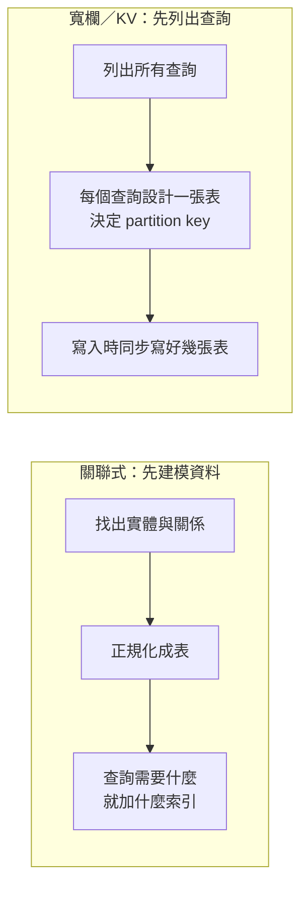
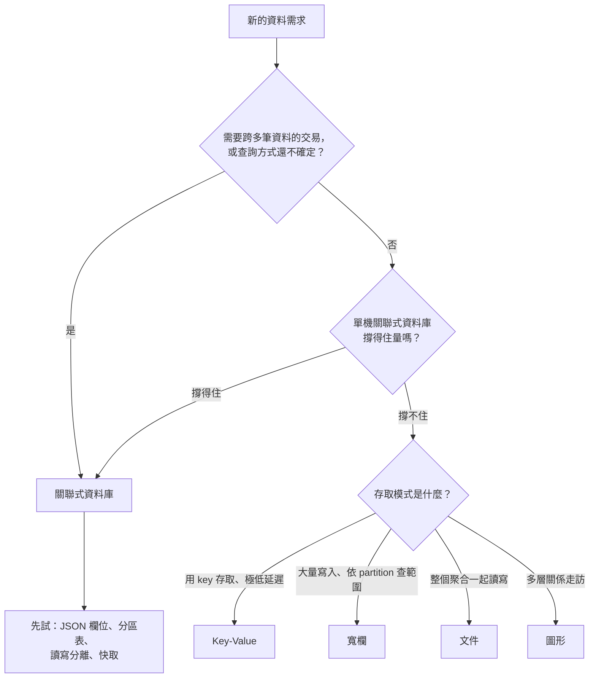

> **System Design 系列** Part 3-1｜上一篇：[CDN 與 HTTP 快取](/post/systemdesign/cdn/)｜下一篇：[Index 與 B+Tree](/post/systemdesign/index-btree/)｜[系列地圖](/post/systemdesign/system-design-thinking/#系列地圖)

## 情境與問題

電商平台要同時上線三個新功能，團隊為資料庫選型吵了起來：

1. **訂單與付款**：一筆訂單要同時扣庫存、建立付款紀錄、使用優惠券，任何一步失敗都要全部回復
2. **商品瀏覽紀錄**：每天約 1 億筆，只會新增，最常見的查詢是「某位會員最近看過的 50 個商品」，保留 90 天
3. **商品屬性**：手機有螢幕尺寸和容量，衣服有尺碼和材質，每個品類的欄位都不一樣，而且營運會持續新增

```diagram
title: 三個新功能，該用哪種資料庫
row: O 訂單與付款 | V 瀏覽紀錄 | A 商品屬性
row: . | DB MySQL | .
step: 訂單與付款
  一筆訂單要同時扣庫存、建立付款紀錄、使用優惠券，任何一步失敗都要全部回復。這正是關聯式資料庫的交易最擅長的事。
O -> DB: 扣庫存＋付款＋優惠券
note O: 一步失敗就全部回復
step: 瀏覽紀錄
  每天約 1 億筆，平均每秒 1,157 筆、尖峰約 5,800 筆，單台 MySQL 批次寫入應付得來。真正的麻煩是每天要刪掉 1 億筆過期資料，DELETE 會產生大量 undo log、鎖和碎片。
V => DB: 每天 1 億筆
note V: 只新增、保留 90 天
note DB: 每天要刪 1 億筆過期資料 [danger]
step: 商品屬性
  手機有螢幕尺寸和容量，衣服有尺碼和材質，營運還會持續新增欄位。傳統的 EAV 表每個屬性一列，查「6 吋以上、256 GB 的手機」要自己 join 自己好幾次。
A -> DB: 每個品類欄位不同
note DB: EAV 要自己 join 自己好幾次 [danger]
step: 團隊吵了起來
  有人說 NoSQL 比較快、全部換 MongoDB，有人說 MySQL 什麼都做得到。三個功能卡住的地方各不相同，問題不在 SQL 或 NoSQL，而在資料的形狀與生命週期。
note O: 要交易
note V: 量大、會過期
note A: 結構一直變
note DB: SQL 還是 NoSQL？
```

有人說「NoSQL 比較快，全部換 MongoDB」，有人說「MySQL 什麼都做得到」。兩邊都只說對了一半。選資料庫要問的不是「SQL 還是 NoSQL」，而是：**資料長什麼樣子、會怎麼被讀寫、需要什麼程度的一致性、量有多大**。

## 最簡單的做法與它的極限

最簡單的做法是三個功能全部放進現有的 MySQL。先估算看看哪裡會撐不住：

- **訂單**：本來就是關聯式資料庫最擅長的事，多筆資料在同一個交易裡全有或全無
- **瀏覽紀錄**：1 億筆 ÷ 86,400 秒 ≈ 平均每秒 1,157 筆，尖峰抓 5 倍約 5,800 筆。InnoDB 每筆資料加上列標頭與交易資訊，大約 50–70 bytes，每天約 5–7 GB，保留 90 天約 0.5 TB。單台 MySQL 用批次寫入可以處理這個量（量級估計，實際要壓測）。真正的麻煩在**刪除**：每天要刪掉 1 億筆過期資料，`DELETE` 會產生大量 undo log、鎖和碎片
- **商品屬性**：傳統做法是 EAV（entity–attribute–value）表，每個屬性一列。查「螢幕 6 吋以上、容量 256 GB 的手機」要自己 join 自己好幾次，又慢又難寫

所以極限不在「MySQL 慢」，而在**資料的形狀和生命週期**。後面會看到，這三個問題在 MySQL 裡都有解，而且比引入新資料庫便宜得多。但先要理解 NoSQL 到底在解決什麼。

## 核心機制

### 五種資料模型

| 類型 | 資料長什麼樣 | 擅長 | 不擅長 | 代表 |
|---|---|---|---|---|
| 關聯式 | 正規化的表，用外鍵關聯 | 任意查詢、join、多筆交易、限制條件 | 自動水平擴展、結構差異大的資料 | MySQL、PostgreSQL |
| Key-Value | key 對應一個值 | 用 key 存取，延遲極低 | 依值查詢、範圍查詢（依產品而定） | Redis、DynamoDB（當 KV 用時） |
| 文件 | 巢狀的 JSON 文件 | 一次讀出整個聚合（一張訂單和它的明細） | 跨文件的關聯與交易 | MongoDB |
| 寬欄 | partition key 決定位置，clustering key 決定排序 | 超大量寫入、依 partition 的範圍查詢 | 任何沒有指定 partition key 的查詢 | Cassandra、HBase |
| 圖形 | 節點與邊 | 多層關係的走訪（朋友的朋友） | 大量聚合計算 | Neo4j |

全文搜尋引擎（Elasticsearch 等）通常不是主要資料庫，而是從主庫同步過去的第二份資料，見 [全文搜尋篇](/post/systemdesign/full-text-search/)。

### 「NoSQL 比較快」是快在哪裡

NoSQL 沒有魔法。它在特定情境下比較快，是因為以下四件事，而且每一件都有代價：

1. **放棄了某些功能**：沒有 join、多筆交易受限、次要索引有限。不做的事當然不花時間
2. **資料模型貼合存取模式**：一份文件包含一整張訂單和明細，用一次讀取拿到，不需要 join 五張表。代價是另一種存取模式（例如「找出所有買過某商品的訂單」）就變得很難
3. **寫入路徑不同**：Cassandra 這類資料庫用 LSM-Tree，寫入是循序追加，特別適合大量寫入。代價是讀取可能要查好幾層檔案（見 [B-Tree vs LSM-Tree 篇](/post/systemdesign/btree-vs-lsm/)）
4. **內建分片**：資料依 partition key 自動分散到多台機器。代價是跨 partition 的查詢與交易很貴，甚至做不到

反過來說，關聯式資料庫用主鍵查一筆資料，通常也在 1 ms 以內。如果你的查詢本來就是「用 ID 拿一筆」，換資料庫並不會更快。

### 先想查詢，還是先想資料

這是兩種陣營最根本的差異：



以瀏覽紀錄為例，若要支援兩個查詢：

| 查詢 | 關聯式（一張表） | 寬欄（每個查詢一張表） |
|---|---|---|
| 某會員最近看過的商品 | 主鍵 `(member_id, viewed_at)` | 表 A：partition key `member_id`，依 `viewed_at` 排序 |
| 某商品今天被多少人看過 | 次要索引 `(product_id, viewed_at)` | 表 B：partition key `(product_id, 日期)` |
| 下個月新增的第三種查詢 | 加一個索引 | 新增表 C，並**回填所有歷史資料** |

在寬欄資料庫裡，每多一種查詢就要多一份資料，寫入時也要同時寫好幾份。如果需求還在變動，這個代價很高。這就是為什麼**需求不確定時，關聯式資料庫的查詢彈性本身就是價值**。

### Schema 不會消失，只會搬家

「NoSQL 不需要 schema」是常見的誤解。資料一定有結構，差別只在結構由誰檢查：

- **Schema-on-write**（關聯式）：寫入時由資料庫檢查，不符合就拒絕。改結構要做 migration
- **Schema-on-read**（文件資料庫）：寫入時什麼都收，讀取時由程式碼解讀。改結構不必停機，但程式碼必須同時看得懂新舊兩種格式，直到所有舊文件都轉換完

後者把 migration 的負擔從資料庫搬到了應用程式，而且這個負擔通常是隱形的：五年後，程式裡會有一段 `if (doc.version == 1) ... else if (doc.version == 2) ...`，沒有人敢刪。

### 交易與一致性的範圍

| | 單筆資料的原子性 | 多筆資料的交易 | 讀到最新資料 |
|---|---|---|---|
| MySQL、PostgreSQL | 有 | 有，任意多筆 | 主庫預設是；讀 replica 則有延遲 |
| MongoDB | 單一文件 | 4.0 起支援副本集內的多文件交易，4.2 起支援分片叢集 | 依 read concern 設定 |
| DynamoDB | 單一 item | `TransactWriteItems`，一次最多 100 個操作 | 預設最終一致，可指定強一致讀取（成本加倍） |
| Cassandra | 單一 partition 內 | 沒有通用交易；輕量交易（Paxos）只做單一 partition 的比較後設定 | 依每次請求指定的一致性等級 |

注意 NoSQL 的交易能力這幾年進步很多，「NoSQL 沒有交易」已經不正確。但跨分片的交易永遠比單機貴，這是物理限制，不是產品問題。分散式 SQL（Spanner、CockroachDB、TiDB）提供跨分片交易，代價是每次寫入要多一輪跨節點的協調延遲。一致性的取捨見 [CAP 與 PACELC 篇](/post/systemdesign/cap-pacelc/)。

### 決策流程



最常被跳過的是中間那一步：**單機關聯式資料庫撐不撐得住**，要用 [Napkin Math](/post/systemdesign/napkin-math/) 算，而不是憑感覺。

## 方案比較

回到情境裡的三個功能：

| 功能 | 選擇 | 理由 | 重新評估的時機 |
|---|---|---|---|
| 訂單與付款 | MySQL | 需要多表交易與限制條件，查詢方式多（客服、報表、對帳） | 單一主庫的寫入撐不住時，先考慮依會員分片（見 [Sharding 篇](/post/systemdesign/sharding/)） |
| 瀏覽紀錄 | MySQL 分區表 | 每秒數千筆在單機能力內；依日期分區後，過期資料用 `DROP PARTITION` 瞬間刪除 | 量成長 10 倍（尖峰每秒約 6 萬筆），或需要跨機房寫入時，改用寬欄資料庫 |
| 商品屬性 | MySQL JSON 欄位 | 結構差異大，但查詢模式固定；常查的屬性用 functional index | 需要全文搜尋或多條件的模糊篩選時，同步一份到搜尋引擎 |

多種資料庫並存（polyglot persistence）沒有錯，但每多一種資料庫，就多一套：備份與還原、監控與告警、版本升級、on-call 的專業知識、跟其他資料庫之間的同步與對帳。對小團隊來說，這些維運成本往往比效能差異更重要。

## Java 落地

### 1. 商品屬性：JSON 欄位加 functional index

```sql
CREATE TABLE product (
    id         BIGINT       NOT NULL PRIMARY KEY,
    category   VARCHAR(16)  NOT NULL,
    name       VARCHAR(200) NOT NULL,
    attributes JSON         NOT NULL,
    -- functional index（MySQL 8.0.13+）：可以和一般欄位組成複合索引
    INDEX idx_phone_screen (category, (CAST(attributes->>'$.screenInch' AS DECIMAL(3,1))))
);
```

```sql
SELECT id, name
FROM product
WHERE category = 'PHONE'
  AND CAST(attributes->>'$.screenInch' AS DECIMAL(3,1)) >= 6.5;
```

functional index 在 MySQL 內部是一個隱藏的 generated column，再對它建索引。**查詢裡的運算式必須和建索引時一模一樣**，少一個 `CAST` 或換一種寫法，索引就用不到，記得用 `EXPLAIN` 確認。JSON 陣列（例如標籤）則可以用 multi-valued index（MySQL 8.0.17+，寫法是 `CAST(... AS CHAR(32) ARRAY)`）。

JPA 端用 Hibernate 6 的 JSON 對應：

```java
@Entity
public class Product {

    @Id
    private Long id;

    @Enumerated(EnumType.STRING)
    @Column(nullable = false)
    private ProductCategory category;

    @Column(nullable = false)
    private String name;

    @JdbcTypeCode(SqlTypes.JSON)
    @Column(nullable = false)
    private Map<String, String> attributes = new HashMap<>();   // 值一律存字串，型別在索引那層 CAST

    protected Product() {
    }

    public Product(Long id, ProductCategory category, String name) {
        this.id = id;
        this.category = category;
        this.name = name;
    }

    public void replaceAttributes(Map<String, String> requested) {
        Set<String> unknown = new HashSet<>(requested.keySet());
        unknown.removeAll(category.allowedAttributes());
        if (!unknown.isEmpty()) {
            throw new IllegalArgumentException("此品類不允許的屬性：" + unknown);   // 白名單，擋住任意欄位寫入
        }
        this.attributes = new HashMap<>(requested);
    }
}
```

```java
public enum ProductCategory {

    PHONE(Set.of("screenInch", "storageGb", "color")),
    APPAREL(Set.of("size", "color", "material"));

    private final Set<String> allowedAttributes;

    ProductCategory(Set<String> allowedAttributes) {
        this.allowedAttributes = allowedAttributes;
    }

    public Set<String> allowedAttributes() {
        return allowedAttributes;
    }
}
```

`@JdbcTypeCode(SqlTypes.JSON)` 要標在屬性上。屬性值刻意用 `Map<String, String>`，原因和 [Session 篇](/post/systemdesign/scaling-stateless/)遇到的問題一樣：`Map<String, Object>` 經過 JSON 來回一趟，數字的型別會被猜錯。品類對應的允許屬性放在 enum 裡（enum 的對應方式見 [JPA Enum 篇](/post/database/jpa-enum-mapping/)），這就是把「schema」從資料庫搬回應用程式的具體樣子：結構仍然存在，只是改由程式碼檢查。

### 2. 瀏覽紀錄：依日期分區

```sql
CREATE TABLE product_view_event (
    member_id  BIGINT      NOT NULL,
    viewed_at  DATETIME(3) NOT NULL,
    product_id BIGINT      NOT NULL,
    PRIMARY KEY (member_id, viewed_at, product_id)   -- 分區欄位必須包含在每一個 unique key 裡
)
PARTITION BY RANGE COLUMNS (viewed_at) (
    PARTITION p20261122 VALUES LESS THAN ('2026-11-23'),
    PARTITION p20261123 VALUES LESS THAN ('2026-11-24')
);
```

```sql
-- 刪除一整天的資料：只是丟掉一個分區檔案，幾乎瞬間完成
ALTER TABLE product_view_event DROP PARTITION p20260824;
```

主鍵用 `(member_id, viewed_at)` 開頭，「某會員最近看過的商品」就是一次索引範圍掃描。但要注意：查詢條件**沒有帶 `viewed_at`** 時，MySQL 無法判斷資料在哪個分區，只能 90 個分區逐一查。所以查詢要加上時間範圍，讓 MySQL 只看最近幾個分區（partition pruning）：

```sql
SELECT product_id, viewed_at
FROM product_view_event
WHERE member_id = ?
  AND viewed_at >= NOW() - INTERVAL 7 DAY
ORDER BY viewed_at DESC
LIMIT 50;
```

分區要每天預先建立、過期刪除，交給排程處理（ShedLock 的用法見 [無狀態服務篇](/post/systemdesign/scaling-stateless/)）：

```java
@Component
public class ViewEventPartitionJob {

    private static final ZoneId TAIPEI = ZoneId.of("Asia/Taipei");
    private static final DateTimeFormatter DAY = DateTimeFormatter.BASIC_ISO_DATE;   // 20261122
    private static final int DAYS_AHEAD = 7;
    private static final int RETENTION_DAYS = 90;

    private final JdbcTemplate jdbc;

    public ViewEventPartitionJob(JdbcTemplate jdbc) {
        this.jdbc = jdbc;
    }

    @Scheduled(cron = "0 30 2 * * *", zone = "Asia/Taipei")
    @SchedulerLock(name = "view-event-partitions", lockAtMostFor = "10m")
    public void maintain() {
        LocalDate today = LocalDate.now(TAIPEI);
        Set<String> existing = new HashSet<>(jdbc.queryForList("""
                SELECT partition_name FROM information_schema.partitions
                WHERE table_schema = DATABASE() AND table_name = 'product_view_event'
                """, String.class));

        for (int i = 0; i <= DAYS_AHEAD; i++) {                     // 預先建好未來 7 天
            LocalDate day = today.plusDays(i);
            String name = "p" + day.format(DAY);
            if (!existing.contains(name)) {
                jdbc.execute("ALTER TABLE product_view_event ADD PARTITION (PARTITION %s VALUES LESS THAN ('%s'))"
                        .formatted(name, day.plusDays(1)));
            }
        }

        LocalDate cutoff = today.minusDays(RETENTION_DAYS);
        for (String name : existing) {                              // 超過保留期限的整個分區直接丟掉
            if (LocalDate.parse(name.substring(1), DAY).isBefore(cutoff)) {
                jdbc.execute("ALTER TABLE product_view_event DROP PARTITION " + name);
            }
        }
    }
}
```

為什麼預先建 7 天？因為**沒有對應分區的資料寫不進去**：如果排程連續失敗到分區用完，所有寫入都會收到 `Table has no partition for value ...` 錯誤。預留幾天的緩衝，再對「最新分區的日期」設告警。DDL 裡的分區名稱和日期全部由程式產生，沒有任何外部輸入，所以可以用字串組 SQL；只要有使用者輸入參與，就絕對不能這樣做。

寫入端用 JDBC 批次，MySQL Connector/J 要加上 `rewriteBatchedStatements=true`，驅動程式才會把一批 `INSERT` 改寫成一條多列的 `INSERT`，否則批次仍然是一筆一筆送。

## 踩坑與 Gotchas

- **「NoSQL 比較快」**：快是因為放棄了功能並貼合特定存取模式。查詢模式一變，優勢就消失
- **把 MongoDB 當成沒有 schema**：schema 搬到了程式碼裡，而且沒有人維護文件
- **寬欄資料庫用了沒帶 partition key 的查詢**：Cassandra 的 `ALLOW FILTERING` 會掃描整個叢集，開發環境資料少看不出來，上線後就逾時
- **Partition key 選得不好**：用「日期」當 partition key，當天所有寫入都打到同一個分區，形成熱點。DynamoDB 單一分區的吞吐量有上限，熱門 key 會被限流
- **文件無限長大**：把留言、紀錄一直往同一份文件塞，最後撞到大小上限（MongoDB 單一文件 16 MB），而且每次更新都要重寫整份文件
- **EAV 表**：看似彈性，查詢時要 join 自己好幾次，也無法用限制條件保證資料正確。MySQL 5.7 之後通常改用 JSON 欄位
- **分區表的查詢沒帶分區欄位**：每個分區都查一次，比不分區還慢
- **分區用完沒告警**：所有寫入突然全部失敗
- **為了一個功能引入新資料庫**：效能沒差多少，維運成本卻翻倍

### 資安相關

- **NoSQL 也有注入**：把 client 送來的 JSON 物件直接當成查詢條件，攻擊者送 `{"password": {"$ne": null}}` 這類運算子，條件就變成「密碼不是 null」，形同不用密碼。查詢參數一律綁定成明確的型別（字串、數字），不要把請求裡的物件原封不動丟進查詢
- **彈性欄位等於彈性攻擊面**：JSON 欄位或文件資料庫如果照單全收 client 送來的欄位，攻擊者就能寫入 `verified: true` 這類不該由使用者決定的屬性。這屬於 OWASP API Security Top 10 2023 的 API3（Broken Object Property Level Authorization），上面 `replaceAttributes` 的白名單就是為此而設
- **預設不設防的部署**：2017 年起，數萬個沒有設定驗證、直接暴露在網路上的 MongoDB 被清空資料勒索。Elasticsearch、Redis 也發生過同類事件。任何資料庫都要放內網、開驗證
- **多一種資料庫，就多一份個資**：同一筆個資可能同時存在主庫、搜尋引擎、快取和分析資料庫。使用者要求刪除時，每一份都要刪；資安稽核時，每一份都要有加密與存取控制

## 何時用／何時別用

- **預設選關聯式資料庫**：需求還在變、需要交易、查詢方式多樣，或團隊對它最熟。MySQL 和 PostgreSQL 加上 JSON 欄位、分區表、讀寫分離、快取，能撐住的規模遠超過多數人的預期
- **改用 NoSQL 的訊號**：存取模式固定而且單純（幾乎都用 key 存取）、寫入量明確超出單機能力、需要多個地區同時寫入、資料天生就是一棵獨立的樹或一張圖
- **重新評估的時機**：分區表的單機寫入接近壓測上限；JSON 欄位的查詢越來越複雜，functional index 越加越多；同一份資料開始需要好幾種完全不同的查詢方式（這時可能需要的是 CQRS 加上專用的讀取資料庫，見 [CQRS 篇](/post/architecture/cqrs/)）

## 參考資料

- Martin Kleppmann，《Designing Data-Intensive Applications》，O'Reilly，2017：第 2 章 Data Models and Query Languages
- Giuseppe DeCandia et al., "Dynamo: Amazon's Highly Available Key-value Store", SOSP 2007
- Fay Chang et al., "Bigtable: A Distributed Storage System for Structured Data", OSDI 2006
- Avinash Lakshman, Prashant Malik, "Cassandra: A Decentralized Structured Storage System", *ACM SIGOPS Operating Systems Review*, 2010
- MySQL Reference Manual — The JSON Data Type、Functional Key Parts、Multi-Valued Indexes：<https://dev.mysql.com/doc/refman/8.0/en/json.html>
- MySQL Reference Manual — Partitioning Keys, Primary Keys, and Unique Keys：<https://dev.mysql.com/doc/refman/8.0/en/partitioning-limitations-partitioning-keys-unique-keys.html>
- Hibernate ORM User Guide — JSON mapping：<https://docs.jboss.org/hibernate/orm/6.6/userguide/html_single/Hibernate_User_Guide.html>
- Amazon DynamoDB Developer Guide — Transactions：<https://docs.aws.amazon.com/amazondynamodb/latest/developerguide/transactions.html>
- MongoDB Manual — Transactions：<https://www.mongodb.com/docs/manual/core/transactions/>
- OWASP API Security Top 10 2023 — API3 Broken Object Property Level Authorization：<https://owasp.org/API-Security/editions/2023/en/0xa3-broken-object-property-level-authorization/>
- 互動圖解延伸：Dilum Sanjaya，System Design — an interactive course：<https://designed-to-scale.vercel.app/>
