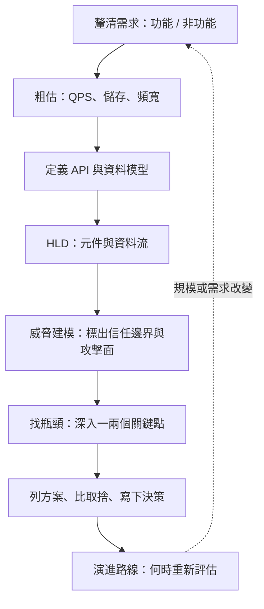

> **System Design 系列** Part 0（導讀）｜下一篇：[一個 HTTP Request 的旅程](/post/systemdesign/request-lifecycle/)

## 系列地圖

這個系列從「一台機器」一路談到「分散式系統」，每一篇都用同一個結構：

1. **情境與問題**：先講一個具體場景，不從名詞開始
2. **最簡單的做法與它的極限**：先找出能用的最簡單方案，再看它在哪裡撐不住
3. **核心機制**：用 mermaid 圖說明原理
4. **方案比較**：每個方案犧牲什麼、換到什麼
5. **Java 落地**：Spring Boot、MySQL、Redis 的實作
6. **踩坑與 Gotchas**：有資安面向時，另列「資安相關」
7. **何時用／何時別用**：包含「什麼條件下要重新評估」
8. **參考資料**

| Part | 主題 | 文章 |
|---|---|---|
| 0 導讀 | 系統設計怎麼想 | 本篇 |
| 1 量測基礎 | 先學會量、會估，才知道瓶頸在哪 | [一個 HTTP Request 的旅程](/post/systemdesign/request-lifecycle/)、[Latency、Throughput 與 p99](/post/systemdesign/latency-throughput/)、[Napkin Math 容量估算](/post/systemdesign/napkin-math/) |
| 2 單機到多機 | 一台不夠時的第一步 | [垂直擴展、水平擴展與無狀態服務](/post/systemdesign/scaling-stateless/)、[Load Balancing 深入](/post/systemdesign/load-balancing/)、[Cache 深入](/post/systemdesign/caching/)、[CDN 與 HTTP 快取](/post/systemdesign/cdn/) |
| 3 儲存基礎 | 資料怎麼存、怎麼找 | [SQL vs NoSQL](/post/systemdesign/sql-vs-nosql/)、[Index 與 B+Tree](/post/systemdesign/index-btree/)、[B-Tree vs LSM-Tree](/post/systemdesign/btree-vs-lsm/)、[交易與隔離等級](/post/systemdesign/transaction-isolation/)、[檔案與物件儲存](/post/systemdesign/object-storage/)、[Bloom Filter 與 HyperLogLog](/post/systemdesign/bloom-filter-hyperloglog/)、[全文搜尋與倒排索引](/post/systemdesign/full-text-search/)、[Geohash 與地理索引](/post/systemdesign/geohash/) |
| 4 分散式資料 | 一台資料庫裝不下、扛不住之後 | [Replication 與 Replication Lag](/post/systemdesign/replication-lag/)、[Sharding](/post/systemdesign/sharding/)、[Consistent Hashing](/post/systemdesign/consistent-hashing/)、[分散式 ID](/post/systemdesign/distributed-id/)、[CAP 與 PACELC](/post/systemdesign/cap-pacelc/)、[共識與 Raft](/post/systemdesign/consensus-raft/)、[分散式鎖與 Fencing Token](/post/systemdesign/distributed-lock/) |
| 5 服務通訊 | 服務之間怎麼說話 | [REST、gRPC 與 GraphQL](/post/systemdesign/rest-grpc-graphql/)、[Message Queue](/post/systemdesign/message-queue/)、[Pub/Sub 與投遞語意](/post/systemdesign/pubsub-delivery-semantics/)、[冪等性與 Idempotency Key](/post/systemdesign/idempotency-key/)、[即時更新](/post/systemdesign/realtime-updates/) |
| 6 可靠性 | 壞掉時怎麼辦 | [備援、故障轉移與 DR](/post/systemdesign/redundancy-failover-dr/)、[Timeout/Retry/Backoff 與 Jitter](/post/systemdesign/timeout-retry-backoff/)、[Circuit Breaker 與 Bulkhead](/post/systemdesign/circuit-breaker-bulkhead/)、[Rate Limiting](/post/systemdesign/rate-limiting/)、[Observability](/post/systemdesign/observability/) |
| 7 架構演進 | 系統和團隊一起長大 | [單體 vs 微服務](/post/systemdesign/monolith-vs-microservices/)、[Service Discovery](/post/systemdesign/service-discovery/)、[Saga 與 Outbox](/post/systemdesign/saga-outbox/)、[Batch 與 Stream](/post/systemdesign/batch-vs-stream/) |
| 8 安全 | 從系統設計角度看安全 | [身分驗證：Session、Token 與 OAuth 2.0／OIDC](/post/systemdesign/authentication-session-token-oidc/)、[授權模型與 OWASP API Top 10](/post/systemdesign/authorization-owasp-api-top10/)、[BOLA 穿過 BFF 之後：微服務的身分傳遞](/post/systemdesign/identity-propagation/)、[傳輸與資料加密及 Secrets 管理](/post/systemdesign/encryption-secrets/)、[濫用防護](/post/systemdesign/abuse-prevention/) |
| 9 實戰題 | 把前面的元件組起來 | URL Shortener、News Feed、聊天系統、秒殺搶票、通知系統、排行榜、分散式排程（撰寫中） |
| 10 交付 | 安全地把變更送上線 | 大規模系統的測試、CI/CD 與部署策略（撰寫中） |

## 情境與問題

公司要辦年度線上講座，名額 3,000 個。行銷預估開放報名當天會有 5 萬人在線上等，開放後的前 30 秒就會湧進約 2.4 萬次報名請求。主管丟下一句：「下週給我一份設計。」

很多人的第一反應是開始畫圖：前面放 Redis 預扣名額、中間接 Kafka 非同步落庫、後面再拆一個報名微服務。圖很漂亮，但這時候其實還不知道下面幾件事：

- 尖峰到底有多高？一台 MySQL 撐不撐得住？
- 「不能超賣」和「回應要快」衝突時，哪個優先？
- 多出來的 Redis、Kafka，故障時誰負責對帳？

系統設計的核心不是背架構圖，而是**在限制條件下做取捨，並把理由講清楚**。工具是最後一步才選的。

## 最簡單的做法與它的極限

先從最簡單、能動的版本開始：一台 Spring Boot 加一台 MySQL，報名就是一筆 `INSERT` 加一個條件式 `UPDATE`：

```sql
UPDATE event SET remaining = remaining - 1
WHERE id = 42 AND remaining > 0;
```

`remaining > 0` 這個條件交給資料庫判斷，影響 0 筆就代表額滿，天生不會超賣。接著用數字找出它的極限：

- 2.4 萬次請求 ÷ 30 秒 ≈ **800 次/秒** 的報名寫入尖峰
- 每一次報名都要更新**同一行** `event`。InnoDB 對同一行的更新必須排隊，一次只有一個交易能持有這行的 row lock，直到 commit 才釋放
- 吞吐量上限 ≈ 1 ÷ 每筆交易持鎖時間：持鎖 1 ms 是 1,000 TPS，持鎖 2 ms 就只剩 500 TPS

800 剛好落在邊緣。這就是估算的價值：不需要猜，它直接告訴你**真正的瓶頸是那一行熱點資料（hot row）**，而不是 CPU、也不是應用伺服器的數量。接下來的設計都繞著這個瓶頸做決定。

## 核心機制：系統設計的思考流程



### 功能需求 vs 非功能需求

| 類型 | 報名系統的例子 | 決定了什麼 |
|---|---|---|
| 功能需求 | 報名、取消、查詢剩餘名額、額滿後候補 | API 與資料模型 |
| 非功能需求 | 尖峰 800 次/秒寫入、**絕不超賣**、p99 < 500 ms、活動當天 99.9% 可用、報名資料保存 1 年、只有本人能查詢與取消自己的報名 | 架構、元件選型、部署方式 |

非功能需求一定要有數字。「要很快」不是需求，「p99 < 500 ms」才是；「要很穩」不是需求，「活動當天可用率 99.9%（約 1.4 分鐘停機額度）」才是。

### HLD 與 LLD 的分工

| | HLD（High-Level Design） | LLD（Low-Level Design） |
|---|---|---|
| 回答的問題 | 有哪些元件、資料怎麼流、怎麼擴展與容錯 | 類別與介面怎麼切、資料表長怎樣、錯誤怎麼處理 |
| 產出 | 架構圖、資料流、容量估算、選型理由 | class diagram、DDL、API 規格、狀態機 |
| 主要讀者 | 團隊、主管、SRE | 實作者、code reviewer |
| 改錯的代價 | 高（資料庫選型、sharding key 幾乎不可逆） | 相對低（重構就能改） |

面試的 system design 通常停在 HLD，再加一兩個 deep dive。實務上兩者互相影響：下一節會看到，LLD 裡「SQL 的執行順序」直接改變了 HLD 的容量上限。

### 輕量的威脅建模

HLD 畫出資料流之後，順著每一條資料流跨過的**信任邊界**（瀏覽器到 API、API 到資料庫、服務到服務），問六個問題。這六個問題的英文首字母合起來是 STRIDE：

| 威脅 | 要問的問題 | 報名系統的例子 | 對策（系列中的位置） |
|---|---|---|---|
| Spoofing 冒充 | 誰能假裝成別人？ | 盜用帳號替別人報名 | 身分驗證（[Part 8](/post/systemdesign/authentication-session-token-oidc/)） |
| Tampering 竄改 | 誰能改掉傳輸中或儲存的資料？ | 把請求裡的 memberId 改成別人的，幫他取消報名 | 身分只從驗證過的 token 取，不信任請求參數（[Part 8](/post/systemdesign/authorization-owasp-api-top10/)） |
| Repudiation 否認 | 事後能證明誰做了什麼嗎？ | 使用者堅稱自己沒有取消 | 稽核紀錄（[Part 6](/post/systemdesign/observability/)） |
| Information disclosure 洩漏 | 誰能看到不該看的資料？ | 用遞增的報名編號，逐一查出別人的報名資料 | 物件層授權（[Part 8](/post/systemdesign/authorization-owasp-api-top10/)） |
| Denial of service 阻斷 | 誰能讓服務對別人不可用？ | 機器人在開放瞬間搶光名額 | 限流、驗證碼（[Part 6](/post/systemdesign/rate-limiting/)、[Part 8](/post/systemdesign/abuse-prevention/)） |
| Elevation of privilege 提權 | 誰能做超出權限的事？ | 一般會員呼叫管理員的「匯出名單」API | 功能層授權（[Part 8](/post/systemdesign/authorization-owasp-api-top10/)） |

不需要一開始就寫成完整報告。目的是在架構還容易改的時候，把「誰可以碰什麼資料」列成需求，而不是上線後才補。

## 方案比較：Trade-off 框架

每個架構決策都用同一個框架逼自己講清楚：

1. **至少列兩個方案**，包含「維持現狀／最簡單方案」
2. 每個方案回答：**犧牲什麼、換到什麼**。講不出犧牲的方案，代表還沒想清楚
3. 排序依據：**正確性 > 可維護性 > 效能**，除非有數據證明效能就是當下的瓶頸
4. 寫下**觸發重新評估的條件**，給半年後的自己和新同事留線索

套用到報名系統的名額扣減：

| 方案 | 做法 | 換到 | 犧牲 | 重新評估條件 |
|---|---|---|---|---|
| A. 條件式 UPDATE | 單一 SQL 扣名額，搭配本機「已額滿」旗標提前拒絕 | 最簡單、強一致、維運零成本 | 熱點 row 的寫入上限受持鎖時間限制 | 壓測 p99 > 500 ms |
| B. 名額分桶 | 名額拆成 N 行，每次隨機挑一行扣 | 鎖競爭降為約 1/N，仍在 MySQL 交易內 | 查總名額要加總；尾端名額分佈不均時要重試 | 尾端重試率過高 |
| C. Redis 預扣 + 非同步落庫 | Lua script 原子扣減，再經 MQ 寫回 MySQL | 每秒數萬次扣減 | 多兩套元件；Redis 與 DB 不一致時要對帳與補償 | 單場名額或流量到秒殺等級 |
| D. 排隊等候室 | 前端先進佇列，依序放行 | 後端負載完全可控 | 使用者要等，實作與體驗設計成本高 | 流量遠超後端能力時 |

3,000 個名額、800 次/秒的尖峰，**先選 A**，壓測不過再換 B。C 和 D 留給更大的規模。這個結論不是「A 最好」，而是「A 在這個規模下夠用，而且我們知道它什麼時候會不夠用」。

## Java 落地：從 HLD 走到 LLD

### 資料表

```sql
CREATE TABLE event (
    id        BIGINT PRIMARY KEY,
    title     VARCHAR(200) NOT NULL,
    capacity  INT NOT NULL,
    remaining INT NOT NULL,
    CHECK (remaining >= 0)
);

CREATE TABLE registration (
    id         BIGINT AUTO_INCREMENT PRIMARY KEY,
    event_id   BIGINT NOT NULL,
    member_id  BIGINT NOT NULL,
    created_at DATETIME(3) NOT NULL DEFAULT CURRENT_TIMESTAMP(3),
    UNIQUE KEY uk_event_member (event_id, member_id)
);
```

`uk_event_member` 讓資料庫擋掉重複報名；`CHECK` 從 MySQL 8.0.16 起才會真正執行，是最後一道防線。

### 報名服務

```java
@Service
public class RegistrationService {

    private final JdbcClient jdbcClient;
    private final SoldOutFlag soldOutFlag;

    public RegistrationService(JdbcClient jdbcClient, SoldOutFlag soldOutFlag) {
        this.jdbcClient = jdbcClient;
        this.soldOutFlag = soldOutFlag;
    }

    @Transactional
    public void register(long eventId, long memberId) {
        if (soldOutFlag.isSoldOut(eventId)) {
            throw new SoldOutException(eventId);       // 額滿後的請求不碰資料庫
        }

        try {
            jdbcClient.sql("INSERT INTO registration (event_id, member_id) VALUES (:eventId, :memberId)")
                    .param("eventId", eventId)
                    .param("memberId", memberId)
                    .update();
        } catch (DuplicateKeyException e) {
            throw new AlreadyRegisteredException(eventId, memberId);
        }

        // 熱點 row 放在交易的最後一步更新：持鎖時間只剩 UPDATE + commit
        int updated = jdbcClient.sql("""
                UPDATE event SET remaining = remaining - 1
                WHERE id = :eventId AND remaining > 0
                """)
                .param("eventId", eventId)
                .update();

        if (updated == 0) {
            soldOutFlag.markSoldOut(eventId);
            throw new SoldOutException(eventId);       // RuntimeException → 回滾上面的 INSERT
        }
    }
}
```

```java
@Component
public class SoldOutFlag {

    private static final long TTL_MILLIS = 30_000;
    private final Map<Long, Long> soldOutUntil = new ConcurrentHashMap<>();

    public boolean isSoldOut(long eventId) {
        Long until = soldOutUntil.get(eventId);
        return until != null && until > System.currentTimeMillis();
    }

    public void markSoldOut(long eventId) {
        soldOutUntil.put(eventId, System.currentTimeMillis() + TTL_MILLIS);
    }
}
```

這段程式裡有三個 LLD 決策，每一個都會影響 HLD：

- **先 INSERT 再 UPDATE**：如果反過來，熱點 row 的鎖要一路持有到 INSERT 完成才釋放，持鎖時間變長，吞吐量上限直接下降。SQL 的順序就是容量
- **用例外表達失敗**：`SoldOutException`、`AlreadyRegisteredException` 都是 `RuntimeException`，丟出時 `@Transactional` 會回滾整筆交易。如果改成「catch 住後回傳錯誤碼」，前面已經執行的 SQL 會被 commit，名額就被白白扣掉
- **旗標只是最佳化，正確性在資料庫**：`SoldOutFlag` 是每台機器各自的記憶體，各台不同步也沒關係，因為就算旗標誤判，SQL 的 `remaining > 0` 仍然會擋住超賣。TTL 30 秒是為了讓有人取消報名、名額釋出後，旗標能自動失效

### 把決策寫成 ADR

```markdown
# ADR-007：報名名額扣減採用 MySQL 條件式 UPDATE

- Status: Accepted
- Date: 2026-11-22

## Context
開放報名後 30 秒內預估 2.4 萬次請求（約 800 次/秒），名額 3,000，不可超賣。
瓶頸是 event 表的單一熱點 row。

## Decision
名額扣減使用單一條件式 UPDATE，放在交易最後一步；
搭配本機「已額滿」旗標（TTL 30 秒），額滿後直接拒絕。

## Alternatives considered
- 名額分桶：鎖競爭較低，但查總數與尾端重試變複雜，目前規模不需要
- Redis 預扣 + 非同步落庫：吞吐最高，但需要對帳與故障補償機制

## Consequences
- 熱點 row 寫入上限取決於持鎖時間，交易內禁止加入非必要操作
- 重新評估條件：壓測 p99 > 500 ms，或單場名額超過 2 萬
```

## 踩坑與 Gotchas

- **先選工具再找問題**：還沒估算就決定上 Kafka、Redis、微服務，結果多了三套要維運的元件，瓶頸卻在一行 SQL
- **只講 happy path**：使用者連點兩次、網路逾時後重送、資料庫主從切換的那幾秒怎麼辦？設計文件要回答這些問題
- **非功能需求沒有數字**：沒有數字就無法驗收，也無法判斷方案夠不夠
- **把「最終一致」當成免費**：要說清楚不一致的時間窗口多長、這段時間使用者看到什麼、誰來修正
- **把正確性交給快取或旗標**：快取、本機旗標都可能過期或不同步，只能用來加速，不能用來保證正確
- **沒寫重新評估條件**：半年後流量翻十倍，新同事看到「為什麼只用一行 SQL」會以為當初設計錯了，其實只是條件改變了
- **把 CAP 當成唯一的思考工具**：CAP 只是「分散式一致性」這一類決策的框架，大多數設計決策跟它無關

## 何時用／何時別用

- **需要完整的 HLD 文件**：新系統、跨團隊協作、牽涉金流或資料正確性、做不可逆的選擇（資料庫選型、sharding key、對外 API 格式）
- **一份 ADR 就夠**：單一、可逆的技術決策，例如換一個 HTTP client、調整快取 TTL
- **不需要正式設計**：改壞了可以馬上回退的小改動，直接做、直接量
- **重新評估的時機**：規模變成原本的 10 倍、核心需求改變（例如從「先搶先贏」改成「抽籤」）、團隊規模或組織分工改變

判斷要花多少力氣設計，看的是**決策可不可逆**：可逆的就快速決定、上線後用數據修正；不可逆的才值得多花時間估算和比較。

## 參考資料

- Martin Kleppmann，《Designing Data-Intensive Applications》，O'Reilly，2017：第 1 章 Reliability、Scalability、Maintainability
- Michael Nygard, "Documenting Architecture Decisions", 2011：<https://cognitect.com/blog/2011/11/15/documenting-architecture-decisions>
- Jeff Bezos, 2015 Letter to Shareholders：可逆（two-way door）與不可逆（one-way door）決策
- MySQL 8.0 Reference Manual — InnoDB Locking：<https://dev.mysql.com/doc/refman/8.0/en/innodb-locking.html>
- Spring Framework Reference — JDBC Core Classes（`JdbcClient`）：<https://docs.spring.io/spring-framework/reference/data-access/jdbc/core.html>
- Adam Shostack, *Threat Modeling: Designing for Security*, Wiley, 2014
- OWASP — Threat Modeling Cheat Sheet：<https://cheatsheetseries.owasp.org/cheatsheets/Threat_Modeling_Cheat_Sheet.html>
- 互動圖解延伸：Dilum Sanjaya，System Design — an interactive course：<https://designed-to-scale.vercel.app/>（本系列的主題規劃參考了這份課程，內容皆為本站原創撰寫）
