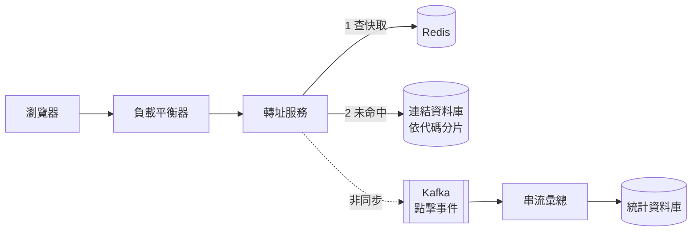

> **System Design 系列** Part 9-1｜上一篇：[濫用防護](/post/systemdesign/abuse-prevention/)｜下一篇：[News Feed](/post/systemdesign/news-feed/)｜[系列地圖](/post/systemdesign/system-design-thinking/#系列地圖)

Part 9 是實戰題：每一題都從需求與估算開始，把前面八個 Part 的元件組起來，並在最後用[系列導讀](/post/systemdesign/system-design-thinking/)的 STRIDE 做一次威脅模型。

## 情境與問題

講座平台要開放短網址功能給講者與企業客戶：分享講座頁面、追蹤不同行銷管道的點擊數。例如 `https://lec.tw/a8Kd2xQ` 導向 `https://lectures.example.com/lectures/42?utm_source=line`。

**功能需求**

- 建立短網址：輸入原始網址，取得短代碼；企業客戶可以自訂代碼（`lec.tw/acme2026`）
- 轉址：開啟短網址，導向原始網址
- 有效期限與停用：活動結束後失效；被檢舉為惡意的連結要能立即停用
- 點擊統計：每條連結每天的點擊數、不重複訪客數、來源

**非功能需求**

- 轉址要快而且穩：短網址印在海報與簡報上，轉址失敗就是整場活動的入口壞了
- 代碼不能重複，一條短網址永遠只對應一個原始網址
- 統計可以延遲幾分鐘，也可以有少量誤差

**規模估算**（[Napkin Math 篇](/post/systemdesign/napkin-math/)的方法）

| 項目 | 估算 |
|---|---|
| 每月新增 | 3,000 萬條 → 平均每秒約 12 次寫入，尖峰估 5 倍約 60 次 |
| 讀寫比 | 100 : 1 → 每月 30 億次轉址，平均每秒約 1,200 次 |
| 轉址尖峰 | 熱門講座在直播中貼出連結，估平均的 10 倍，每秒約 1.2 萬次 |
| 保存 5 年的連結數 | 3,000 萬 × 12 × 5 = 18 億條 |
| 連結的儲存量 | 每條約 500 位元組（網址、擁有者、時間、狀態）→ 約 900 GB |
| 點擊事件 | 每月 30 億筆 × 約 100 位元組 = 每月約 300 GB 的原始事件 |

這是一個**讀遠多於寫、讀取幾乎都是單一鍵查詢**的系統。點擊統計則是另一條寫入量很大的路徑，不能和轉址綁在一起。

## 最簡單的做法與它的極限

一台應用程式加一張 MySQL 表，代碼用自動遞增的 ID 轉成 base62：

```sql
CREATE TABLE short_link (
    id       BIGINT AUTO_INCREMENT PRIMARY KEY,
    long_url VARCHAR(2048) NOT NULL,
    clicks   BIGINT NOT NULL DEFAULT 0
);
-- 轉址時：SELECT long_url ...；UPDATE short_link SET clicks = clicks + 1 WHERE id = ?
```

- **代碼可以被列舉**：遞增的代碼讓任何人都能從 `lec.tw/1` 試到 `lec.tw/9999999`，所有「只給特定人看」的連結（例如未公開的講座錄影）都被找到；代碼的增長速度也洩漏了業務量（[分散式 ID 篇](/post/systemdesign/distributed-id/)）
- **每次點擊都寫入同一列**：熱門連結每秒上萬次 `UPDATE` 同一列，全部在搶同一把列鎖（[交易與隔離等級篇](/post/systemdesign/transaction-isolation/)），轉址的延遲被點擊統計拖垮
- **單一資料庫**：900 GB 的連結表加上每秒上萬次讀取，最後要面對複寫與分片

## 核心機制

### 代碼怎麼產生

| 方式 | 做法 | 優點 | 問題 |
|---|---|---|---|
| 遞增 ID 轉 base62 | 資料庫序號或 Snowflake ID 轉成 base62 | 保證不重複，不需要檢查 | 可列舉（Snowflake 也能大致推測）；Snowflake 轉出來約 11 個字元，偏長 |
| 原始網址的雜湊 | MD5 或 SHA-256 取前 7 個字元 | 同一個網址得到同一個代碼 | 截短後仍可能碰撞，要處理；不同使用者對同一網址會共用代碼與統計 |
| 隨機代碼 | `SecureRandom` 產生 7 個 base62 字元，寫入時檢查唯一 | 不可預測、實作簡單 | 需要處理碰撞 |
| 預先產生的代碼池 | 另一個服務事先產生並分配一批批未使用的代碼 | 寫入時不需要檢查 | 多一個要維運的服務；代碼池的狀態要可靠 |

7 個 base62 字元的空間是 62⁷ ≈ 3.5 兆。即使 5 年後存了 18 億條，一個新的隨機代碼剛好撞上既有代碼的機率約為 18 億 ÷ 3.5 兆 ≈ 0.05%，平均每 2,000 次建立才需要重試一次。所以**隨機代碼加上唯一鍵約束、碰撞時重試**就足夠了。如果用 6 個字元（約 570 億），5 年後的碰撞機率會升到 3% 左右，仍然可行，但沒有省多少長度。

自訂代碼（`acme2026`）和隨機代碼放在同一張表、同一個唯一鍵；自訂代碼要有最小長度與保留字清單（`admin`、`login`、`api`），避免搶走系統路徑或冒充官方。

### 301 還是 302

| 狀態碼 | 瀏覽器的行為 | 適合 |
|---|---|---|
| 301 Moved Permanently | 可以快取轉址結果，之後直接前往原始網址，不再經過你的服務 | 永久不變、不需要統計的連結 |
| 302 Found（或 307） | 每次都回來詢問 | 需要統計、可能修改目的地、可能被停用的連結 |

301 能大幅減少流量，但連結一旦被瀏覽器快取，**停用就無法生效**，惡意連結被檢舉後，曾經點過的人仍然會被直接帶到惡意網站。講座平台的連結需要統計與停用，所以使用 302，並加上 `Cache-Control: no-store`，不讓瀏覽器與中間的快取保存轉址結果。

### 讀取路徑：快取與不存在的代碼



- **快取**：點擊數符合長尾分布，少數熱門連結佔了大部分流量，cache-aside 的命中率很高（[Cache 篇](/post/systemdesign/caching/)）。快取的有效期限設為幾分鐘，連結被停用時主動刪除快取
- **不存在的代碼**：攻擊者大量嘗試隨機代碼，每一個都穿透快取打到資料庫。對「不存在」也做短期的快取，或者用 Bloom filter 先擋掉一定不存在的代碼（[Bloom Filter 篇](/post/systemdesign/bloom-filter-hyperloglog/)）
- **資料庫**：存取模式幾乎都是用代碼查一列，適合依代碼的雜湊分片，或直接使用鍵值資料庫（[SQL vs NoSQL 篇](/post/systemdesign/sql-vs-nosql/)、[Sharding 篇](/post/systemdesign/sharding/)）。900 GB 在一台 MySQL 上仍然放得下，第一版可以先不分片，用 replica 分擔讀取

尖峰每秒 1.2 萬次轉址，快取命中率 95% 時，資料庫每秒只要處理約 600 次查詢，一台 replica 就能承受。

### 點擊統計：不要和轉址綁在一起

每次轉址都同步寫資料庫，會讓轉址的延遲取決於統計的寫入。改成：

1. 轉址服務送出一則點擊事件（代碼、時間、來源、使用者代理的摘要），**不等待**寫入完成
2. 串流處理依代碼與分鐘彙總（[Batch 與 Stream 篇](/post/systemdesign/batch-vs-stream/)），寫入統計表
3. 不重複訪客數用 HyperLogLog 估算，每條連結每天只需要 12 KB，而不是保存每個訪客的 ID

點擊事件允許少量遺失（[Pub/Sub 篇](/post/systemdesign/pubsub-delivery-semantics/)的 at-most-once 是可以接受的選擇）：Kafka 暫時無法寫入時，轉址仍然要成功，只是這幾秒的點擊沒有被統計。**轉址的可用性永遠優先於統計的完整性**。

### 跨區域：剛建立的連結在別的區域找不到

講座平台在台灣與日本各有一個區域，連結資料庫的 primary 在台灣，日本讀取 replica。講者在台灣建立連結，立刻貼到群組裡，日本的使用者點開時，replica 可能還沒收到這筆資料，回應 404（[Replication 篇](/post/systemdesign/replication-lag/)）。

處理方式：replica 查不到時，**回頭查 primary 一次**再決定是否回應 404。真正不存在的代碼很少（除非是攻擊），而攻擊流量已經被負面快取與 Bloom filter 擋掉，所以回頭查 primary 的成本不高。

但被 Bloom filter 判定「一定不存在」的代碼，根本不會走到 replica 與 primary。如果日本區域的 Bloom filter 是非同步更新的，剛建立的代碼會先被它擋下，回到同樣的 404。所以建立連結時，要**同步**把代碼加進每個區域的 Bloom filter，之後才回應建立成功；建立的流量只有每秒數十次，多幾十毫秒的跨區域延遲可以接受。某個區域加入失敗時，那個區域暫停使用 Bloom filter、改為回頭查 primary，直到 filter 重建完成。

### 有效期限與停用

- 讀取時檢查 `expires_at` 與狀態，不依賴背景工作即時刪除
- 背景工作定期把過期很久的連結移到歷史表，讓主要的表保持精簡
- 過期的代碼**不要重新分配**給別人：舊的海報、舊的郵件裡仍然有這個網址，重新分配等於把別人的流量導到新的目的地

## 方案比較

| 決策 | 選擇 | 放棄的替代方案與原因 |
|---|---|---|
| 代碼 | 7 個字元的隨機 base62，唯一鍵加重試 | 遞增 ID：可列舉；雜湊：要處理碰撞且會共用代碼；代碼池：多一個服務 |
| 轉址 | 302，不允許快取 | 301：無法統計與停用 |
| 儲存 | MySQL 加 replica，依代碼查詢；成長後依代碼雜湊分片 | 一開始就用分散式資料庫：900 GB 還不需要 |
| 快取 | Redis cache-aside，加上負面快取 | 在 CDN 快取轉址：統計要改從 CDN 的日誌取得，停用時要清除 CDN；流量再大一個數量級時再考慮 |
| 統計 | 非同步事件 + 串流彙總 + HyperLogLog | 同步寫入：熱點列的鎖競爭拖慢轉址 |

## Java 落地

### 1. 資料表

```sql
CREATE TABLE short_link (
    code        VARCHAR(16) CHARACTER SET ascii COLLATE ascii_bin NOT NULL,   -- 區分大小寫
    long_url    VARCHAR(2048) NOT NULL,
    owner_id    BIGINT       NOT NULL,
    status      VARCHAR(10)  NOT NULL DEFAULT 'ACTIVE',                       -- ACTIVE、DISABLED
    expires_at  TIMESTAMP(3) NULL,
    created_at  TIMESTAMP(3) NOT NULL DEFAULT CURRENT_TIMESTAMP(3),
    PRIMARY KEY (code),
    KEY idx_owner (owner_id, created_at)
);
```

`ascii_bin` 是關鍵：MySQL 預設的 collation 不區分大小寫，`a8Kd2xQ` 與 `A8KD2XQ` 會被視為同一個值，base62 的空間直接少了一大半，而且會出現「建立時說重複、查詢時查到別人的連結」的錯誤。

### 2. 建立短網址

```java
@Service
public class ShortLinkService {

    private static final char[] BASE62 = "0123456789ABCDEFGHIJKLMNOPQRSTUVWXYZabcdefghijklmnopqrstuvwxyz".toCharArray();
    private static final int CODE_LENGTH = 7;
    private static final int MAX_ATTEMPTS = 3;

    private final JdbcClient jdbc;
    private final LinkTargetValidator validator;
    private final SecureRandom random = new SecureRandom();

    public ShortLinkService(JdbcClient jdbc, LinkTargetValidator validator) {
        this.jdbc = jdbc;
        this.validator = validator;
    }

    public String create(long ownerId, String longUrl, Instant expiresAt) {
        URI target = validator.validate(longUrl);           // 協定、長度、惡意網址檢查，見威脅模型
        for (int attempt = 1; attempt <= MAX_ATTEMPTS; attempt++) {
            String code = randomCode();
            try {
                jdbc.sql("""
                                INSERT INTO short_link (code, long_url, owner_id, expires_at)
                                VALUES (:code, :url, :owner, :expiresAt)
                                """)
                        .param("code", code)
                        .param("url", target.toString())
                        .param("owner", ownerId)
                        .param("expiresAt", expiresAt == null ? null : Timestamp.from(expiresAt))
                        .update();
                return code;
            } catch (DuplicateKeyException e) {
                // 機率約 0.05%，換一個代碼重試
            }
        }
        throw new IllegalStateException("連續 " + MAX_ATTEMPTS + " 次代碼碰撞，檢查代碼空間是否接近飽和");
    }

    private String randomCode() {
        char[] code = new char[CODE_LENGTH];
        for (int i = 0; i < CODE_LENGTH; i++) {
            code[i] = BASE62[random.nextInt(BASE62.length)];
        }
        return new String(code);
    }
}
```

連續三次碰撞在正常情況下幾乎不可能發生（0.05% 的三次方），真的發生時代表代碼空間快滿了，或者隨機數產生器有問題，應該告警而不是無限重試。

### 3. 轉址

```java
@RestController
public class RedirectController {

    private static final Pattern CODE = Pattern.compile("^[0-9A-Za-z]{4,16}$");

    private final LinkResolver resolver;
    private final ClickEventPublisher clicks;

    public RedirectController(LinkResolver resolver, ClickEventPublisher clicks) {
        this.resolver = resolver;
        this.clicks = clicks;
    }

    @GetMapping("/{code}")
    public ResponseEntity<Void> redirect(@PathVariable String code, HttpServletRequest request) {
        if (!CODE.matcher(code).matches()) {
            return ResponseEntity.notFound().build();         // 格式不對的直接拒絕，不查快取與資料庫
        }
        return resolver.resolve(code)                           // 快取 → replica → primary，包含負面快取
                .filter(link -> link.isActiveAt(Instant.now()))
                .map(link -> {
                    clicks.publish(code, request);              // 非同步，失敗也不影響轉址
                    return ResponseEntity.status(HttpStatus.FOUND)
                            .location(link.target())
                            .header(HttpHeaders.CACHE_CONTROL, "no-store")
                            .header("Referrer-Policy", "no-referrer")
                            .<Void>build();
                })
                .orElseGet(() -> ResponseEntity.notFound().build());
    }
}
```

```java
@Component
public class ClickEventPublisher {

    private final KafkaTemplate<String, ClickEvent> kafka;

    public ClickEventPublisher(KafkaTemplate<String, ClickEvent> kafka) {
        this.kafka = kafka;
    }

    public void publish(String code, HttpServletRequest request) {
        ClickEvent event = ClickEvent.from(code, request);       // 只保留統計需要的欄位，不存完整 IP
        try {
            kafka.send("link-clicks", code, event);             // 不等待結果
        } catch (RuntimeException e) {
            // 例如本機緩衝區已滿：放棄這筆統計，轉址照常
        }
    }
}
```

- 點擊事件的生產者使用較小的 `max.block.ms`，broker 無法連線時快速失敗，不要讓轉址的執行緒卡在 `send()` 等待中繼資料
- `Referrer-Policy: no-referrer` 避免把短網址本身（可能是未公開的連結）透過 `Referer` 洩漏給目的網站

> 以上程式碼依 Spring Boot 4.1 與 Spring for Apache Kafka 官方文件撰寫，沒有實際編譯與執行。`LinkResolver`、`LinkTargetValidator` 是示意的元件。

## 踩坑與 Gotchas

- **代碼欄位的 collation 不區分大小寫**：前面說明過，這是最容易被忽略的錯誤
- **用 301 之後才想到要統計或停用**：已經被快取的轉址收不回來
- **點擊統計同步寫入同一列**：熱門連結的轉址延遲跟著統計一起變慢
- **重新分配過期的代碼**：舊的網址被導到新的目的地
- **轉址到自己**：短網址指向另一個短網址，或者指向自己，形成迴圈。建立時拒絕以自己的網域為目的地
- **原始網址的正規化**：同一個網址的大小寫、尾端斜線、參數順序不同，如果要「相同網址共用代碼」，要先決定正規化的規則；講座平台不共用，所以不需要
- **跨區域的 404**：剛建立的連結在另一個區域查不到

### 威脅模型

| STRIDE | 威脅 | 講座平台的情境 | 防禦 |
|---|---|---|---|
| Spoofing 冒充 | 用你的網域包裝惡意網址 | 攻擊者建立 `lec.tw/xxxx` 導向釣魚網站，使用者相信 `lec.tw` 而點擊 | 建立時比對惡意網址清單（例如 Google Safe Browsing）；新帳號或未驗證的建立者，轉址前顯示中繼頁面；快速的檢舉與停用流程 |
| Tampering 竄改 | 修改別人連結的目的地 | 修改 API 只檢查登入，沒有檢查擁有者 | 物件層授權（[8-2](/post/systemdesign/authorization-owasp-api-top10/)） |
| Repudiation 否認 | 惡意連結的建立者否認 | 事後無法追查是誰建立的 | 保存建立者、時間、來源 IP 的稽核紀錄 |
| Information disclosure 洩漏 | 列舉出未公開的連結；統計資料外洩 | 用遞增代碼逐一嘗試，找到未公開講座的錄影連結 | 隨機代碼；`Referrer-Policy`；統計 API 的物件層授權；點擊事件不保存完整 IP |
| Denial of service 阻斷 | 大量不存在的代碼穿透快取；大量建立連結 | 隨機代碼的掃描讓資料庫過載 | 格式檢查、負面快取、Bloom filter；建立連結的限流（[8-5](/post/systemdesign/abuse-prevention/)） |
| Elevation of privilege 提權 | 透過預覽功能存取內部網路；`javascript:` 網址 | 「產生連結預覽」時伺服器去抓目的網址，被指向內部服務；目的地是 `javascript:` 時在某些情境下執行腳本 | 只允許 `http` 與 `https`；預覽功能套用 SSRF 防護（[8-2](/post/systemdesign/authorization-owasp-api-top10/)） |

另外有一個系統層級的風險：**網域信譽**。只要有足夠多的惡意連結使用你的網域，瀏覽器、郵件服務與通訊軟體可能把整個 `lec.tw` 列為危險網域，所有正常的連結跟著失效。這是短網址服務最嚴重的營運風險，所以惡意網址的偵測與停用速度，是一個要監控的指標。

## 何時用／何時別用

- **自建**：需要自己的網域、與既有帳號系統整合的統計、或者對資料的掌控（例如企業客戶的連結不能經過第三方）
- **使用現成的服務**：只是偶爾需要短網址，自建的維運成本（尤其是惡意連結的處理）不值得
- **重新評估的時機**：轉址量再成長一個數量級時，考慮在 CDN 邊緣處理轉址；連結數接近單一資料庫的容量時，依代碼的雜湊分片

## 參考資料

- RFC 9110, "HTTP Semantics"（301、302、307 的定義）
- Google Safe Browsing APIs：<https://developers.google.com/safe-browsing>
- OWASP Cheat Sheet Series — Unvalidated Redirects and Forwards：<https://cheatsheetseries.owasp.org/cheatsheets/Unvalidated_Redirects_and_Forwards_Cheat_Sheet.html>
- MySQL 8.4 Reference Manual — Character Sets and Collations：<https://dev.mysql.com/doc/refman/8.4/en/charset.html>
- Alex Xu, *System Design Interview – An Insider's Guide*, 2020, Chapter 8 "Design a URL Shortener"（題目來源，本文的設計與估算為獨立撰寫）
- 互動圖解延伸：Dilum Sanjaya，System Design — an interactive course：<https://designed-to-scale.vercel.app/>
